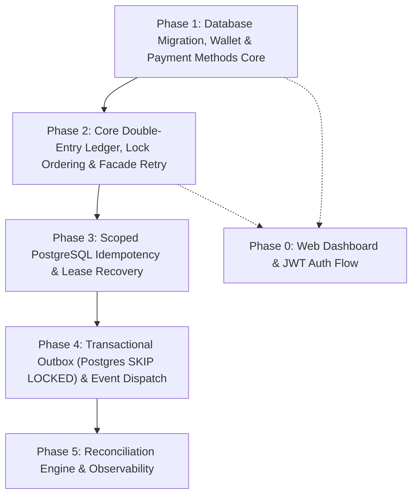

# Mini Digital Wallet — Kế Hoạch Triển Khai Chi Tiết (PLAN.md)

Tài liệu kế hoạch thực thi kỹ thuật chi tiết theo từng bước, xác định rõ file cần tạo/sửa, tác vụ cụ thể, tiêu chí nghiệm thu (DoD) và lệnh kiểm thử cho toàn bộ 6 Phase của **Mini Digital Wallet (mini-digital-wallet)**.

---

## 1. Thông Tin Dự Án & Phạm Vi Kỹ Thuật

- **Tên dự án**: `mini-digital-wallet`
- **Base package**: `com.minidigitalwallet`
- **Công nghệ cốt lõi**: Java 21, Spring Boot 3 / 4, PostgreSQL 16, Redis 7, Testcontainers, Thymeleaf / HTML5 UI.
- **Tiền tệ chuẩn**: **USD** (mặc định), đơn vị lưu trữ: **Cents** ($1.00 = 100 cents, kiểu `Long`).
- **Quy tắc bất biến**:
  - Không âm số dư ví người dùng: `CHECK (account_type = 'SYSTEM' OR available_balance >= 0)`.
  - Cân bằng sổ kép: $\sum \text{Debit} = \sum \text{Credit}$ trên từng transaction.
  - Sổ cái bất biến: Append-only, hoàn tiền bằng transaction mới (`reversal_of_transaction_id`).
  - Bảo mật thẻ PCI-DSS: Tuyệt đối không lưu raw PAN/CVV; chỉ lưu `masked_number` (`**** 4242`) và token từ Payment Gateway.
  - Idempotency có phạm vi: `(actor_id, operation, idempotency_key)` kèm `lease_expires_at` chống kẹt trạng thái.
  - Ranh giới Retry: `@Retryable` nằm trên Facade bean ngoài ranh giới `@Transactional`.

---

## 2. Cấu Trúc Thư Mục Chuẩn Layered MVC (Package-by-Layer)

Dự án áp dụng mô hình kiến trúc Layered Architecture (MVC) chuẩn theo từng tầng trách nhiệm:

```
src/main/java/com/minidigitalwallet
├── config/              # Cấu hình Spring (Async, OpenAPI, Web)
├── controller/          # Tầng Controller tiếp nhận REST request (Wallet, PaymentMethod, Ledger, Transfer, Reconciliation)
├── service/             # Tầng Service interface & Facade (WalletService, LedgerFacade, TransferService, ...)
│   └── impl/            # Triển khai nghiệp vụ thực tế (@Service, @Transactional)
├── repository/          # Tầng Repository truy xuất dữ liệu Spring Data JPA
├── entity/              # Tầng Data Entity (@Entity JPA / Hibernate)
│   └── enums/           # Toàn bộ Enums trạng thái và định danh kiểu
├── dto/                 # Data Transfer Objects
│   ├── request/         # Input DTOs từ client (CreateWalletRequest, TopUpRequest, ...)
│   └── response/        # Output DTOs trả về client (ApiResponse, WalletResponse, ...)
├── exception/           # Custom business exceptions & GlobalExceptionHandler RFC 7807
├── interceptor/         # Interceptor / Filter (IdempotencyInterceptor)
└── listener/            # Spring Domain Event Listeners (@TransactionalEventListener)
```

---

## 3. Lộ Trình 6 Phase Triển Khai Chi Tiết



---

### Phase 1: Database Migration, Wallet & Payment Methods Core

*Mục tiêu: Thiết lập toàn bộ cấu trúc bảng trên PostgreSQL, hạch toán tài khoản hệ thống mở đầu, quản lý ví và phương thức thanh toán chuẩn PCI-DSS tokenization.*

#### Danh sách files cần tạo:
- `src/main/resources/db/migration/V1__init_schema.sql`
- `src/main/java/com/minidigitalwallet/wallet/domain/Wallet.java`
- `src/main/java/com/minidigitalwallet/wallet/domain/WalletType.java`
- `src/main/java/com/minidigitalwallet/wallet/domain/WalletStatus.java`
- `src/main/java/com/minidigitalwallet/wallet/repository/WalletRepository.java`
- `src/main/java/com/minidigitalwallet/wallet/service/WalletService.java`
- `src/main/java/com/minidigitalwallet/wallet/web/WalletController.java`
- `src/main/java/com/minidigitalwallet/wallet/web/dto/CreateWalletRequest.java`
- `src/main/java/com/minidigitalwallet/wallet/web/dto/WalletResponse.java`
- `src/main/java/com/minidigitalwallet/paymentmethod/domain/PaymentMethod.java`
- `src/main/java/com/minidigitalwallet/paymentmethod/domain/MethodType.java`
- `src/main/java/com/minidigitalwallet/paymentmethod/domain/CardProvider.java`
- `src/main/java/com/minidigitalwallet/paymentmethod/repository/PaymentMethodRepository.java`
- `src/main/java/com/minidigitalwallet/paymentmethod/service/PaymentMethodService.java`
- `src/main/java/com/minidigitalwallet/paymentmethod/web/PaymentMethodController.java`
- `src/main/java/com/minidigitalwallet/paymentmethod/web/dto/LinkCardRequest.java`
- `src/main/java/com/minidigitalwallet/paymentmethod/web/dto/PaymentMethodResponse.java`
- `src/main/java/com/minidigitalwallet/common/exception/GlobalExceptionHandler.java`
- `src/main/java/com/minidigitalwallet/common/exception/WalletException.java`
- `src/test/java/com/minidigitalwallet/wallet/WalletServiceTest.java`

#### Các bước thực hiện:
1. **Flyway Migration V1**:
   - Khởi tạo 6 bảng: `payment_methods`, `accounts`, `ledger_transactions`, `ledger_entries`, `idempotency_records`, `outbox_events`, `processed_events`.
   - Ràng buộc: `CHECK (account_type = 'SYSTEM' OR available_balance >= 0)`.
   - Seed 3 tài khoản hệ thống: `SYS_EXTERNAL_SETTLEMENT` (1,000,000,000,000 cents), `SYS_CASH_IN_TRANSIT` (0), `SYS_FEE_REVENUE` (0).
2. **Module Payment Methods**:
   - Mock tokenization: Nhận thẻ $\rightarrow$ chuyển đổi thành `**** 4242` và token `tok_mock_visa_...`.
   - CRUD API cho thẻ liên kết.
3. **Module Wallet**:
   - Tạo ví mới cho user (mặc định: `available_balance = 0`, `currency = 'USD'`, `status = 'ACTIVE'`).
   - Tra cứu số dư O(1).
4. **RFC 7807 Error Handling**:
   - `@RestControllerAdvice` bắt các lỗi `WalletNotFoundException`, `InsufficientBalanceException`, `DuplicateKeyException` trả về JSON RFC 7807.

#### Kiểm tra & Nghiệm thu (DoD):
- Lệnh chạy: `.\mvnw.cmd test`
- Flyway migration thực thi không lỗi trên PostgreSQL.
- Unit/Integration test tạo ví và liên kết thẻ pass 100%.

---

### Phase 2: Core Double-Entry Ledger, Lock Ordering & Facade Retry (Cột Mốc MVP)

*Mục tiêu: Hiện thực hóa hạt nhân tài chính sổ kép: Journal Header + Ledger Lines, Deterministic Lock Ordering, Spring `@Retryable` ngoài ranh giới `@Transactional`, Nạp/Rút/Chuyển P2P/Hoàn tiền và bộ Concurrency Tests.*

#### Danh sách files cần tạo:
- `src/main/java/com/minidigitalwallet/ledger/domain/LedgerTransaction.java`
- `src/main/java/com/minidigitalwallet/ledger/domain/LedgerEntry.java`
- `src/main/java/com/minidigitalwallet/ledger/domain/EntryType.java` (DEBIT, CREDIT)
- `src/main/java/com/minidigitalwallet/ledger/domain/TransactionType.java` (TRANSFER, DEPOSIT, WITHDRAWAL, REVERSAL)
- `src/main/java/com/minidigitalwallet/ledger/domain/TransactionStatus.java` (POSTED, REVERSED)
- `src/main/java/com/minidigitalwallet/ledger/repository/LedgerTransactionRepository.java`
- `src/main/java/com/minidigitalwallet/ledger/repository/LedgerEntryRepository.java`
- `src/main/java/com/minidigitalwallet/ledger/service/LedgerService.java` (Bean mang `@Transactional`)
- `src/main/java/com/minidigitalwallet/ledger/facade/LedgerFacade.java` (Bean mang `@Retryable`)
- `src/main/java/com/minidigitalwallet/ledger/web/TransferController.java`
- `src/main/java/com/minidigitalwallet/ledger/web/dto/TransferRequest.java`
- `src/main/java/com/minidigitalwallet/ledger/web/dto/TopupRequest.java`
- `src/main/java/com/minidigitalwallet/ledger/web/dto/WithdrawRequest.java`
- `src/main/java/com/minidigitalwallet/ledger/web/dto/ReversalRequest.java`
- `src/main/java/com/minidigitalwallet/ledger/web/dto/TransactionResponse.java`
- `src/test/java/com/minidigitalwallet/ledger/ConcurrencyTransferTest.java`
- `src/test/java/com/minidigitalwallet/ledger/DeadlockRetryTest.java`
- `src/test/java/com/minidigitalwallet/ledger/DoubleEntryInvariantTest.java`

#### Các bước thực hiện:
1. **Kiến trúc Bean Phân Tách Cho Retry**:
   - `LedgerFacade`: Bọc `@Retryable(retryFor = {CannotAcquireLockException.class, PessimisticLockingFailureException.class}, maxAttempts = 3, backoff = @Backoff(delay = 50, multiplier = 2))`.
   - `LedgerService`: `@Transactional(isolation = Isolation.READ_COMMITTED)`.
2. **Khóa Cố Định Tránh Deadlock**:
   - Sắp xếp khóa 2 ví theo thứ tự từ điển: `firstLock = min(A, B)`, `secondLock = max(A, B)`.
   - Thực thi `SELECT ... FOR UPDATE` tuần tự.
3. **Luồng Nghiệp Vụ Sổ Kép**:
   - **Nạp tiền (Top-up)**: Charge thẻ liên kết qua Mock Gateway $\rightarrow$ Debit `SYS_EXTERNAL_SETTLEMENT`, Credit `USER_WALLET`.
   - **Rút tiền (Withdraw)**: Kiểm tra số dư $\rightarrow$ Debit `USER_WALLET`, Credit `SYS_EXTERNAL_SETTLEMENT` $\rightarrow$ Payout về thẻ.
   - **Chuyển P2P**: Debit ví A, Credit ví B $\rightarrow$ Cập nhật `available_balance` cả 2 ví.
   - **Hoàn tiền (Reversal)**: Tạo transaction mới trỏ `reversal_of_transaction_id`, ghi 2 dòng bút toán đảo chiều.
4. **Bộ Kiểm Thử Đồng Thời (Testcontainers PostgreSQL)**:
   - `ConcurrencyTransferTest`: 50 threads đồng thời rút tiền từ 1 ví 10,000 cents (mỗi thread 1,000 cents) $\rightarrow$ đúng 10 thành công, 40 thất bại, số dư cuối cùng đúng bằng 0, không âm.
   - `DeadlockRetryTest`: 50 threads chuyển $A \rightarrow B$ song song 50 threads $B \rightarrow A$ $\rightarrow$ 100% giao dịch an toàn, không treo kết nối.
   - `DoubleEntryInvariantTest`: Duyệt mọi transaction, kiểm tra $\sum \text{Debit} = \sum \text{Credit}$.

#### Kiểm tra & Nghiệm thu (DoD):
- Tất cả các test trong `src/test/java/com/minidigitalwallet/ledger/` chạy xanh (BUILD SUCCESS).

---

### Phase 3: Scoped PostgreSQL Idempotency & Lease Recovery

*Mục tiêu: Chặn đứng tình trạng duplicate charge, race-condition bằng cơ chế Scoped Durable Idempotency trên PostgreSQL, hỗ trợ thu hồi lease cho request bị treo.*

#### Danh sách files cần tạo:
- `src/main/java/com/minidigitalwallet/idempotency/domain/IdempotencyRecord.java`
- `src/main/java/com/minidigitalwallet/idempotency/domain/IdempotencyStatus.java` (IN_PROGRESS, COMPLETED, FAILED)
- `src/main/java/com/minidigitalwallet/idempotency/domain/IdempotencyCompositeKey.java` (actor_id, operation, idempotency_key)
- `src/main/java/com/minidigitalwallet/idempotency/repository/IdempotencyRecordRepository.java`
- `src/main/java/com/minidigitalwallet/idempotency/service/IdempotencyService.java`
- `src/main/java/com/minidigitalwallet/idempotency/web/IdempotentAspect.java` (hoặc Filter/Interceptor)
- `src/test/java/com/minidigitalwallet/idempotency/IdempotencyConcurrencyTest.java`

#### Các bước thực hiện:
1. **Quản lý Khóa Đa Thành Phần (Composite Scope)**:
   - Scope gồm: `actor_id` (ID người dùng/client), `operation` (TOPUP, WITHDRAW, TRANSFER), `idempotency_key`.
   - Tính SHA-256 hash của request body.
2. **Cơ chế Lease Recovery Cho `IN_PROGRESS`**:
   - Ghi nhận `IN_PROGRESS` kèm `lease_expires_at = NOW() + 30s`.
   - Nếu trùng composite key:
     - Đã `COMPLETED`: Trả cached response payload (HTTP 200).
     - Đang `IN_PROGRESS` và còn hạn lease: Trả HTTP 409 Conflict.
     - Đang `IN_PROGRESS` nhưng hết hạn lease (worker trước crash): Cho phép instance hiện tại thu hồi và thực thi lại.
     - Khác `request_hash`: Trả HTTP 422 Unprocessable Entity.
3. **Cấu hình Redis**:
   - Thiết lập Redis Token Bucket Rate Limiter chống spam request, bảo vệ DB connection pool.

#### Kiểm tra & Nghiệm thu (DoD):
- `IdempotencyConcurrencyTest`: 100 threads bắn đồng thời cùng 1 request $\rightarrow$ Chỉ đúng 1 transaction được ghi nhận vào DB.

---

### Phase 4: Transactional Outbox (PostgreSQL SKIP LOCKED) & Event Dispatching

*Mục tiêu: Đảm bảo At-Least-Once delivery, gửi sự kiện thông báo/webhook đáng tin cậy bằng bảng Outbox lưu trong cùng ACID transaction với Ledger, sử dụng PostgreSQL `SKIP LOCKED` worker poller và Spring Event Dispatcher.*

#### Danh sách files:
- `src/main/java/com/minidigitalwallet/entity/OutboxEvent.java`
- `src/main/java/com/minidigitalwallet/entity/ProcessedEvent.java`
- `src/main/java/com/minidigitalwallet/entity/enums/OutboxStatus.java` (PENDING, PROCESSING, SENT, FAILED, DEAD)
- `src/main/java/com/minidigitalwallet/repository/OutboxEventRepository.java`
- `src/main/java/com/minidigitalwallet/repository/ProcessedEventRepository.java`
- `src/main/java/com/minidigitalwallet/service/OutboxService.java`
- `src/main/java/com/minidigitalwallet/service/impl/OutboxServiceImpl.java`
- `src/main/java/com/minidigitalwallet/listener/WalletEventListener.java`
- `src/test/java/com/minidigitalwallet/service/OutboxPollingRecoveryTest.java`

#### Các bước thực hiện:
1. **Ghi Outbox Trong Transaction**:
   - Giao dịch chuyển tiền ghi kèm sự kiện `WALLET_DEBITED`, `WALLET_CREDITED` vào bảng `outbox_events`.
2. **Outbox Poller Với PostgreSQL Lease Lock**:
   - `SELECT ... FOR UPDATE SKIP LOCKED` quét các event `PENDING` đến hạn.
   - Cấp lease 30s (`locked_until`). Dispatch sự kiện sang `NotificationService` hoặc external webhook.
   - Thành công $\rightarrow$ chuyển `status = 'SENT'`.
   - Lỗi $\rightarrow$ tăng `attempt_count`, tính `next_attempt_at` theo exponential backoff (tối đa 5 lần trước khi chuyển `DEAD`).
3. **Consumer Idempotency**:
   - Chèn `(event_id, consumer_name)` vào bảng `processed_events` để deduplicate.

#### Kiểm tra & Nghiệm thu (DoD):
- `OutboxPollingRecoveryTest`: Giả lập lỗi mạng khi dispatch $\rightarrow$ Outbox poller tự động retry theo exponential backoff và chuyển SENT sau khi phục hồi.

---

### Phase 5: Reconciliation Engine & Observability Chuẩn Production

*Mục tiêu: Tự động đối soát phát hiện sai lệch số dư so với sổ cái, cung cấp giám sát metrics và trace ID xuyên suốt.*

#### Danh sách files cần tạo:
- `src/main/java/com/minidigitalwallet/reconciliation/ReconciliationJob.java`
- `src/main/java/com/minidigitalwallet/reconciliation/domain/ReconciliationReport.java`
- `src/main/java/com/minidigitalwallet/common/filter/TraceIdFilter.java`
- `src/main/resources/logback-spring.xml`
- `src/test/java/com/minidigitalwallet/reconciliation/ReconciliationDetectionTest.java`

#### Các bước thực hiện:
1. **Reconciliation Job Định Kỳ**:
   - Scheduled job chạy kiểm toán theo Natural Balance:
     $$\text{available\_balance} \equiv \sum \text{Amount}_{\text{CREDIT}} - \sum \text{Amount}_{\text{DEBIT}}$$
   - Kiểm tra toàn hệ thống: $\sum \text{Credits} - \sum \text{Debits} = 0$.
   - Nếu phát hiện sai lệch $\rightarrow$ Log ERROR kèm chi tiết và ghi nhận vào bảng `reconciliation_reports`.
2. **Distributed Tracing (MDC)**:
   - Bắt hoặc sinh `X-Trace-ID` từ HTTP headers, lưu vào Logback MDC, gắn vào Kafka record header và log toàn bộ luồng xử lý.
3. **Micrometer & Actuator Metrics**:
   - Expose metrics: `outbox_pending_count`, `transfer_duration_seconds`, `deadlock_retry_count`.

#### Kiểm tra & Nghiệm thu (DoD):
- `ReconciliationDetectionTest`: Sửa thủ công số dư ví bằng SQL $\rightarrow$ ReconciliationJob phát hiện ngay lập tức và tạo report bất thường.

---

### Phase 0: Product Flow & Web Dashboard (Giao Diện Trực Quan)

*Mục tiêu: Xây dựng giao diện web trực quan, cho phép người dùng thao tác toàn bộ vòng đời ví và cung cấp màn hình đối soát cho quản trị viên.*

#### Danh sách files cần tạo:
- `src/main/java/com/minidigitalwallet/auth/domain/User.java`
- `src/main/java/com/minidigitalwallet/auth/service/AuthService.java`
- `src/main/java/com/minidigitalwallet/auth/security/JwtTokenProvider.java`
- `src/main/java/com/minidigitalwallet/auth/security/SecurityConfig.java`
- `src/main/java/com/minidigitalwallet/web/DashboardController.java`
- `src/main/resources/templates/login.html`
- `src/main/resources/templates/dashboard.html`
- `src/main/resources/templates/cards.html`
- `src/main/resources/templates/transfer.html`
- `src/main/resources/templates/statement.html`
- `src/main/resources/templates/admin-audit.html`
- `src/main/resources/static/css/styles.css`
- `src/main/resources/static/js/app.js`

#### Các bước thực hiện:
1. **Xác thực Người dùng (Auth)**:
   - Form đăng ký, đăng nhập cấp JWT cookie/header.
2. **Giao diện Người Dùng**:
   - **Dashboard ví**: Hiển thị Wallet ID, số dư khả dụng O(1) dạng USD ($X.XX).
   - **Quản lý Thẻ**: Thêm thẻ Visa/Mastercard (mock tokenization), danh sách thẻ `**** 4242`, xóa thẻ.
   - **Form Nạp tiền (Top-up)**: Chọn thẻ liên kết, nhập số tiền USD $\rightarrow$ gọi API topup.
   - **Form Rút tiền (Withdraw)**: Chọn thẻ nhận, nhập số tiền USD $\rightarrow$ gọi API withdraw.
   - **Form Chuyển tiền P2P**: Nhập Wallet ID đích, số tiền, nội dung $\rightarrow$ nhận biên lai giao dịch.
   - **Sao kê & Biên lai**: Bảng lịch sử biến động số dư theo thời gian thực.
3. **Dashboard Quản Trị Viên (Admin Audit)**:
   - Màn hình theo dõi báo cáo đối soát số dư toàn hệ thống và trạng thái hàng đợi Outbox.

#### Kiểm tra & Nghiệm thu (DoD):
- Truy cập `http://localhost:8080`, đăng nhập, liên kết thẻ, nạp $100, chuyển P2P $30 sang ví khác, xem số dư cập nhật tức thì.

---

## 4. Kế Hoạch Kiểm Thử Tự Động Toàn Diện (Test Matrix)

| Tên Test Class | Loại Test | Công Nghệ | Tiêu Chí Pass |
|---|---|---|---|
| `WalletServiceTest` | Unit Test | JUnit 5, Mockito | Tạo ví, tra cứu số dư, validate trạng thái ví |
| `PaymentMethodTest` | Unit Test | JUnit 5 | Mock tokenization thẻ, che số thẻ `**** 4242` |
| `ConcurrencyTransferTest` | Stress / Integration | Testcontainers Postgres, 50 threads | Không bao giờ âm số dư khi rút tiền đồng thời |
| `DeadlockRetryTest` | Concurrency / Integration | Testcontainers Postgres, 50 threads | Chuyển chéo $A \leftrightarrow B$, tự động retry `40P01` |
| `DoubleEntryInvariantTest` | Property / Integration | JUnit 5, Spring Data JPA | $\sum \text{Debit} \equiv \sum \text{Credit}$ trên 100% giao dịch |
| `IdempotencyConcurrencyTest` | Concurrency / Integration | Testcontainers Postgres, 100 threads | Cùng key chỉ tạo đúng 1 giao dịch trong DB |
| `OutboxBrokerRecoveryTest` | Fault Tolerance | Testcontainers Postgres + Kafka | DB commit khi Kafka tắt, gửi bù khi Kafka bật lại |
| `ReconciliationDetectionTest` | Audit / Integration | Testcontainers Postgres | Phát hiện tức thời mọi sai lệch số dư cố ý |

---

## 5. Trình Tự Thực Thi Khuyến Nghị

```
Bước 1: Phase 1 — Flyway Migration V1, Payment Methods Entity & Wallet Engine (PostgreSQL)
Bước 2: Phase 2 — Core Double-Entry Ledger, Lock Ordering, Facade @Retryable & Concurrency Tests
Bước 3: Phase 3 — Scoped PostgreSQL Idempotency Guard & Lease Recovery
Bước 4: Phase 4 — Transactional Outbox Scheduler & Kafka P2P Ordering
Bước 5: Phase 5 — Reconciliation Job & Distributed Tracing
Bước 6: Phase 0 — Web Dashboard UI & JWT Auth Flow
```
