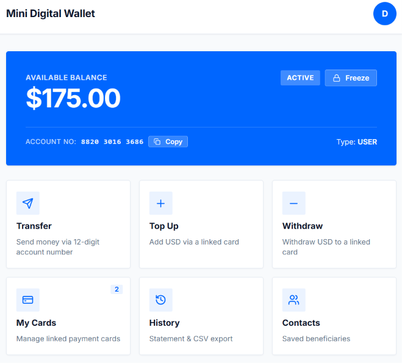

# Mini Digital Wallet (core-ledger-service)


Modular monolith backend for a mini digital wallet: identity & users, multi-status wallets, linked payment cards, and an immutable double-entry ledger with concurrency safety, rate-limiting, and database-backed idempotency.



## Features

### Core Banking & Financial Safety
- **Double-Entry Bookkeeping**: Balanced `DEBIT/CREDIT` pairs in `Long` cents; strictly append-only audit trail.
- **Pessimistic Concurrency & Anti-Deadlock**: Lexicographical `min/max` lock ordering with row-level locks (`SELECT FOR UPDATE`).
- **Two-Tier Idempotency**: Fast-fail memory lease + physical PostgreSQL `UNIQUE` constraints with SHA-256 payload hashing.
- **Nightly Reconciliation**: Automated 2 AM set-based audit verifying per-wallet balances and global zero-sum integrity.
- **Fee Engine (Strategy Pattern)**: Pluggable policies (`ZERO`, `FLAT`, `PERCENTAGE`, `TIERED`) via Spring Map Injection (Open/Closed Principle).

### Wallet & Transfers
- **Wallet Lifecycle**: State machine (`ACTIVE`, `FROZEN`, `CLOSED`) with 12-digit human-friendly account numbers.
- **Core Operations**: Top-up from card, withdrawal, instant P2P transfer, and single-use non-destructive reversals.
- **Transaction Limits**: Velocity caps ($10k/tx, $50k/day) validated under row locks to eliminate TOCTOU race conditions.
- **Saved Contacts & Statements**: Beneficiary directory with favorites; streaming CSV statement export with $O(1)$ memory overhead.

### Identity & Security
- **Authentication & Sessions**: 15-min JWT access token + rotating 7-day refresh token with automatic token-reuse detection.
- **Transaction PIN**: 6-digit BCrypt-hashed PIN required on all debits; 15-min lockout after 5 consecutive failed attempts.
- **RBAC & Authorization**: Strict `USER` and `ADMIN` roles protecting management, settlement, and reconciliation endpoints.
- **Zero BOLA & PCI-DSS Safety**: Strict caller-ownership checks on all resources; card details tokenized and masked (`**** 4242`).

## Tech Stack

Java 21, Spring Boot 3.3, Spring Security + JWT, JPA/Hibernate, PostgreSQL 16 + Flyway, Maven, React 19 + Vite 8. Tests: JUnit 5, Mockito, Testcontainers.

## Project Structure

```
com.minidigitalwallet
├── controller/  # REST endpoints (Auth, Wallet, Transfer, Ledger, Contact, Reconciliation)
├── service/     # WalletService, TransferService, LedgerService/Facade, ContactService,
│                # TransactionPinValidator, TransactionLimitValidator (LedgerGuard),
│                # PinRateLimiter, IdempotencyService, CallerProvider, ReconciliationService,
│                # fee/ (FeeEngine, FeeStrategy, Zero/Flat/Percentage/TieredFeeStrategy)
├── domain/      # Money, AccountNumber (12-digit account number), WalletState
├── entity/      # JPA entities (User, Wallet, PaymentMethod, LedgerEntry, Contact, ...)
├── repository/  # Spring Data JPA repositories
├── dto/         # Request and response records
├── exception/   # Custom domain errors (RFC 7807 Problem Details)
├── security/    # JWT filters, OwnershipGuard, CurrentUser
└── resources/db/migration/  # Flyway V1-V11 (V8: pin_hash, V9: contacts, V10: refresh tokens, V11: user role)
docker-compose.yml  # Local PostgreSQL 16 setup
```

## Quick Start

Requirements: JDK 21, Maven 3.9+, Docker, Node.js 20+.

```bash
# 0. Set JWT secret (REQUIRED — application fails fast if missing; 64+ hex characters = 256 bits)
# Generate: openssl rand -hex 32
export APP_JWT_SECRET=404E635266556A586E3272357538782F413F4428472B4B6250645367566B5970  # dev only

# 1. Start PostgreSQL
docker compose up -d

# 2. Run backend service (Flyway automatically applies migrations V1-V11)
mvn spring-boot:run
# App runs at: http://localhost:8080, default database: localhost:5436/wallet_db
# Public health endpoints: /actuator/health, /actuator/info

# 3. Run Web Dashboard
cd web && npm install && npm run dev
# Web runs at: http://localhost:5173
```

## API Summary

```
POST /api/v1/auth/register
POST /api/v1/auth/login            (5 failed attempts/15min => 429 too-many-requests)
POST /api/v1/auth/refresh          (rotates refresh token; reuse => 401 + all sessions revoked)
POST /api/v1/auth/logout           (revokes one refresh token)
POST /api/v1/auth/logout-all       (revokes every session, authenticated)
GET  /api/v1/auth/me
POST /api/v1/auth/pin              (setup or change 6-digit transaction PIN)

POST /api/v1/wallets               (owner_id in body ignored — wallet always belongs to caller)
GET  /api/v1/wallets/{id}          (403 if not owned by caller)
GET  /api/v1/wallets/{id}/balance  (403 if not owned by caller)
GET  /api/v1/wallets/account/{accountNumber}   (recipient preview: account_number + currency only, no balances)
GET  /api/v1/wallets?user_id=...   (lists only caller-owned wallets)
PATCH /api/v1/wallets/{id}/status  (403 if not owned by caller)

POST /api/v1/transfers/topup      (header: Idempotency-Key)
POST /api/v1/transfers/withdraw   (headers: X-Transaction-Pin, Idempotency-Key)
POST /api/v1/transfers/p2p        (headers: X-Transaction-Pin, Idempotency-Key)
POST /api/v1/transfers/reversals  (403 if caller not party to transaction; 409 if already reversed)

GET  /api/v1/ledger/transactions/{id}
GET  /api/v1/ledger/transactions/reference/{referenceId}
GET  /api/v1/ledger/wallets/{walletId}/entries
GET  /api/v1/ledger/wallets/{walletId}/statement         (filters: type, from, to; pagination)
GET  /api/v1/ledger/wallets/{walletId}/statement/export  (direct CSV streaming)

GET    /api/v1/contacts            (list saved beneficiaries)
POST   /api/v1/contacts            (save new beneficiary)
DELETE /api/v1/contacts/{id}       (remove beneficiary)
PATCH  /api/v1/contacts/{id}/favorite (toggle favorite flag)

POST /api/v1/admin/reconciliation/run   (ROLE_ADMIN only)
GET  /api/v1/admin/reconciliation/runs (ROLE_ADMIN only; latest 50 reconciliation runs)
```

## Documentation

### Product Management & PO Portfolio
- **Product Requirement Document (PRD)**: [docs/product/PRD.md](docs/product/PRD.md) — Problem statement, user personas, scope, and North Star metrics.
- **User Stories & Acceptance Criteria**: [docs/product/USER_STORIES.md](docs/product/USER_STORIES.md) — Gherkin scenarios (Given-When-Then), happy paths, and risk edge cases.
- **Ops & Dispute Playbook**: [docs/product/OPS_PLAYBOOK.md](docs/product/OPS_PLAYBOOK.md) — Reversal SOP, 4-eye policy (Maker-Checker), and incident SLAs.

### Core Business & Architecture
- **Core Business & Banking**: [docs/BUSINESS.md](docs/BUSINESS.md) — Double-entry bookkeeping, 11 financial invariants, Fee Strategy Engine, and Business Analyst framework.
- **REST API Specification**: [docs/API.md](docs/API.md) — Comprehensive endpoints, conventions, headers, and RFC 7807 error details.
- **Setup & Quickstart**: [docs/SETUP.md](docs/SETUP.md) — 4-step local startup guide, cURL cheat sheet, and troubleshooting.

### Computer Science & Financial Engineering Concepts
- [PostgreSQL Engineering](docs/concepts/postgres.md) — MVCC tuple internals (`xmin`/`xmax`), physical page layout, B-Tree index scan, deterministic lock ordering, and set-based reconciliation.
- [Technical Foundations](docs/concepts/spring-boot-base.md) — IEEE 754 vs `Long` cents, Java 21 `record`, Hibernate lifecycle, Deadlock prevention, and Strategy Pattern with Spring Map Injection.
- [Double-Entry Bookkeeping](docs/concepts/double-entry-bookkeeping.md) — Pacioli (1494), zero-sum conservation, and append-only event streams.
- [Concurrency & Deadlocks](docs/concepts/concurrency-and-deadlocks.md) — ACID isolation, Coffman's 4 conditions, DAG lock ordering, and Spring AOP proxy.
- [Two-Tier Idempotency](docs/concepts/two-tier-idempotency.md) — IETF draft standard, distributed leases, and SHA-256 cryptographic request fingerprinting.
- [Security & Authorization](docs/concepts/security-and-authorization.md) — BCrypt adaptive cost factor, RFC 6819 token rotation, and OWASP BOLA defense.


### Architectural & Service Diagrams
- [Overview Architecture](docs/diagram/overview.md) — Layered monolith architecture and core transaction flow.
- [Double-Entry Ledger](docs/diagram/ledger.md) — Balanced journal lines, deterministic lock ordering, and AOP retry facade.
- [Wallet Lifecycle](docs/diagram/wallet.md) — State pattern (`ACTIVE`, `FROZEN`, `CLOSED`) and onboarding sequence.
- [Authentication & JWT](docs/diagram/authentication.md) — Stateless JWT filter chain, login/register, and user principal.
- [Payment Methods](docs/diagram/payment-method.md) — PCI-DSS mock tokenization, card lifecycle, and BOLA defense.
- [Saved Contacts](docs/diagram/contact.md) — 12-digit account number recipient directory and favorite prioritization.
- [Two-Tier Idempotency](docs/diagram/idempotency.md) — SHA-256 payload hashing, 30s lease auto-recovery, and replay mechanism.
- [Security Guards](docs/diagram/security-guards.md) — Daily limits under row-lock (anti-TOCTOU), PIN rate limiter, and refresh token rotation.
- [Nightly Reconciliation](docs/diagram/reconciliation.md) — 2 AM automated audit job with set-based $O(1)$ zero-sum verification.

## Tests

```bash
mvn test   # 106 unit & service tests (H2/Mockito) + concurrency/integration tests (Testcontainers PostgreSQL 16)
```

## Load Test Results (k6)

Scripts: 50 VUs / 30s reads (`GET /api/v1/wallets/{id}/balance`), 20 VUs / 30s writes (`POST /api/v1/transfers/topup`, unique `Idempotency-Key` per iteration). Local run with application and PostgreSQL hosted on the same machine.

| Scenario | Reqs | Throughput | Checks passed | Failed | avg | med | p90 | p95 | max |
|---|---|---|---|---|---|---|---|---|---|
| Read balance | 128,572 | 4,284/s | 100% (200) | 0.00% | 11.53ms | 11.18ms | 14.57ms | 17.47ms | 51.15ms |
| Write top-up | 3,397 | 112.6/s | 100% (201) | 0.00% | 176.85ms | 172.58ms | 251.56ms | 280.44ms | 447.30ms |

Reads scale efficiently (4,000+ rps, p95 under 20ms). Writes are deliberately transactional (pessimistic lock + balanced double-entry + idempotency lease within a single transaction) achieving ~113 rps with zero failures and zero duplicates.
