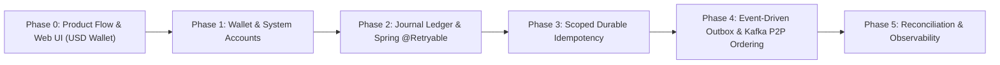

# Mini Digital Wallet — Thiết Kế Kiến Trúc Modular Monolith & Event-Driven

Tài liệu thiết kế kiến trúc, mô hình dữ liệu, cấu trúc thư mục, hướng dẫn khởi tạo dự án và lộ trình 5 Phase thực hành chuyên sâu **Java 21 + Spring Boot 3 + PostgreSQL + Redis + Apache Kafka** theo mô hình **Modular Monolith** cho **Mini Digital Wallet (mini-digital-wallet)** với Core Double-Entry Ledger Engine.

---

## Mục lục

1. [Kiến trúc Tổng thể & Luồng Dữ liệu (Modular Monolith + Event-Driven)](#1-kiến-trúc-tổng-thể--luồng-dữ-liệu-modular-monolith--event-driven)
2. [5 Nguyên Tắc Thiết Kế Tài Chính Cốt Lõi](#2-5-nguyên-tắc-thiết-kế-tài-chính-cốt-lõi)
3. [Mô hình Dữ liệu Chuẩn (Database Schema & DDL)](#3-mô-hình-dữ-liệu-chuẩn-database-schema--ddl)
4. [Cấu trúc Thư mục Chuẩn (Modular Monolith Architecture)](#4-cấu-trúc-thư-mục-chuẩn-modular-monolith-architecture)
5. [Hướng dẫn Khởi tạo Dự án từ Đầu (Bootstrap Guide)](#5-hướng-dẫn-khởi-tạo-dự-án-từ-đầu-bootstrap-guide)
6. [Lộ trình Triển khai 5 Phase Chuẩn Tuyển dụng Fintech](#6-lộ-trình-triển-khai-5-phase-chuẩn-tuyển-dụng-fintech)
7. [Những Kịch Bản Phỏng Vấn Tạo Khác Biệt (Senior Differentiators)](#7-những-kịch-bản-phỏng-vấn-tạo-khác-biệt-senior-differentiators)
8. [Tối ưu & Mở rộng Hệ thống Phân tán](#8-tối-ưu--mở-rộng-hệ-thống-phân-tán)

---

## 1. Kiến trúc Tổng thể & Luồng Dữ liệu (Modular Monolith + Event-Driven)

Dự án chọn mô hình **Modular Monolith** nhằm bảo đảm tính atomic và nhất quán dữ liệu giao dịch trong cùng RDBMS (PostgreSQL), kết hợp **Event-Driven qua Apache Kafka** theo **Transactional Outbox Pattern** (At-Least-Once delivery) và **Consumer Idempotency** để phát sự kiện sang các tác vụ ngoại vi (thông báo biến động số dư, audit trail, phân tích gian lận) mà loại bỏ rủi ro Dual-Write bất đồng bộ.

```mermaid
flowchart TD
    subgraph Inbound Transports
        REST["REST API Client<br/>(HTTP :8080 - Ví Điện Tử: Nạp, Rút, Chuyển P2P)"]
    end

    subgraph Core Mini Wallet Application
        IDEMP["1. Durable Idempotency Guard<br/>(PostgreSQL idempotency_records Atomic & Zero Dual-State)"]
        LOCK["2. Deterministic Lock Ordering & Spring Retry<br/>min(A, B) -> max(A, B) + @Retryable on 40P01"]
        LEDGER["3. Journal & Double-Entry Ledger Engine<br/>ledger_transactions + ledger_entries (Debit/Credit)<br/>Snapshot available_balance Projection Update"]
        OUTBOX_WRITER["4. Outbox Event Generator<br/>(Ghi event kèm lease metadata vào outbox_events)"]
        OUTBOX_PUB["5. Outbox Poller / Publisher (Phase 4)<br/>(SELECT ... FOR UPDATE SKIP LOCKED)"]
        RECON["6. Reconciliation Engine (Phase 5)<br/>(Scheduled Audit Job: sum(ledger_entries) == available_balance)"]
    end

    subgraph Datastores
        PG[("PostgreSQL 16<br/>- accounts / wallets (Snapshot Projection)<br/>- ledger_transactions (Journal Header)<br/>- ledger_entries (Immutable Lines)<br/>- idempotency_records (Durable Truth)<br/>- outbox_events (Reliable Outbox)<br/>- processed_events (Consumer Dedupe)")]
    end

    subgraph Event Broker & Downstream Phase 4
        KAFKA{{"Apache Kafka<br/>(Topic: wallet-events, Key: wallet_id)"}}
        CONSUMER["Idempotent Domain Event Consumer<br/>(Notification, Audit, Analytics)<br/>Deduplicate via DB processed_events"]
    end

    REST --> IDEMP
    IDEMP --> LOCK
    LOCK --> LEDGER
    LEDGER --> OUTBOX_WRITER
    OUTBOX_WRITER -->|1 Single Atomic Database Transaction| PG
    RECON -. "Audit Scan Invariant" .-> PG

    OUTBOX_PUB -->|Poll PENDING & Lease Expired| PG
    OUTBOX_PUB -->|Publish Event (At-Least-Once)| KAFKA
    KAFKA --> CONSUMER
    CONSUMER -->|Check & Record Dedupe Key| PG
```

---

### 2. Các Nguyên Tắc Thiết Kế Tài Chính Cốt Lõi

### 2.1 Sổ Kép Bất Biến, Tài Khoản Hệ Thống & Giao Dịch Hoàn Tiền (Reversals)

- **Vấn đề**: Cập nhật số dư trực tiếp bằng `UPDATE accounts SET balance = balance + 100` làm mất dấu vết kế toán. Seed số dư ban đầu hay nạp/rút không có bút toán đối ứng sẽ phá vỡ cân bằng kế toán ($\sum \text{Debit} \neq \sum \text{Credit}$).
- **Giải pháp Kiến trúc**:
  1. **Tách biệt Giao dịch gốc (Journal Transaction) và Các dòng bút toán (Ledger Entries)**:
     - Mỗi yêu cầu tài chính tạo ra 1 bản ghi cha `ledger_transactions` (`id`, `reference_id`, `actor_id`, `operation`, `idempotency_key`, `type`, `status`, `currency`, `reversal_of_transaction_id`, `created_at`).
     - Mỗi giao dịch chứa 2 hoặc nhiều dòng bút toán con `ledger_entries` (`id`, `transaction_id`, `account_id`, `entry_type`, `amount`, `line_no`).
  2. **Bất biến Kế toán & Quy ước Số Dư (Natural Balance)**:
     - Invariant tuyệt đối: $\sum \text{Debit} = \sum \text{Credit}$ trên mỗi transaction.
     - Đơn vị tiền tệ mặc định: **USD** (minor unit = cents: $1.00 = 100 cents, kiểu `Long`, không dùng số thực, không chuyển tiền chéo tiền tệ).
     - Không chuyển tiền vào chính mình (`from_account != to_account`).
     - Ràng buộc toàn vẹn: `UNIQUE(transaction_id, line_no)`.
     - **Quy ước số dư tự nhiên (Natural Balance)**:
       - Với ví người dùng (`USER`): Natural balance là CREDIT (tiền ví là nghĩa vụ nợ của hệ thống đối với khách hàng). Công thức số dư khả dụng:
         $$
         \text{available\_balance} = \sum \text{Credit} - \sum \text{Debit}
         $$
       - Ràng buộc không âm `CHECK (available_balance >= 0)` **chỉ áp dụng cho tài khoản `USER`**.
     - **Tài khoản Hệ thống (System Accounts)**:
       - `SYS_EXTERNAL_SETTLEMENT`: Tài khoản đối ứng nạp/rút tiền qua ngân hàng/cổng thanh toán (tài khoản nguồn đối ứng, có thể mang số dư âm theo quy ước hoặc không bị ràng buộc `CHECK >= 0`).
       - `SYS_CASH_IN_TRANSIT`: Tài khoản giữ tiền trung gian đang xử lý (Escrow / Hold).
       - `SYS_FEE_REVENUE`: Tài khoản ghi nhận doanh thu phí dịch vụ.
       - Ràng buộc cơ sở dữ liệu: `CHECK (account_type = 'SYSTEM' OR available_balance >= 0)`.
     - Ví dụ Nạp 100 USD (10,000 cents) vào Ví A:
       - Debit: `SYS_EXTERNAL_SETTLEMENT` (10,000 cents)
       - Credit: Ví Khách hàng A (10,000 cents)
     - Ví dụ Chuyển 50 USD (5,000 cents) từ Ví A sang Ví B:
       - Debit: Ví Khách hàng A (5,000 cents)
       - Credit: Ví Khách hàng B (5,000 cents)
  3. **Cơ chế Hoàn tiền / Điều chỉnh (Reversals) - Bất biến Append-Only**:
     - Tuyệt đối không xóa (`DELETE`) hay sửa (`UPDATE`) các transaction hoặc ledger entry đã ghi nhận.
     - Khi hoàn tiền hoặc điều chỉnh sai sót: Sinh một transaction mới có `status = 'POSTED'` và liên kết `reversal_of_transaction_id` trỏ về transaction gốc.
     - Cặp bút toán con ghi đảo ngược hoàn toàn dòng tiền gốc (Credit tài khoản bị trừ, Debit tài khoản đã nhận).

> **[Action]**: Tạo `ledger_transactions` kèm `reversal_of_transaction_id`, danh sách con `ledger_entries`, miễn trừ `CHECK >= 0` cho tài khoản `SYSTEM`.
> **[Theory Recall]**: Pacioli's Accounting Equation ($\text{Assets} = \text{Liabilities} + \text{Equity}$). Sổ kép bất biến, append-only.
> **[Design Pattern]**: Event-Sourced Ledger Journaling + Compensating Transaction Pattern.
> **[Catastrophe Prevented]**: Loại bỏ hiện tượng số dư ảo, bảo toàn lịch sử kiểm toán tài chính khi đảo bút toán.
> **[Interview TL;DR]**: "Mọi biến động số dư là một cặp bút toán cân bằng. Không bao giờ sửa quá khứ; hoàn tiền là một transaction mới trỏ về transaction gốc."

---

### 2.2 Thứ Tự Khóa Cố Định & Bọc Spring @Retryable Ngoài Ranh Giới @Transactional

- **Vấn đề (Circular Wait Deadlock & Transaction Rollback Boundary)**:
  - Giao dịch 1 chuyển $A \rightarrow B$ (khóa A chờ B); Giao dịch 2 chuyển $B \rightarrow A$ (khóa B chờ A) gây Deadlock chu trình (Coffman's Circular Wait).
  - Lỗi cấu hình Spring phổ biến: Đặt `@Retryable` và `@Transactional` trên cùng một method / cùng một class. Khi DB ném lỗi deadlock (`40P01`), Spring Transaction Manager đã đánh dấu transaction là rollback-only. Nếu retry ngay trên transaction đã hỏng mà không mở kết nối/transaction mới, retry sẽ thất bại với `TransactionRollbackException`.
- **Giải pháp Kiến trúc**:
  1. **Sắp xếp khóa cố định theo thứ tự từ điển**:
     $$
     \text{FirstLock} = \min(\text{ID}_A, \text{ID}_B), \quad \text{SecondLock} = \max(\text{ID}_A, \text{ID}_B)
     $$
     Bất kể chiều chuyển tiền nào, mọi luồng đều xin khóa tài khoản nhỏ hơn trước bằng `SELECT ... FOR UPDATE`.
  2. **Tách biệt Proxy Boundary cho Spring @Retryable**:
     - Đặt `@Retryable` trên **tầng Facade / Controller / Outer Bean**, bọc ngoài class thực thi `@Transactional`.
     - Mỗi lần retry sẽ kích hoạt một transaction Spring hoàn toàn mới với snapshot và database connection sạch:
       ```java
       // Tầng Facade ngoài cùng: Chịu trách nhiệm Retry
       @Service
       public class LedgerFacade {
           private final LedgerService ledgerService;

           @Retryable(
               retryFor = {CannotAcquireLockException.class, PessimisticLockingFailureException.class},
               maxAttempts = 3,
               backoff = @Backoff(delay = 50, multiplier = 2)
           )
           public TransferResult executeTransfer(TransferCommand cmd) {
               return ledgerService.doTransferInTransaction(cmd); // Gọi sang bean có @Transactional
           }
       }
       ```
     - Chỉ bắt các ngoại lệ xung đột tạm thời: `CannotAcquireLockException`, `PessimisticLockingFailureException` (mã lỗi PostgreSQL `40P01` và Lock Acquisition Timeout).

> **[Action]**: Khóa theo `min(A, B) -> max(A, B)` và tách `@Retryable` ở Bean Facade bên ngoài ranh giới `@Transactional`.
> **[Theory Recall]**: Coffman's Deadlock Prevention + Transient Fault Handling with Clean Transaction Boundary.
> **[Design Pattern]**: Deterministic Resource Ordering + Retry Template with Distinct Proxy Boundaries.
> **[Catastrophe Prevented]**: Ngăn chặn tình trạng retry trên transaction đã bị đánh dấu rollback gây crash hàng loạt luồng xử lý.
> **[Interview TL;DR]**: "@Retryable phải bọc bên ngoài @Transactional trên hai bean khác nhau để mỗi lần retry được cấp một transaction mới sạch sẽ."

---

### 2.3 Idempotency Bền Vững (PostgreSQL-Backed, Phạm Vi Khóa & Thu Hồi Khóa Treo)

- **Vấn đề**:
  - Redis làm chốt chặn chính tiềm ẩn nguy cơ Dual-State: Redis ghi thành công nhưng DB lỗi $\rightarrow$ request retry bị từ chối; hoặc Redis restart mất RAM $\rightarrow$ double charge.
  - Sử dụng khóa toàn cục đơn giản `idempotency_key` dễ bị va chạm giữa các người dùng hoặc các hành động khác nhau (ví dụ: cùng key `REQ_01` cho nạp và chuyển tiền).
  - Nếu worker bị crash khi đang giữ trạng thái `IN_PROGRESS`, request sẽ bị kẹt vĩnh viễn ở trạng thái 409 Conflict.
- **Giải pháp Kiến trúc Tối Giản & Bền Vững**:
  1. **Phạm vi Khóa Idempotency Đa Thành Phần (Composite Scoping)**:
     - Khóa chính hoặc Unique Key trên bảng `idempotency_records`: `(actor_id, operation, idempotency_key)`.
     - Lưu kèm `request_hash`: Hash SHA-256 canonical của request body để kiểm tra tính toàn vẹn payload.
  2. **Cơ chế Thu hồi Khóa Treo (Lease Expiration for IN_PROGRESS)**:
     - Bổ sung `lease_expires_at TIMESTAMPTZ` (ví dụ: `NOW() + INTERVAL '30 SECONDS'`).
     - Bản ghi `IN_PROGRESS` được ghi nhận qua một transaction nhỏ (pre-flight) hoặc insert an toàn.
     - Khi nhận request có cùng composite key:
       - Nếu status `COMPLETED`: Trả ngay `response_payload` đã lưu (HTTP 200).
       - Nếu status `IN_PROGRESS` và `lease_expires_at > NOW()`: Trả HTTP 409 Conflict (request đang xử lý đồng thời).
       - Nếu status `IN_PROGRESS` và `lease_expires_at <= NOW()`: Worker trước đã crash quá hạn lease $\rightarrow$ cho phép tiến trình hiện tại tiếp quản (lease recovery) và xử lý lại an toàn.
       - Khác `request_hash`: Trả HTTP 422 Unprocessable Entity (tái sử dụng key với dữ liệu khác).
  3. **Vai Trò Thực Sự Của Redis**:
     - Redis **không phải là nguồn chân lý** cho Idempotency hay Số Dư.
     - Redis chỉ đóng vai trò L2 Rate Limiting (Token Bucket chống spam) và Read Cache O(1) cho thông tin tài khoản tĩnh.

> **[Action]**: Khóa Idempotency bằng `(actor_id, operation, idempotency_key)`, kèm SHA-256 hash và `lease_expires_at` chống kẹt trạng thái.
> **[Theory Recall]**: Lease-Based Distributed Locking & Durable State Machine.
> **[Design Pattern]**: Scoped Idempotent Consumer + Pre-flight Lease Allocation.
> **[Catastrophe Prevented]**: Tránh va chạm key giữa người dùng và loại bỏ tình trạng request bị kẹt 409 vĩnh viễn khi pod crash.
> **[Interview TL;DR]**: "Idempotency phải có scope (actor, operation, key) và thời hạn lease; DB là nguồn sự thật, Redis chỉ để rate limit."

---

### 2.4 Phân Định Số Dư Snapshot với Sổ Cái & Kỷ Luật Tiền Tệ USD

- **Vấn đề**: Nhiều hệ thống nhầm lẫn giữa `accounts.balance` (số dư tức thời) với Sổ Cái (Ledger). Nếu coi `accounts.balance` là sự thật duy nhất, khi dữ liệu bị can thiệp sẽ không thể chứng minh được số dư đúng.
- **Giải pháp Kiến trúc**:
  1. **Ledger là Single Source of Truth**:
     - Lịch sử dòng tiền trong `ledger_entries` là bất biến và không thể đảo ngược.
  2. **Account Balances là Materialized Projections / Snapshots**:
     - `available_balance`: Số dư khả dụng cho phép tiêu (phục vụ tra cứu O(1) và kiểm tra điều kiện `available_balance >= amount`).
     - `ledger_balance`: Tổng số dư kế toán đã được xác nhận.
     - Cập nhật snapshot diễn ra **trong cùng một database transaction** với thao tác chèn các dòng `ledger_entries`.
  3. **Kỷ luật Tiền tệ USD & Quy tắc V1**:
     - Lưu trữ bằng số nguyên `Long` (minor units: cents, $1.00 = 100 cents). Tuyệt đối không dùng `float` hay `double`.
     - Quy tắc bất biến V1: **Chỉ hỗ trợ đồng tiền USD (Single Currency USD)**. Loại bỏ độ phức tạp của tỷ giá và cross-currency.
     - Quản lý trạng thái tài khoản rõ ràng: `account_status` (`ACTIVE`, `FROZEN`, `CLOSED`). Tài khoản không ở trạng thái `ACTIVE` sẽ bị từ chối mọi giao dịch debit/credit.

---

### 2.5 Transactional Outbox, Đảm Bảo Thứ Tự Kafka P2P & Deduplication 2 Lớp

- **Vấn đề**:
  - Giao thức At-Least-Once Delivery của Outbox Poller có thể làm trùng lặp sự kiện gửi sang Kafka nếu app bị kill sau khi gửi Kafka nhưng trước khi cập nhật DB.
  - **Bài toán thứ tự trong giao dịch P2P**: Một giao dịch P2P liên quan đến 2 ví ($A \rightarrow B$). Nếu chỉ chọn `wallet_id` của bên gửi làm Partition Key trên Kafka, người nhận ($B$) sẽ không được đảm bảo thứ tự biến động số dư trên partition của mình.
- **Giải pháp Kiến trúc**:
  1. **Outbox Poller với Cơ Chế Lease & Exponential Backoff**:
     - Bảng `outbox_events` quản lý trạng thái: `status`, `attempt_count`, `next_attempt_at`, `locked_until`, `last_error`.
     - Poller sử dụng `SELECT ... FOR UPDATE SKIP LOCKED` và cấp lease lock 30 giây để nhiều instance poller chạy song song mà không tranh chấp.
  2. **Giải Quyết Thứ Tự Kafka Cho Giao Dịch Hai Phía (P2P)**:
     - Tạo 2 domain events riêng biệt trong cùng Outbox transaction:
       - Event 1: `WalletDebitedEvent` với Partition Key = `source_wallet_id`, kèm `account_version` để giữ thứ tự cho bên gửi.
       - Event 2: `WalletCreditedEvent` với Partition Key = `target_wallet_id`, kèm `account_version` để giữ thứ tự cho bên nhận.
     - Cả hai event đều mang cùng `transaction_id` và `reference_id` để downstream có thể tương quan (correlate).
  3. **Deduplication Hai Lớp Tại Phía Consumer**:
     - **Tác vụ ghi Database**: Sử dụng bảng `processed_events (event_id, consumer_group, processed_at)` nằm trọn trong cùng Database Transaction với thay đổi dữ liệu của consumer.
     - **Tác vụ Ngoại vi (Gửi SMS, Email, Gọi Webhook)**: Lưu trạng thái gửi hoặc truyền kèm `Idempotency-Key` sang dịch vụ bên thứ ba (ví dụ: SendGrid / Twilio idempotency header).

---

## 3. Mô hình Dữ liệu Chuẩn (Database Schema & DDL)

### 3.1 Sơ đồ Thực thể (ER Diagram)

```mermaid
erDiagram
    PAYMENT_METHODS }o--|| ACCOUNTS : "funds"
    ACCOUNTS ||--o{ LEDGER_ENTRIES : "materializes"
    LEDGER_TRANSACTIONS ||--|{ LEDGER_ENTRIES : "contains lines"
    LEDGER_TRANSACTIONS ||--o| LEDGER_TRANSACTIONS : "reversal_of"
    IDEMPOTENCY_RECORDS ||--o| LEDGER_TRANSACTIONS : "guards"
    LEDGER_TRANSACTIONS ||--o{ OUTBOX_EVENTS : "emits"

    PAYMENT_METHODS {
        varchar id PK "id VARCHAR(64)"
        varchar owner_id "owner_id VARCHAR(64)"
        varchar method_type "method_type VARCHAR(20) ('DEBIT_CARD', 'CREDIT_CARD', 'BANK_ACCOUNT')"
        varchar provider "provider VARCHAR(20) ('VISA', 'MASTERCARD', 'NAPAS')"
        varchar masked_number "masked_number VARCHAR(20)"
        varchar holder_name "holder_name VARCHAR(100)"
        varchar payment_token "payment_token VARCHAR(128) NOT NULL"
        boolean is_default "is_default BOOLEAN DEFAULT FALSE"
        varchar status "status VARCHAR(20) ('ACTIVE', 'REVOKED')"
        timestamptz created_at "created_at TIMESTAMPTZ"
        timestamptz updated_at "updated_at TIMESTAMPTZ"
    }

    ACCOUNTS {
        varchar id PK "id VARCHAR(64)"
        varchar owner_id "owner_id VARCHAR(64)"
        varchar account_type "account_type VARCHAR(20) ('USER', 'SYSTEM')"
        varchar account_status "account_status VARCHAR(20) ('ACTIVE', 'FROZEN', 'CLOSED')"
        varchar currency "currency VARCHAR(3) DEFAULT 'USD'"
        bigint available_balance "available_balance BIGINT DEFAULT 0"
        bigint ledger_balance "ledger_balance BIGINT DEFAULT 0"
        int version "version INT DEFAULT 1"
        timestamptz created_at "created_at TIMESTAMPTZ"
        timestamptz updated_at "updated_at TIMESTAMPTZ"
    }

    LEDGER_TRANSACTIONS {
        varchar id PK "id VARCHAR(64)"
        varchar reference_id UK "reference_id VARCHAR(64) UNIQUE"
        varchar actor_id "actor_id VARCHAR(64) NOT NULL"
        varchar operation "operation VARCHAR(30) NOT NULL"
        varchar idempotency_key "idempotency_key VARCHAR(64) NOT NULL"
        varchar type "type VARCHAR(30) ('TRANSFER', 'DEPOSIT', 'WITHDRAWAL', 'REVERSAL', 'FEE_DEDUCTION')"
        varchar status "status VARCHAR(20) ('POSTED', 'REVERSED')"
        varchar currency "currency VARCHAR(3) DEFAULT 'USD'"
        varchar reversal_of_transaction_id FK "reversal_of_transaction_id VARCHAR(64) REFERENCES ledger_transactions(id)"
        varchar description "description VARCHAR(255)"
        timestamptz created_at "created_at TIMESTAMPTZ"
    }

    LEDGER_ENTRIES {
        varchar id PK "id VARCHAR(64)"
        varchar transaction_id FK "transaction_id VARCHAR(64) REFERENCES ledger_transactions(id)"
        varchar account_id FK "account_id VARCHAR(64) REFERENCES accounts(id)"
        varchar entry_type "entry_type VARCHAR(10) ('DEBIT', 'CREDIT')"
        bigint amount "amount BIGINT NOT NULL CHECK > 0"
        int line_no "line_no INT NOT NULL"
        timestamptz created_at "created_at TIMESTAMPTZ"
    }

    IDEMPOTENCY_RECORDS {
        varchar actor_id PK "actor_id VARCHAR(64)"
        varchar operation PK "operation VARCHAR(30)"
        varchar idempotency_key PK "idempotency_key VARCHAR(64)"
        varchar request_hash "request_hash VARCHAR(64) NOT NULL"
        varchar status "status VARCHAR(20) ('IN_PROGRESS', 'COMPLETED', 'FAILED')"
        varchar transaction_id FK "transaction_id VARCHAR(64) REFERENCES ledger_transactions(id)"
        text response_payload "response_payload TEXT"
        timestamptz lease_expires_at "lease_expires_at TIMESTAMPTZ"
        timestamptz created_at "created_at TIMESTAMPTZ"
        timestamptz updated_at "updated_at TIMESTAMPTZ"
        PRIMARY KEY (actor_id, operation, idempotency_key)
    }

    OUTBOX_EVENTS {
        varchar id PK "id VARCHAR(64)"
        varchar aggregate_type "aggregate_type VARCHAR(64)"
        varchar aggregate_id "aggregate_id VARCHAR(64)"
        varchar event_type "event_type VARCHAR(64)"
        text payload "payload TEXT NOT NULL"
        varchar status "status VARCHAR(20) ('PENDING', 'PUBLISHED', 'FAILED')"
        int attempt_count "attempt_count INT DEFAULT 0"
        timestamptz next_attempt_at "next_attempt_at TIMESTAMPTZ"
        timestamptz locked_until "locked_until TIMESTAMPTZ"
        text last_error "last_error TEXT"
        timestamptz created_at "created_at TIMESTAMPTZ"
        timestamptz updated_at "updated_at TIMESTAMPTZ"
    }

    PROCESSED_EVENTS {
        varchar event_id PK "event_id VARCHAR(64)"
        varchar consumer_group PK "consumer_group VARCHAR(64)"
        timestamptz processed_at "processed_at TIMESTAMPTZ"
    }
```

---

### 3.2 SQL Migration DDL (`src/main/resources/db/migration/V1__init_schema.sql`)

```sql
-- 1. Bảng payment_methods: Quản lý phương thức thanh toán / thẻ liên kết (PCI-DSS Tokenized)
CREATE TABLE IF NOT EXISTS payment_methods (
    id VARCHAR(64) PRIMARY KEY,
    owner_id VARCHAR(64) NOT NULL,
    method_type VARCHAR(20) NOT NULL, -- 'DEBIT_CARD', 'CREDIT_CARD', 'BANK_ACCOUNT'
    provider VARCHAR(20) NOT NULL,    -- 'VISA', 'MASTERCARD', 'NAPAS'
    masked_number VARCHAR(20) NOT NULL, -- '**** **** **** 4242'
    holder_name VARCHAR(100) NOT NULL,
    payment_token VARCHAR(128) NOT NULL, -- Token đại diện từ Payment Gateway (Zero Raw PAN/CVV)
    is_default BOOLEAN NOT NULL DEFAULT FALSE,
    status VARCHAR(20) NOT NULL DEFAULT 'ACTIVE', -- 'ACTIVE', 'REVOKED'
    created_at TIMESTAMP WITH TIME ZONE DEFAULT CURRENT_TIMESTAMP,
    updated_at TIMESTAMP WITH TIME ZONE DEFAULT CURRENT_TIMESTAMP
);

-- 2. Bảng accounts: Quản lý số dư tức thời (Materialized Snapshot Projection)
CREATE TABLE IF NOT EXISTS accounts (
    id VARCHAR(64) PRIMARY KEY,
    owner_id VARCHAR(64) NOT NULL,
    account_type VARCHAR(20) NOT NULL DEFAULT 'USER', -- 'USER', 'SYSTEM'
    account_status VARCHAR(20) NOT NULL DEFAULT 'ACTIVE', -- 'ACTIVE', 'FROZEN', 'CLOSED'
    currency VARCHAR(3) NOT NULL DEFAULT 'USD',
    available_balance BIGINT NOT NULL DEFAULT 0,
    ledger_balance BIGINT NOT NULL DEFAULT 0,
    version INT NOT NULL DEFAULT 1,
    created_at TIMESTAMP WITH TIME ZONE DEFAULT CURRENT_TIMESTAMP,
    updated_at TIMESTAMP WITH TIME ZONE DEFAULT CURRENT_TIMESTAMP,
    CONSTRAINT chk_user_available_balance_positive CHECK (account_type = 'SYSTEM' OR available_balance >= 0),
    CONSTRAINT chk_user_ledger_balance_positive CHECK (account_type = 'SYSTEM' OR ledger_balance >= 0)
);

-- 3. Bảng ledger_transactions: Giao dịch gốc (Journal Header)
CREATE TABLE IF NOT EXISTS ledger_transactions (
    id VARCHAR(64) PRIMARY KEY,
    reference_id VARCHAR(64) NOT NULL,
    actor_id VARCHAR(64) NOT NULL,
    operation VARCHAR(30) NOT NULL, -- 'TRANSFER', 'DEPOSIT', 'WITHDRAWAL', 'REVERSAL'
    idempotency_key VARCHAR(64) NOT NULL,
    type VARCHAR(30) NOT NULL, -- 'TRANSFER', 'DEPOSIT', 'WITHDRAWAL', 'REVERSAL', 'FEE_DEDUCTION'
    status VARCHAR(20) NOT NULL DEFAULT 'POSTED', -- 'POSTED', 'REVERSED'
    currency VARCHAR(3) NOT NULL DEFAULT 'USD',
    reversal_of_transaction_id VARCHAR(64) REFERENCES ledger_transactions(id),
    description VARCHAR(255),
    created_at TIMESTAMP WITH TIME ZONE DEFAULT CURRENT_TIMESTAMP,
    CONSTRAINT uq_ledger_tx_reference UNIQUE (reference_id)
);

-- 4. Bảng ledger_entries: Các bút toán thành phần (Immutable Ledger Lines)
CREATE TABLE IF NOT EXISTS ledger_entries (
    id VARCHAR(64) PRIMARY KEY,
    transaction_id VARCHAR(64) NOT NULL REFERENCES ledger_transactions(id),
    account_id VARCHAR(64) NOT NULL REFERENCES accounts(id),
    entry_type VARCHAR(10) NOT NULL, -- 'DEBIT', 'CREDIT'
    amount BIGINT NOT NULL CHECK (amount > 0),
    line_no INT NOT NULL,
    created_at TIMESTAMP WITH TIME ZONE DEFAULT CURRENT_TIMESTAMP,
    CONSTRAINT uq_tx_line UNIQUE (transaction_id, line_no)
);

-- 5. Bảng idempotency_records: Nguồn chân lý bền vững theo Scope (actor, operation, key)
CREATE TABLE IF NOT EXISTS idempotency_records (
    actor_id VARCHAR(64) NOT NULL,
    operation VARCHAR(30) NOT NULL,
    idempotency_key VARCHAR(64) NOT NULL,
    request_hash VARCHAR(64) NOT NULL,
    status VARCHAR(20) NOT NULL, -- 'IN_PROGRESS', 'COMPLETED', 'FAILED'
    transaction_id VARCHAR(64) REFERENCES ledger_transactions(id),
    response_payload TEXT,
    lease_expires_at TIMESTAMP WITH TIME ZONE,
    created_at TIMESTAMP WITH TIME ZONE DEFAULT CURRENT_TIMESTAMP,
    updated_at TIMESTAMP WITH TIME ZONE DEFAULT CURRENT_TIMESTAMP,
    PRIMARY KEY (actor_id, operation, idempotency_key)
);

-- 6. Bảng outbox_events: Transactional Outbox với cơ chế Lease Lock & Retry Backoff
CREATE TABLE IF NOT EXISTS outbox_events (
    id VARCHAR(64) PRIMARY KEY,
    aggregate_type VARCHAR(64) NOT NULL,
    aggregate_id VARCHAR(64) NOT NULL,
    event_type VARCHAR(64) NOT NULL,
    payload TEXT NOT NULL,
    status VARCHAR(20) NOT NULL DEFAULT 'PENDING', -- 'PENDING', 'PUBLISHED', 'FAILED'
    attempt_count INT NOT NULL DEFAULT 0,
    next_attempt_at TIMESTAMP WITH TIME ZONE DEFAULT CURRENT_TIMESTAMP,
    locked_until TIMESTAMP WITH TIME ZONE,
    last_error TEXT,
    created_at TIMESTAMP WITH TIME ZONE DEFAULT CURRENT_TIMESTAMP,
    updated_at TIMESTAMP WITH TIME ZONE DEFAULT CURRENT_TIMESTAMP
);

-- 7. Bảng processed_events: Chốt chặn deduplicate cho Kafka Consumer downstream
CREATE TABLE IF NOT EXISTS processed_events (
    event_id VARCHAR(64) NOT NULL,
    consumer_group VARCHAR(64) NOT NULL,
    processed_at TIMESTAMP WITH TIME ZONE DEFAULT CURRENT_TIMESTAMP,
    PRIMARY KEY (event_id, consumer_group)
);

-- 8. Khởi tạo các System Accounts mặc định (Opening Invariants)
INSERT INTO accounts (id, owner_id, account_type, account_status, currency, available_balance, ledger_balance)
VALUES 
    ('SYS_EXTERNAL_SETTLEMENT', 'SYSTEM', 'SYSTEM', 'ACTIVE', 'USD', 1000000000000, 1000000000000),
    ('SYS_CASH_IN_TRANSIT',      'SYSTEM', 'SYSTEM', 'ACTIVE', 'USD', 0, 0),
    ('SYS_FEE_REVENUE',          'SYSTEM', 'SYSTEM', 'ACTIVE', 'USD', 0, 0)
ON CONFLICT (id) DO NOTHING;

-- 9. Indexes tối ưu hiệu năng truy vấn
CREATE INDEX IF NOT EXISTS idx_payment_methods_owner ON payment_methods(owner_id);
CREATE INDEX IF NOT EXISTS idx_accounts_owner_id ON accounts(owner_id);
CREATE INDEX IF NOT EXISTS idx_ledger_entries_account ON ledger_entries(account_id, created_at DESC);
CREATE INDEX IF NOT EXISTS idx_ledger_entries_tx ON ledger_entries(transaction_id);
CREATE INDEX IF NOT EXISTS idx_outbox_poll ON outbox_events(status, next_attempt_at) WHERE status = 'PENDING';
CREATE INDEX IF NOT EXISTS idx_idemp_lease ON idempotency_records(status, lease_expires_at) WHERE status = 'IN_PROGRESS';
```

---

## 4. Cấu trúc Thư mục Chuẩn (Modular Monolith Architecture)

```
mini-digital-wallet/
├── docker-compose.yml                      # Chạy Postgres 16, Redis 7, Apache Kafka (KRaft)
├── pom.xml                                 # Quản lý dependencies Java 21, Spring Boot 3, Kafka
├── src/
│   ├── main/
│   │   ├── resources/
│   │   │   ├── application.yml             # Cấu hình DB, Redis, Kafka, Ports
│   │   │   └── db/migration/
│   │   │       └── V1__init_schema.sql     # Flyway Migration khởi tạo bảng & indexes
│   │   └── java/com/minidigitalwallet/
│   │       ├── MiniDigitalWalletApplication.java
│   │       │
│   │       ├── wallet/                     # [Module Quản Lý Ví & Snapshot Projection]
│   │       │   ├── domain/Wallet.java      # Entity snapshot số dư ví
│   │       │   ├── domain/WalletStatus.java # ACTIVE, FROZEN, CLOSED
│   │       │   ├── domain/WalletType.java   # USER, SYSTEM
│   │       │   ├── repository/WalletRepository.java # Pessimistic Lock queries
│   │       │   ├── service/WalletService.java
│   │       │   └── web/WalletController.java
│   │       │
│   │       ├── paymentmethod/              # [Module Thẻ & Phương Thức Thanh Toán PCI-DSS]
│   │       │   ├── domain/PaymentMethod.java # Entity Tokenized Card/Bank
│   │       │   ├── domain/MethodType.java    # DEBIT_CARD, CREDIT_CARD, BANK_ACCOUNT
│   │       │   ├── domain/CardProvider.java  # VISA, MASTERCARD, NAPAS
│   │       │   ├── repository/PaymentMethodRepository.java
│   │       │   ├── service/PaymentMethodService.java
│   │       │   └── web/PaymentMethodController.java
│   │       │
│   │       ├── ledger/                     # [Module Core Journal & Sổ Kép]
│   │       │   ├── domain/LedgerTransaction.java # Header giao dịch gốc
│   │       │   ├── domain/LedgerEntry.java       # Dòng bút toán DEBIT/CREDIT
│   │       │   ├── domain/EntryType.java         # DEBIT, CREDIT
│   │       │   ├── domain/TransactionType.java   # TRANSFER, DEPOSIT, WITHDRAWAL
│   │       │   ├── repository/LedgerTransactionRepository.java
│   │       │   ├── repository/LedgerEntryRepository.java
│   │       │   ├── service/LedgerService.java    # Điều phối lock min->max, retry 40P01, ghi sổ kép
│   │       │   └── web/TransferController.java
│   │       │
│   │       ├── idempotency/                # [Module Idempotency Bền Vững (PostgreSQL)]
│   │       │   ├── domain/IdempotencyRecord.java # Entity lưu persistent trên DB
│   │       │   ├── repository/IdempotencyRecordRepository.java
│   │       │   ├── service/IdempotencyService.java # DB truth, zero dual-state
│   │       │   └── web/IdempotencyFilter.java      # Interceptor xử lý Idempotency-Key
│   │       │
│   │       ├── outbox/                     # [Module Transactional Outbox & Kafka Publisher]
│   │       │   ├── domain/OutboxEvent.java         # Entity Outbox với Lease metadata
│   │       │   ├── repository/OutboxEventRepository.java
│   │       │   ├── publisher/OutboxScheduler.java  # Worker SKIP LOCKED với lease lock & retry
│   │       │   └── consumer/LedgerNotificationConsumer.java # Consumer mẫu có DB deduplication
│   │       │
│   │       ├── reconciliation/             # [Module Đối Soát & Kiểm Toán Sổ Cái]
│   │       │   └── ReconciliationJob.java  # Scheduled job: sum(ledger_entries) == available_balance
│   │       │
│   │       └── common/                     # [Tầng Dùng Chung & Cấu Hình]
│   │           ├── exception/GlobalExceptionHandler.java # Chuẩn RFC 7807 Problem Details
│   │           ├── config/KafkaConfig.java
│   │           └── config/RedisConfig.java
│   │
│   └── test/java/com/minidigitalwallet/    # [Tầng Kiểm Thử Kỹ Thuật Chuyên Sâu]
│       ├── ConcurrencyTransferTest.java    # 50+ threads chuyển tiền đồng thời không âm số dư
│       ├── DeadlockRetryTest.java          # Chuyển chéo A<->B đồng thời, bắt và retry 40P01
│       ├── IdempotencyConcurrencyTest.java # 100 requests cùng Idempotency Key chỉ tạo 1 transaction
│       ├── DoubleEntryInvariantTest.java   # Bất biến Sigma Debit = Sigma Credit trên mọi transaction
│       └── OutboxBrokerRecoveryTest.java   # Kafka down, DB vẫn commit, recover khi Kafka online
```

---

## 5. Hướng dẫn Khởi tạo Dự án từ Đầu (Bootstrap Guide)

### 5.1 Yêu cầu Môi trường (Prerequisites)

- **Java Development Kit**: JDK 21 (khuyến nghị OpenJDK 21 hoặc Eclipse Temurin 21).
  - Kiểm tra phiên bản: `java -version`
- **Build Tool**: Apache Maven 3.9+ (hoặc Maven Wrapper `mvnw`).
  - Kiểm tra: `mvn -version`
- **Container Engine**: Docker & Docker Compose v2+.
  - Kiểm tra: `docker compose version`
- **IDE**: IntelliJ IDEA / VS Code cài sẵn extension: *Extension Pack for Java*, *Lombok Plugin*, *Protobuf Support*.

---

### 5.2 Khởi tạo Nhanh Cây Thư mục (CLI Command)

- **Trên Windows (PowerShell)**:

```powershell
New-Item -ItemType Directory -Force -Path `
  "src/main/resources/db/migration", `
  "src/main/java/com/minidigitalwallet/wallet/domain", `
  "src/main/java/com/minidigitalwallet/wallet/repository", `
  "src/main/java/com/minidigitalwallet/wallet/service", `
  "src/main/java/com/minidigitalwallet/wallet/web", `
  "src/main/java/com/minidigitalwallet/ledger/domain", `
  "src/main/java/com/minidigitalwallet/ledger/repository", `
  "src/main/java/com/minidigitalwallet/ledger/service", `
  "src/main/java/com/minidigitalwallet/ledger/web", `
  "src/main/java/com/minidigitalwallet/idempotency/domain", `
  "src/main/java/com/minidigitalwallet/idempotency/repository", `
  "src/main/java/com/minidigitalwallet/idempotency/service", `
  "src/main/java/com/minidigitalwallet/idempotency/web", `
  "src/main/java/com/minidigitalwallet/outbox/domain", `
  "src/main/java/com/minidigitalwallet/outbox/repository", `
  "src/main/java/com/minidigitalwallet/outbox/publisher", `
  "src/main/java/com/minidigitalwallet/outbox/consumer", `
  "src/main/java/com/minidigitalwallet/reconciliation", `
  "src/main/java/com/minidigitalwallet/common/exception", `
  "src/main/java/com/minidigitalwallet/common/config", `
  "src/test/java/com/minidigitalwallet"
```

- **Trên Linux / macOS (Bash)**:

```bash
mkdir -p src/main/resources/db/migration \
  src/main/java/com/minidigitalwallet/{wallet/{domain,repository,service,web},ledger/{domain,repository,service,web},idempotency/{domain,repository,service,web},outbox/{domain,repository,publisher,consumer},reconciliation,common/{exception,config}} \
  src/test/java/com/minidigitalwallet
```

---

### 5.3 File Cấu hình `pom.xml` Chuẩn (Java 21 + Spring Boot 3 + Redis + Kafka)

Tạo file `pom.xml` tại thư mục gốc:

```xml
<?xml version="1.0" encoding="UTF-8"?>
<project xmlns="http://maven.apache.org/POM/4.0.0"
         xmlns:xsi="http://www.w3.org/2001/XMLSchema-instance"
         xsi:schemaLocation="http://maven.apache.org/POM/4.0.0 https://maven.apache.org/xsd/maven-4.0.0.xsd">
    <modelVersion>4.0.0</modelVersion>

    <parent>
        <groupId>org.springframework.boot</groupId>
        <artifactId>spring-boot-starter-parent</artifactId>
        <version>3.3.2</version>
        <relativePath/>
    </parent>

    <groupId>com.minidigitalwallet</groupId>
    <artifactId>mini-digital-wallet</artifactId>
    <version>0.0.1-SNAPSHOT</version>
    <name>mini-digital-wallet</name>
    <description>Banking-Grade Modular Monolith Mini Digital Wallet Service in Java 21</description>

    <properties>
        <java.version>21</java.version>
    </properties>

    <dependencies>
        <!-- Spring Boot Core Starters -->
        <dependency>
            <groupId>org.springframework.boot</groupId>
            <artifactId>spring-boot-starter-web</artifactId>
        </dependency>
        <dependency>
            <groupId>org.springframework.boot</groupId>
            <artifactId>spring-boot-starter-data-jpa</artifactId>
        </dependency>
        <dependency>
            <groupId>org.springframework.boot</groupId>
            <artifactId>spring-boot-starter-data-redis</artifactId>
        </dependency>
        <dependency>
            <groupId>org.springframework.boot</groupId>
            <artifactId>spring-boot-starter-validation</artifactId>
        </dependency>
        <dependency>
            <groupId>org.springframework.boot</groupId>
            <artifactId>spring-boot-starter-actuator</artifactId>
        </dependency>

        <!-- Apache Kafka (Event-Driven Domain Events) -->
        <dependency>
            <groupId>org.springframework.kafka</groupId>
            <artifactId>spring-kafka</artifactId>
        </dependency>

        <!-- Database Driver & Flyway Migration -->
        <dependency>
            <groupId>org.postgresql</groupId>
            <artifactId>postgresql</artifactId>
            <scope>runtime</scope>
        </dependency>
        <dependency>
            <groupId>org.flywaydb</groupId>
            <artifactId>flyway-core</artifactId>
        </dependency>
        <dependency>
            <groupId>org.flywaydb</groupId>
            <artifactId>flyway-database-postgresql</artifactId>
        </dependency>

        <!-- Developer Tooling -->
        <dependency>
            <groupId>org.projectlombok</groupId>
            <artifactId>lombok</artifactId>
            <optional>true</optional>
        </dependency>

        <!-- Testing (JUnit 5, Concurrency & Testcontainers) -->
        <dependency>
            <groupId>org.springframework.boot</groupId>
            <artifactId>spring-boot-starter-test</artifactId>
            <scope>test</scope>
        </dependency>
        <dependency>
            <groupId>org.springframework.kafka</groupId>
            <artifactId>spring-kafka-test</artifactId>
            <scope>test</scope>
        </dependency>
        <dependency>
            <groupId>org.testcontainers</groupId>
            <artifactId>testcontainers</artifactId>
            <scope>test</scope>
        </dependency>
        <dependency>
            <groupId>org.testcontainers</groupId>
            <artifactId>junit-jupiter</artifactId>
            <scope>test</scope>
        </dependency>
        <dependency>
            <groupId>org.testcontainers</groupId>
            <artifactId>postgresql</artifactId>
            <scope>test</scope>
        </dependency>
        <dependency>
            <groupId>org.testcontainers</groupId>
            <artifactId>kafka</artifactId>
            <scope>test</scope>
        </dependency>
    </dependencies>

    <build>
        <plugins>
            <plugin>
                <groupId>org.springframework.boot</groupId>
                <artifactId>spring-boot-maven-plugin</artifactId>
                <configuration>
                    <excludes>
                        <exclude>
                            <groupId>org.projectlombok</groupId>
                            <artifactId>lombok</artifactId>
                        </exclude>
                    </excludes>
                </configuration>
            </plugin>
        </plugins>
    </build>
</project>
```

---

### 5.4 Khởi động Hạ tầng Database, Cache & Kafka (`docker-compose.yml`)

Tạo file `docker-compose.yml` tại thư mục gốc:

```yaml
version: '3.8'

services:
  postgres:
    image: postgres:16-alpine
    container_name: account-postgres
    environment:
      POSTGRES_DB: account_db
      POSTGRES_USER: postgres
      POSTGRES_PASSWORD: postgrespassword
    ports:
      - "5432:5432"
    volumes:
      - pgdata:/var/lib/postgresql/data

  redis:
    image: redis:7-alpine
    container_name: account-redis
    ports:
      - "6379:6379"

  kafka:
    image: apache/kafka:3.7.0
    container_name: account-kafka
    ports:
      - "9092:9092"
    environment:
      KAFKA_NODE_ID: 1
      KAFKA_PROCESS_ROLES: broker,controller
      KAFKA_LISTENERS: PLAINTEXT://:9092,CONTROLLER://:9093
      KAFKA_ADVERTISED_LISTENERS: PLAINTEXT://localhost:9092
      KAFKA_CONTROLLER_LISTENER_NAMES: CONTROLLER
      KAFKA_LISTENER_SECURITY_PROTOCOL_MAP: CONTROLLER:PLAINTEXT,PLAINTEXT:PLAINTEXT
      KAFKA_CONTROLLER_QUORUM_VOTERS: 1@localhost:9093
      KAFKA_OFFSETS_TOPIC_REPLICATION_FACTOR: 1
      KAFKA_TRANSACTION_STATE_LOG_REPLICATION_FACTOR: 1
      KAFKA_TRANSACTION_STATE_LOG_MIN_ISR: 1
      KAFKA_GROUP_INITIAL_REBALANCE_DELAY_MS: 0
      CLUSTER_ID: '4L622n22Q6qhazNzAb4x5g'

volumes:
  pgdata:
```

Lệnh khởi động:

```bash
docker compose up -d
# Kiểm tra trạng thái 3 container: postgres, redis, kafka
docker compose ps
```

---

### 5.5 Kiểm tra Biên dịch & Chạy Thử

```bash
# 1. Tải dependencies và biên dịch ứng dụng
mvn clean compile

# 2. Chạy ứng dụng Spring Boot
mvn spring-boot:run

# 3. Kiểm tra Health check endpoint
curl -X GET http://localhost:8080/actuator/health
```

---

## 6. Lộ trình Triển khai Chuẩn Tuyển dụng Fintech



> **Lưu ý chiến lược ứng tuyển**: **Phase 0 + Phase 2 là bộ đôi Demo cực mạnh**. Phase 0 mang lại trải nghiệm sản phẩm trực quan (Ví USD, Nạp, Rút, Chuyển P2P, Biên lai giao dịch, Web UI), trong khi Phase 2 cung cấp chiều sâu kỹ thuật ngân hàng cốt lõi (Sổ Kép, Deadlock Recovery với Spring @Retryable, Concurrency Testcontainers).

---

### Phase 0: Product Flow & Giao Diện Ví Điện Tử (Web Dashboard & User Flow)

*Mục tiêu: Đưa Mini Digital Wallet từ một backend engine vô hình thành một sản phẩm ví điện tử hoàn chỉnh có giao diện trực quan, luồng người dùng rõ ràng.*

- **Nội dung thực hiện**:
  1. **Xác thực & Danh tính**: Đăng ký, Đăng nhập và cấp JWT Token cho người dùng ví.
  2. **Giao diện Web Dashboard (Thymeleaf / Single Page Web UI)**:
     - Màn hình ví: Hiển thị Wallet ID, Số dư khả dụng (USD / Cents).
     - Quản lý Thẻ Liên Kết (Linked Cards / Funding Sources): Thêm thẻ (Visa/Mastercard mock tokenization), xem danh sách thẻ bị che số (`**** 4242`), xóa thẻ liên kết.
     - Form Nạp tiền (Top-up): Chọn thẻ đã liên kết, nhập số tiền nạp, gọi Mock Payment Gateway charge token $\rightarrow$ ghi nhận ví.
     - Form Rút tiền (Withdraw): Chọn thẻ/tài khoản ngân hàng nhận, nhập số tiền $\rightarrow$ ví trừ tiền và gọi Mock Gateway payout.
     - Form Chuyển tiền P2P (Nhập Wallet ID người nhận, số tiền USD cents, nội dung).
     - Màn hình Chi tiết Biên lai & Lịch sử giao dịch (Transaction Receipt, trạng thái, mã tham chiếu).
     - Dashboard Quản trị viên (Admin Audit & Reconciliation View): Báo cáo đối soát số dư toàn hệ thống theo thời gian thực.
- **Tiêu chuẩn nghiệm thu (DoD)**:
  - Người dùng có thể đăng nhập trên trình duyệt, liên kết thẻ thanh toán, nạp tiền vào ví từ thẻ, chuyển tiền P2P sang ví khác, rút tiền về thẻ và xem ngay biên lai giao dịch.

---

### Phase 1: Quản lý Ví, Thẻ Liên Kết (Payment Methods), System Accounts & Chuẩn hóa API (PostgreSQL Only)

*Mục tiêu: Xây dựng nền tảng Modular Monolith Java 21 + Spring Boot 3, quản lý ví, quản lý thẻ liên kết chuẩn PCI-DSS tokenization, hệ thống tài khoản hệ thống (System Accounts), chuẩn hóa tiền tệ USD (cents) và xử lý lỗi RFC 7807.*

- **Nội dung thực hiện**:
  1. Thiết lập `pom.xml`, kết nối PostgreSQL qua Flyway Migration.
  2. Tạo bảng `payment_methods`: Lưu thẻ đã token hóa (`masked_number`, `payment_token`, `provider`, `holder_name`), tuyệt đối không lưu PAN/CVV.
  3. Tạo bảng `accounts` quản lý số dư snapshot ví (`available_balance`, `ledger_balance`), trạng thái `account_status` (`ACTIVE`, `FROZEN`, `CLOSED`).
  4. Áp dụng quy tắc toàn vẹn: `CHECK (account_type = 'SYSTEM' OR available_balance >= 0)`.
  5. Khởi tạo các System Accounts mặc định (`SYS_EXTERNAL_SETTLEMENT`, `SYS_CASH_IN_TRANSIT`, `SYS_FEE_REVENUE`) tiền tệ `USD`.
  6. Xây dựng REST API:
     - `PaymentMethodController`: `POST /api/v1/payment-methods` (Liên kết thẻ), `GET /api/v1/payment-methods` (Danh sách thẻ), `DELETE /api/v1/payment-methods/{id}` (Hủy thẻ).
     - `WalletController`: `POST /api/v1/wallets` (Tạo ví mới), `GET /api/v1/wallets/{id}/balance` (Tra cứu số dư snapshot O(1)).
  7. Xử lý lỗi tập trung qua `@RestControllerAdvice` trả về format RFC 7807 Problem Details (`type`, `title`, `status`, `detail`, `instance`).
- **Kỹ năng Java thực hành**: Record DTOs, Bean Validation (`@NotNull`, `@Positive`), Custom Exceptions, Spring Data JPA, PCI-DSS Tokenization Modeling.
- **Tiêu chuẩn nghiệm thu (DoD)**:
  - Testcontainers chạy Flyway thành công, kiểm tra constraint `CHECK >= 0` chỉ ép buộc với tài khoản `USER`.
  - API liên kết thẻ và tra cứu ví trả đúng mã lỗi RFC 7807 khi ID không tồn tại hoặc tham số không hợp lệ.

---

### Phase 2: Journal Transaction, Ledger Entries & Concurrency Control (MVP Cốt Lõi)

*Mục tiêu: Xây dựng hệ thống Sổ Kép chuẩn ngân hàng với Giao dịch gốc (Journal Transaction), các dòng bút toán (Ledger Entries), hỗ trợ giao dịch hoàn tiền (Reversals), khóa cố định và Spring `@Retryable` ngoài ranh giới `@Transactional`.*

- **Nội dung thực hiện**:
  1. Tạo bảng `ledger_transactions` (kèm `reversal_of_transaction_id`) và `ledger_entries` với ràng buộc `UNIQUE(transaction_id, line_no)`.
  2. Tách cấu trúc Bean:
     - `LedgerFacade`: Đặt `@Retryable` bắt ngoại lệ `40P01` / `CannotAcquireLockException`.
     - `LedgerService`: Đặt `@Transactional` thực thi logic nghiệp vụ trong database.
  3. Implement luồng chuyển tiền P2P `LedgerService.transfer(...)`:
     - Validate bất biến: `fromId != toId`, cùng `currency = USD`, số tiền `amount > 0`.
     - Deterministic Lock Ordering: `min(fromId, toId) -> max(fromId, toId)` sử dụng `SELECT ... FOR UPDATE`.
     - Kiểm tra điều kiện `fromWallet.available_balance >= amount`.
     - Ghi bản ghi cha `ledger_transactions` (status: `POSTED`).
     - Ghi 2 dòng `ledger_entries`: DEBIT ví nguồn, CREDIT ví đích.
     - Cập nhật snapshot `available_balance` của cả 2 ví trong cùng transaction.
  4. Hỗ trợ giao dịch hoàn tiền (`Reversal`): Tạo transaction mới append-only liên kết qua `reversal_of_transaction_id`, không sửa lịch sử cũ.
  5. Bộ Concurrency Test Suite (Testcontainers):
     - `ConcurrencyTransferTest`: 50 threads đồng thời rút tiền trên 1 ví 10,000 cents (mỗi thread 1,000 cents) -> đúng 10 request thành công, 40 request thất bại, số dư cuối cùng đúng bằng 0, không bao giờ âm.
     - `DeadlockRetryTest`: 50 threads đồng thời chuyển chéo $A \rightarrow B$ và $B \rightarrow A$ -> tất cả giao dịch hoàn thành an toàn, tự động thử lại êm đẹp nếu gặp xung đột khóa.
     - `DoubleEntryInvariantTest`: Xác minh $\sum \text{Debit} = \sum \text{Credit}$ trên mọi transaction.
- **Tiêu chuẩn nghiệm thu (DoD)**:
  - Tất cả integration tests chạy xuyên suốt trên PostgreSQL Testcontainers và pass 100%.

---

### Phase 3: Scoped Durable Idempotency trên PostgreSQL (Zero Dual-State)

*Mục tiêu: Ngăn chặn triệt để duplicate charge và race-condition bằng cơ chế Scoped Durable Idempotency trên PostgreSQL, hỗ trợ thu hồi khóa treo (lease recovery).*

- **Nội dung thực hiện**:
  1. Tạo bảng `idempotency_records` với khóa chính tổng hợp: `PRIMARY KEY (actor_id, operation, idempotency_key)`, cột `request_hash`, `status`, `lease_expires_at`.
  2. Xây dựng `IdempotencyFilter` / `IdempotencyService`:
     - Chèn bản ghi trạng thái `IN_PROGRESS` kèm `lease_expires_at = NOW() + 30s`. Nếu vi phạm unique key:
       - Cùng `request_hash` và status `COMPLETED`: Trả ngay `response_payload` đã lưu mà không thực thi lại logic sổ cái.
       - Cùng `request_hash`, status `IN_PROGRESS` và lease còn hiệu lực: Trả HTTP 409 Conflict.
       - Cùng `request_hash`, status `IN_PROGRESS` nhưng lease đã hết hạn (worker cũ crash): Cho phép instance hiện tại thu hồi và thực thi lại an toàn.
       - Khác `request_hash`: Trả HTTP 422 Unprocessable Entity (tái sử dụng key với payload khác).
  3. Hoàn tất transaction: Cập nhật `idempotency_records` sang `COMPLETED` kèm response body trong cùng transaction với Ledger.
  4. Cấu hình Redis: Đóng vai trò Token Bucket Rate Limiter và Read Cache, không làm nguồn chân lý tài chính.
- **Tiêu chuẩn nghiệm thu (DoD)**:
  - `IdempotencyConcurrencyTest`: 100 threads gửi đồng thời cùng một request (cùng scope + key) -> chỉ đúng 1 transaction được tạo trong `ledger_transactions`, các thread còn lại nhận HTTP 409 hoặc kết quả cached 200.

---

### Phase 4: Event-Driven Transactional Outbox & Đảm Bảo Thứ Tự Kafka P2P

*Mục tiêu: Phát sự kiện biến động số dư sang Kafka đáng tin cậy (At-Least-Once), giải quyết bài toán thứ tự hai phía cho P2P transfer và deduplicate bên phía Consumer.*

- **Nội dung thực hiện**:
  1. Tạo bảng `outbox_events` với các cột quản lý lease: `attempt_count`, `next_attempt_at`, `locked_until`, `last_error`.
  2. Phát sinh sự kiện P2P đảm bảo thứ tự: Tạo 2 sự kiện riêng biệt `WalletDebitedEvent` (partition key: `from_wallet_id`) và `WalletCreditedEvent` (partition key: `to_wallet_id`), kèm sequence version của từng ví.
  3. Xây dựng `OutboxScheduler`:
     - Quét các event đến hạn bằng `SELECT ... FOR UPDATE SKIP LOCKED` và đặt lease 30 giây.
     - Publish lên Kafka. Khi nhận Kafka ACK: cập nhật `status = 'PUBLISHED'`.
     - Khi gặp lỗi: tăng `attempt_count`, cập nhật `next_attempt_at` theo exponential backoff, ghi `last_error`.
  4. Xây dựng Idempotent Consumer hai lớp:
     - Với tác vụ DB: Ghi nhận `(event_id, consumer_group)` vào bảng `processed_events` trong cùng database transaction.
     - Với tác vụ bên ngoài: Truyền `idempotency_key` sang hệ thống 3rd-party (email, sms).
- **Tiêu chuẩn nghiệm thu (DoD)**:
  - `OutboxBrokerRecoveryTest`: Giả lập Kafka broker tắt -> giao dịch chuyển tiền vẫn commit thành công trong DB, event ở trạng thái `PENDING`. Khi Kafka bật lại -> Poller tự động publish bù thành công sang Kafka.
  - Consumer nhận cùng 1 event 2 lần liên tiếp -> chỉ thực hiện tác vụ ngoại vi đúng 1 lần.

---

### Phase 5: Reconciliation Engine, Observability & Vận Hành Chuyên Sâu

*Mục tiêu: Tự động kiểm toán toàn vẹn số liệu giữa Snapshot Projection và Immutable Ledger, cung cấp hệ thống giám sát vận hành đạt chuẩn Production.*

- **Nội dung thực hiện**:
  1. Xây dựng `ReconciliationJob`:
     - Quét định kỳ so sánh giữa số dư snapshot với tổng bút toán sổ cái theo Natural Balance:
       $$
       \text{accounts.available_balance} \equiv \sum \text{ledger_entries.amount (CREDIT)} - \sum \text{ledger_entries.amount (DEBIT)}
       $$
     - Kiểm tra toàn hệ thống: $\sum \text{All Credits} - \sum \text{All Debits} = 0$.
     - Ghi log cảnh báo và lưu bảng kiểm toán nếu phát hiện bất kỳ sai lệch nào.
  2. Structured Logging & Distributed Tracing:
     - Tích hợp Correlation ID / Trace ID qua `MDC` logging (`X-Request-ID`), lan truyền xuyên suốt từ HTTP Headers vào Logback và sang Kafka record headers.
  3. Production Metrics & Health Checks:
     - Expose Actuator metrics: số lượng outbox events tồn đọng (`outbox_pending_count`), thời gian xử lý transaction (`transfer_duration_seconds`), tỷ lệ retry do deadlock (`deadlock_retry_count`).
- **Tiêu chuẩn nghiệm thu (DoD)**:
  - Test case cố ý sửa sai snapshot `available_balance`: `ReconciliationJob` phát hiện ngay lập tức và xuất báo cáo bất thường.
  - Trace ID xuất hiện nhất quán trên tất cả các log từ REST Controller -> Service -> Outbox Poller -> Kafka Consumer.

---

## 7. Những Kịch Bản Phỏng Vấn Tạo Khác Biệt (Senior Differentiators)

Để tạo ấn tượng vượt trội ở vòng phỏng vấn Senior Fintech Engineer, không cần mất quá nhiều thời gian vào việc viết AOP phức tạp hay cache số dư trên Redis. Hãy sẵn sàng **demo và giải thích được 5 kịch bản thực chiến sau**:

1. **Idempotency Stress Test**:
   - *Kịch bản*: Bắn 100 request HTTP đồng thời cùng một `Idempotency-Key` (cùng actor, operation) và cùng body vào hệ thống.
   - *Kết quả chứng minh*: Chỉ đúng 1 transaction được tạo trong database; 99 request còn lại trả về response thành công giống hệt hoặc HTTP 409 Conflict an toàn, không có tình trạng trừ tiền trùng lặp.
2. **Concurrent Bi-Directional Transfer & 40P01 Deadlock Recovery**:
   - *Kịch bản*: 50 threads chuyển tiền $A \rightarrow B$ và 50 threads chuyển tiền $B \rightarrow A$ chạy song song với số dư giới hạn.
   - *Kết quả chứng minh*: Số dư không bao giờ bị âm; khi RDBMS phát sinh lỗi deadlock `40P01`, hệ thống tự động retry êm đẹp qua lớp Facade mà không đánh rớt bất kỳ giao dịch nào.
3. **Kafka Broker Outage & Event Recovery**:
   - *Kịch bản*: Tắt container Kafka trong lúc client liên tục gửi lệnh chuyển tiền.
   - *Kết quả chứng minh*: Tất cả các giao dịch vẫn commit thành công ở database (không bị treo vì Dual-Write). Khi Kafka broker được bật lại, Outbox Scheduler tự động quét và publish toàn bộ sự kiện tồn đọng sang Kafka với thứ tự nhất quán.
4. **Duplicate Message Delivery & Idempotent Consumer**:
   - *Kịch bản*: Giả lập Kafka đẩy cùng một `event_id` hai lần vào Notification Consumer.
   - *Kết quả chứng minh*: Consumer kiểm tra bảng `processed_events`, ghi nhận event đầu tiên và bỏ qua event thứ hai, đảm bảo notification không bị gửi trùng cho khách hàng.
5. **Data Tampering & Reconciliation Detection**:
   - *Kịch bản*: Cố ý thực hiện một lệnh SQL sửa đổi trực tiếp cột `accounts.available_balance` sai lệch so với tổng bút toán trong `ledger_entries`.
   - *Kết quả chứng minh*: Khi `ReconciliationJob` chạy, hệ thống ngay lập tức phát hiện lệch số dư, xác định chính xác tài khoản vi phạm và xuất báo động kiểm toán.

---

## 8. Tối ưu & Mở rộng Hệ thống Phân tán

Khi quy mô giao dịch tăng trưởng và xuất hiện điểm nghẽn hiệu năng:

1. **Nâng cấp Outbox Publisher**: Thay thế Scheduled Polling bằng **Change Data Capture (CDC)** sử dụng **Debezium + Kafka Connect** đọc trực tiếp PostgreSQL WAL log để giảm tải database I/O khi tần suất giao dịch cao.
2. **Tách Microservices theo Bounded Context**: Dễ dàng bóc tách các module `wallet`, `ledger`, `notification` thành các service độc lập vì kiến trúc đã được tổ chức theo ranh giới Domain rõ ràng từ đầu.
3. **Database Sharding**: Phân mảnh các bảng `accounts`, `ledger_transactions`, `ledger_entries` theo `account_id` khi dữ liệu khách hàng vượt ngưỡng khả năng phục vụ của một node đơn lẻ.

