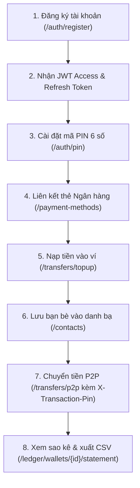

# Đặc Tả Chi Tiết Hệ Thống REST API (Mini Digital Wallet)

Tài liệu đặc tả toàn bộ các cổng giao tiếp lập trình ứng dụng (REST API) của hệ thống **Mini Digital Wallet (core-ledger-service)**.

---

## 1. Quy Ước Chung (General Conventions)

### 1.1 Thông tin kết nối
- **Base URL**: `http://localhost:8080/api/v1`
- **Định dạng dữ liệu**: `Content-Type: application/json`
- **Tiền tệ mặc định**: `USD`, biểu diễn bằng đơn vị nguyên nhỏ nhất là **cents** (1.00 USD = 100 cents, lưu kiểu `Long`). Ví dụ: `50.00 USD` = `5000`, `1,000.00 USD` = `100000`.

### 1.2 Các Headers quan trọng
1. **`Authorization: Bearer <accessToken>`**:
   - Bắt buộc trên mọi endpoint (ngoại trừ các endpoint đăng ký/đăng nhập tại `/api/v1/auth/**`).
   - Token là chuỗi JWT được cấp khi đăng ký hoặc đăng nhập, có thời hạn 15 phút.
2. **`X-Transaction-Pin: <6-chữ-số>`**:
   - Mã PIN gồm 6 chữ số (ví dụ: `123456`).
   - Bắt buộc truyền khi gọi API Rút tiền (`withdraw`) hoặc Chuyển tiền P2P (`p2p`) nếu tài khoản đã cài đặt mã PIN.
3. **`Idempotency-Key: <chuỗi-uuid-duy-nhất>`**:
   - Header chống trùng lặp giao dịch (khuyên dùng trên mọi lệnh nạp, rút, chuyển, hoàn tiền).
   - Nếu client bị rớt mạng và gửi lại đúng `Idempotency-Key` kèm nội dung cũ, hệ thống sẽ trả lại kết quả cũ mà không trừ tiền thêm lần nào.

### 1.3 Ý nghĩa các mã trạng thái HTTP phổ biến
- `200 OK`: Xử lý thành công, trả về kết quả.
- `201 Created`: Tạo mới thành công tài nguyên (User, Ví, Thẻ, Giao dịch).
- `204 No Content`: Thao tác thành công và không cần trả về nội dung body (Logout, Xóa thẻ, Xóa danh bạ).
- `400 Bad Request`: Dữ liệu gửi lên không hợp lệ (số tiền âm, số tài khoản sai định dạng, ví không đủ số dư).
- `401 Unauthorized`: Chưa đăng nhập, thiếu Bearer Token hoặc Token đã hết hạn.
- `403 Forbidden`: Không có quyền truy cập (BOLA - cố tình xem ví/thẻ của người khác, hoặc vi phạm hạn mức giao dịch).
- `404 Not Found`: Không tìm thấy tài nguyên (Ví, Thẻ, Giao dịch).
- `409 Conflict`: Xung đột dữ liệu (Số tài khoản đã tồn tại, giao dịch đã được hoàn tiền trước đó, hoặc trùng key khi đang xử lý).
- `422 Unprocessable Content`: Sử dụng lại `Idempotency-Key` cũ nhưng nội dung request (payload) lại bị thay đổi.
- `429 Too Many Requests`: Bị khóa tạm thời (15 phút) do đăng nhập sai quá 5 lần hoặc nhập sai mã PIN quá 5 lần.

### 1.4 Định dạng báo lỗi chuẩn RFC 7807 (Problem Details)
Mọi lỗi nghiệp vụ trả về từ hệ thống đều tuân thủ chuẩn RFC 7807:
```json
{
  "type": "https://minidigitalwallet.com/errors/insufficient-funds",
  "title": "Insufficient Balance",
  "status": 400,
  "detail": "Ví WAL_123 không đủ số dư. Hiện có: 5000 cents, yêu cầu: 10000 cents",
  "instance": "/api/v1/transfers/withdraw"
}
```

---

## 2. Sơ Đồ Luồng Gọi API Thực Tế



---

## 3. Danh Sách REST APIs Chi Tiết

### 3.1 Xác Thực & Người Dùng (Authentication)

#### 1. Đăng ký tài khoản mới (Register)
- **Method & URL**: `POST /api/v1/auth/register`
- **Quyền truy cập**: Công khai (Public)
- **Mô tả**: Tạo user mới, băm mật khẩu bằng BCrypt, tự động mở 1 ví USD mặc định có số tài khoản 12 chữ số, cấp phát JWT Access Token (15 phút) và Rotating Refresh Token (7 ngày).
- **Request Body**:
  ```json
  {
    "username": "alice",
    "email": "alice@example.com",
    "password": "Password123!",
    "fullName": "Alice Wonderland",
    "currency": "USD"
  }
  ```
- **Response (201 Created)**:
  ```json
  {
    "accessToken": "eyJhbGciOiJIUzI1NiIsInR5cCI6IkpXVCJ9...",
    "tokenType": "Bearer",
    "expiresIn": 900,
    "userId": "3fa85f64-5717-4562-b3fc-2c963f66afa6",
    "username": "alice",
    "email": "alice@example.com",
    "defaultWalletId": "5f425555-2f70-4d56-bc5e-828049fe93c6",
    "refreshToken": "a3f1b2c4-d5e6-4789-a1b2-c3d4e5f67890",
    "refreshExpiresIn": 604800
  }
  ```

#### 2. Đăng nhập (Login)
- **Method & URL**: `POST /api/v1/auth/login`
- **Quyền truy cập**: Công khai (Public)
- **Mô tả**: Kiểm tra username và mật khẩu. Sai 5 lần trong vòng 15 phút sẽ bị khóa (HTTP 429).
- **Request Body**:
  ```json
  {
    "username": "alice",
    "password": "Password123!"
  }
  ```
- **Response (200 OK)**: Trả về thông tin tương tự như khi đăng ký kèm token mới.

#### 3. Làm mới phiên đăng nhập (Refresh Token)
- **Method & URL**: `POST /api/v1/auth/refresh`
- **Mô tả**: Xoay vòng (rotate) refresh token để lấy cặp token mới. Nếu một token cũ đã từng sử dụng bị dùng lại, hệ thống sẽ phát hiện nguy cơ chiếm quyền và hủy toàn bộ mọi phiên đăng nhập của tài khoản đó.
- **Request Body**:
  ```json
  {
    "refreshToken": "a3f1b2c4-d5e6-4789-a1b2-c3d4e5f67890"
  }
  ```
- **Response (200 OK)**: Cặp `accessToken` và `refreshToken` mới toanh.

#### 4. Đăng xuất (Logout / Logout-all)
- **Đăng xuất thiết bị hiện tại**: `POST /api/v1/auth/logout` với body `{"refreshToken": "..."}` -> Trả về `204 No Content`.
- **Đăng xuất khỏi tất cả các thiết bị**: `POST /api/v1/auth/logout-all` (kèm header Authorization) -> Trả về `204 No Content`.

#### 5. Lấy thông tin người dùng hiện tại (Current User)
- **Method & URL**: `GET /api/v1/auth/me`
- **Header**: `Authorization: Bearer <accessToken>`
- **Response (200 OK)**:
  ```json
  {
    "id": "3fa85f64-5717-4562-b3fc-2c963f66afa6",
    "username": "alice",
    "email": "alice@example.com",
    "fullName": "Alice Wonderland",
    "status": "ACTIVE",
    "createdAt": "2026-10-06T12:00:00Z"
  }
  ```

#### 6. Cài đặt / Cập nhật mã PIN giao dịch (Set PIN)
- **Method & URL**: `POST /api/v1/auth/pin`
- **Header**: `Authorization: Bearer <accessToken>`
- **Mô tả**: Thiết lập mã PIN 6 chữ số bảo vệ giao dịch chuyển tiền và rút tiền.
- **Request Body**:
  ```json
  {
    "pin": "123456"
  }
  ```
- **Response (200 OK)**: `{"message": "Transaction PIN updated successfully"}`.

---

### 3.2 Quản Lý Phương Thức Thanh Toán (Payment Methods)

#### 1. Liên kết thẻ mới (Link Card)
- **Method & URL**: `POST /api/v1/payment-methods`
- **Mô tả**: Liên kết thẻ Visa/Mastercard. Áp dụng tiêu chuẩn PCI-DSS: chỉ lưu số thẻ che mặt (`masked_number`) và mã token, không lưu số thẻ thật.
- **Request Body**:
  ```json
  {
    "method_type": "DEBIT_CARD",
    "provider": "VISA",
    "card_number": "4242424242424242",
    "holder_name": "ALICE WONDERLAND",
    "is_default": true
  }
  ```
- **Response (201 Created)**:
  ```json
  {
    "id": "c3f6a2b1-aaaa-bbbb-cccc-ddeeff001122",
    "owner_id": "3fa85f64-5717-4562-b3fc-2c963f66afa6",
    "method_type": "DEBIT_CARD",
    "provider": "VISA",
    "masked_number": "**** **** **** 4242",
    "holder_name": "ALICE WONDERLAND",
    "payment_token": "tok_mock_visa_4242_a1b2c3d4",
    "is_default": true,
    "status": "ACTIVE",
    "created_at": "2026-10-10T12:00:00Z"
  }
  ```

#### 2. Danh sách thẻ đã liên kết của tôi
- **Method & URL**: `GET /api/v1/payment-methods`
- **Response (200 OK)**: Danh sách các thẻ đang ở trạng thái `ACTIVE`.

#### 3. Hủy liên kết thẻ
- **Method & URL**: `DELETE /api/v1/payment-methods/{id}`
- **Response**: `204 No Content`.

---

### 3.3 Quản Lý Ví (Wallets)

#### 1. Tạo ví mới
- **Method & URL**: `POST /api/v1/wallets`
- **Request Body**: `{"currency": "USD", "wallet_type": "USER"}`
- **Response (201 Created)**: Trả về thông tin ví kèm số tài khoản 12 chữ số (`account_number`).

#### 2. Tra cứu người nhận bằng số tài khoản 12 chữ số (Preview Recipient)
- **Method & URL**: `GET /api/v1/wallets/account/{accountNumber}`
- **Mô tả**: Dùng để xem trước người nhận trước khi bấm chuyển tiền P2P. Endpoint này chỉ trả về `account_number`, `wallet_type`, `currency`; hoàn toàn không trả về số dư để bảo vệ quyền riêng tư.
- **Response (200 OK)**:
  ```json
  {
    "account_number": "882012345678",
    "wallet_type": "USER",
    "currency": "USD"
  }
  ```

#### 3. Xem thông tin & số dư ví của chính mình
- **Method & URL**: `GET /api/v1/wallets/{id}/balance`
- **Response (200 OK)**:
  ```json
  {
    "walletId": "5f425555-2f70-4d56-bc5e-828049fe93c6",
    "availableBalance": 50000,
    "ledgerBalance": 50000,
    "currency": "USD"
  }
  ```

---

### 3.4 Giao Dịch Tiền Tệ (Transfers)

#### 1. Nạp tiền vào ví qua thẻ (Top-up)
- **Method & URL**: `POST /api/v1/transfers/topup`
- **Header**: `Idempotency-Key: <uuid-duy-nhất>`
- **Request Body**:
  ```json
  {
    "wallet_id": "5f425555-2f70-4d56-bc5e-828049fe93c6",
    "payment_method_id": "c3f6a2b1-aaaa-bbbb-cccc-ddeeff001122",
    "amount": 50000,
    "description": "Nạp $500 vào ví"
  }
  ```
- **Response (201 Created)**:
  ```json
  {
    "transaction_id": "9b1deb4d-3b7d-4bad-9bdd-2b0d7b3dcb6d",
    "reference_id": "TOPUP-001",
    "transaction_type": "TOPUP",
    "amount": 50000,
    "currency": "USD",
    "description": "Nạp $500 vào ví",
    "created_at": "2026-10-10T12:20:00Z"
  }
  ```

#### 2. Rút tiền về thẻ (Withdrawal)
- **Method & URL**: `POST /api/v1/transfers/withdraw`
- **Headers**:
  - `Idempotency-Key: <uuid-duy-nhất>`
  - `X-Transaction-Pin: 123456` (Nếu đã cài PIN)
- **Request Body**:
  ```json
  {
    "wallet_id": "5f425555-2f70-4d56-bc5e-828049fe93c6",
    "payment_method_id": "c3f6a2b1-aaaa-bbbb-cccc-ddeeff001122",
    "amount": 20000,
    "description": "Rút $200 về thẻ"
  }
  ```
- **Response (201 Created)**: Trả về `TransferResponse` với `transaction_type = "WITHDRAW"`.

#### 3. Chuyển tiền P2P sang số tài khoản 12 chữ số (P2P Transfer)
- **Method & URL**: `POST /api/v1/transfers/p2p`
- **Headers**:
  - `Idempotency-Key: <uuid-duy-nhất>`
  - `X-Transaction-Pin: 123456` (Nếu đã cài PIN)
- **Request Body**:
  ```json
  {
    "source_wallet_id": "5f425555-2f70-4d56-bc5e-828049fe93c6",
    "destination_account_number": "882012345678",
    "amount": 15000,
    "description": "Chuyển tiền ăn trưa"
  }
  ```
- **Response (201 Created)**: Trả về `TransferResponse` với `transaction_type = "P2P_TRANSFER"`.

#### 4. Hoàn tiền giao dịch (Reversal)
- **Method & URL**: `POST /api/v1/transfers/reversals`
- **Mô tả**: Đảo ngược dòng tiền của một giao dịch cũ, không sửa hay xóa dòng lịch sử nào. Mỗi giao dịch chỉ được hoàn tiền tối đa 1 lần.
- **Request Body**:
  ```json
  {
    "original_transaction_id": "9b1deb4d-3b7d-4bad-9bdd-2b0d7b3dcb6d",
    "description": "Hoàn tiền do chuyển nhầm"
  }
  ```
- **Response (201 Created)**: Trả về `TransferResponse` với `transaction_type = "REVERSAL"`.

---

### 3.5 Sao Kê & Lịch Sử Sổ Cái (Ledger & Statements)

#### 1. Sao kê nâng cao phân trang (Advanced Statement)
- **Method & URL**: `GET /api/v1/ledger/wallets/{walletId}/statement?type=DEBIT&page=0&size=20`
- **Tham số tùy chọn**:
  - `type`: `CREDIT` (Tiền vào) hoặc `DEBIT` (Tiền ra)
  - `from`: Thời gian bắt đầu (ISO-8601: `2026-10-01T00:00:00Z`)
  - `to`: Thời gian kết thúc (ISO-8601: `2026-10-31T23:59:59Z`)
  - `page`: Trang cần xem (bắt đầu từ 0)
  - `size`: Số dòng trên mỗi trang
- **Response (200 OK)**: Đối tượng Spring Data Page đầy đủ gồm `content`, `totalPages`, `totalElements`.

#### 2. Xuất sao kê ra file CSV dạng Stream (Export CSV)
- **Method & URL**: `GET /api/v1/ledger/wallets/{walletId}/statement/export`
- **Định dạng trả về**: `text/csv`, file tải về: `statement-{walletId}.csv`.
- **Đặc điểm kỹ thuật**: Stream dữ liệu trực tiếp ra HTTP, không tốn RAM máy chủ kể cả khi có hàng triệu dòng giao dịch.

---

### 3.6 Danh Bạ Thụ Hưởng (Contacts)

- **Lấy danh bạ**: `GET /api/v1/contacts` -> Trả về danh sách tài khoản đã lưu, ưu tiên tài khoản yêu thích (`isFavorite = true`) lên trên.
- **Lưu tài khoản mới vào danh bạ**: `POST /api/v1/contacts` với body `{"accountNumber": "882012345678", "nickname": "Bob"}`.
- **Xóa khỏi danh bạ**: `DELETE /api/v1/contacts/{id}` -> `204 No Content`.
- **Bật/Tắt yêu thích**: `PATCH /api/v1/contacts/{id}/favorite` -> Đảo trạng thái `isFavorite`.

---

### 3.7 Đối Soát Hệ Thống (Admin Reconciliation)

*Lưu ý: Các endpoint này chỉ dành riêng cho tài khoản quản trị viên có quyền `ROLE_ADMIN`.*

- **Kích hoạt chạy đối soát ngay**: `POST /api/v1/admin/reconciliation/run`
- **Lịch sử 50 lần đối soát gần nhất**: `GET /api/v1/admin/reconciliation/runs`
- **Response (200 OK)**:
  ```json
  {
    "run_id": "7f425555-2f70-4d56-bc5e-828049fe93c7",
    "started_at": "2026-10-12T02:00:00Z",
    "finished_at": "2026-10-12T02:00:01Z",
    "wallets_checked": 128,
    "mismatched_count": 0,
    "globally_balanced": true,
    "status": "OK"
  }
  ```
