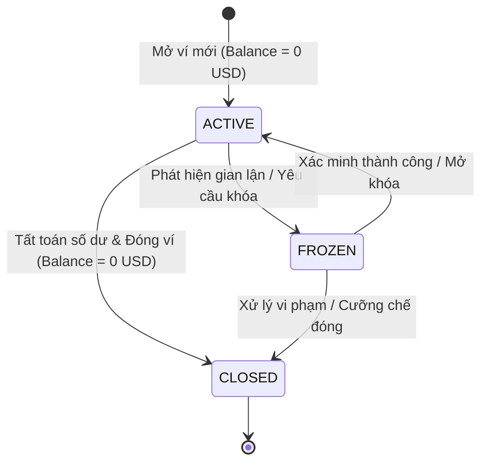
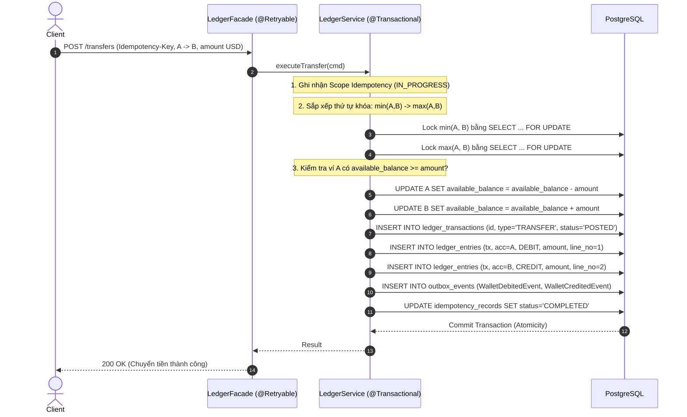

# Tài Liệu Phân Tích & Đặc Tả Nghiệp Vụ Ví Điện Tử

Tài liệu giải thích toàn diện và chuyên sâu về các quy tắc tài chính, luồng xử lý giao dịch, cơ chế an toàn số dư và mô hình sổ cái kế toán kép (Double-Entry Ledger) cho **Mini Digital Wallet (mini-digital-wallet)**.

---

## Mục Lục
1. [Tổng Quan Nghiệp Vụ](#1-tổng-quan-nghiệp-vụ)
2. [Mô Hình Trạng Thái Ví (Wallet State Machine)](#2-mô-hình-trạng-thái-ví-wallet-state-machine)
3. [Các Luồng Nghiệp Vụ Cốt Lõi (Core Business Flows)](#3-các-luồng-nghiệp-vụ-cốt-lõi-core-business-flows)
   - [3.1 Mở Ví Mới (Wallet Onboarding)](#31-mở-ví-mới-wallet-onboarding)
   - [3.2 Quản Lý Thẻ & Nguồn Tiền (Payment Methods & PCI-DSS Tokenization)](#32-quản-lý-thẻ--nguồn-tiền-payment-methods--pci-dss-tokenization)
   - [3.3 Nạp Tiền (Top-up)](#33-nạp-tiền-vào-ví-top-up-via-tokenized-card)
   - [3.4 Rút Tiền (Withdrawal)](#34-rút-tiền-khỏi-ví-về-thẻ-withdrawal-to-linked-card)
   - [3.5 Chuyển Tiền P2P Sổ Kép (Double-Entry P2P Transfer)](#35-chuyển-tiền-p2p-sổ-kép-double-entry-p2p-transfer)
   - [3.6 Giao Dịch Hoàn Tiền (Reversals)](#36-giao-dịch-hoàn-tiền-reversals)
   - [3.7 Sao Kê & Đối Soát (Statement & Reconciliation)](#37-sao-kê--đối-soát-statement--reconciliation)
4. [Các Quy Tắc Tài Chính Bắt Buộc (Financial Invariants & Constraints)](#4-các-quy-tắc-tài-chính-bắt-buộc-financial-invariants--constraints)
5. [Phân Tích Các Tình Huống Biên & Xử Lý Rủi Ro (Edge Cases & Safety)](#5-phân-tích-các-tình-huống-biên--xử-lý-rủi-ro-edge-cases--safety)

---

## 1. Tổng Quan Nghiệp Vụ

Trong các hệ thống ngân hàng và fintech, **Core Ledger** đóng vai trò là **Nguồn Chân Lý Tài Chính Duy Nhất (Single Source of Truth)**. 

### Các Khái Niệm Dữ Liệu Tách Biệt:
1. **Số Dư Tức Thời (Materialized Snapshot Projection - Bảng `accounts`)**:
   - `available_balance`: Số dư khả dụng để tiêu, phục vụ tra cứu nhanh $O(1)$ và kiểm tra `available_balance >= amount`.
   - `ledger_balance`: Số dư kế toán đã ghi nhận.
2. **Giao Dịch Gốc (Journal Header - Bảng `ledger_transactions`)**:
   - Lưu vết cấp cao của giao dịch: ai thực hiện (`actor_id`), hành động (`operation`), mã định danh (`idempotency_key`), loại giao dịch, mã giao dịch đảo ngược (`reversal_of_transaction_id`).
3. **Dòng Bút Toán Thành Phần (Immutable Lines - Bảng `ledger_entries`)**:
   - Lưu vết chi tiết từng biến động tiền tệ (Tài khoản nào, `DEBIT` hay `CREDIT`, bao nhiêu USD cents, dòng số mấy `line_no`).
   - Bất biến, append-only, tuyệt đối không được phép `UPDATE` hay `DELETE`.

> **Định lý Bất Biến Kiểm Toán & Quy Ước Số Dư Tự Nhiên (Natural Balance)**:
> - Với ví người dùng (`USER`), số dư tự nhiên là Credit (nghĩa vụ của ví với người dùng):
>   $$\text{Wallet.available\_balance} \equiv \sum \text{Amount}_{\text{CREDIT}} - \sum \text{Amount}_{\text{DEBIT}}$$
> - Bất biến cân bằng toàn hệ thống trên mọi giao dịch:
>   $$\sum \text{Amount}_{\text{DEBIT}} = \sum \text{Amount}_{\text{CREDIT}}$$

---

## 2. Mô Hình Trạng Thái Ví (Wallet State Machine)

Ví người dùng trong hệ thống chuyển dịch qua các trạng thái nghiêm ngặt:

### Quyền Hạn Theo Trạng Thái:

| Nghiệp vụ | `ACTIVE` (Hoạt động) | `FROZEN` (Đóng băng) | `CLOSED` (Đã đóng) |
| :--- | :---: | :---: | :---: |
| **Xem số dư / Sao kê** | Cho phép | Cho phép | Cho phép |
| **Nạp tiền (Top-up)** | Cho phép | Cho phép (tùy chính sách) | Từ chối |
| **Rút tiền (Withdraw)** | Cho phép | **Từ chối** | **Từ chối** |
| **Chuyển tiền đi (Transfer Out)** | Cho phép | **Từ chối** | **Từ chối** |
| **Nhận tiền chuyển đến (Transfer In)** | Cho phép | Cho phép | **Từ chối** |

---

## 3. Các Luồng Nghiệp Vụ Cốt Lõi (Core Business Flows)

### 3.1 Mở Ví Mới (Wallet Onboarding)
- **Mục đích**: Cấp phát ví thanh toán mới cho người dùng.
- **Quy tắc**:
  - Số dư ban đầu luôn bằng `0 USD`.
  - Tiền tệ: `USD` (minor unit: cents).
  - Trạng thái khởi tạo: `ACTIVE`, loại ví: `USER`.
  - Ràng buộc cơ sở dữ liệu: `CHECK (account_type = 'SYSTEM' OR available_balance >= 0)`.

---

### 3.2 Quản Lý Thẻ & Nguồn Tiền (Payment Methods & PCI-DSS Tokenization)
- **Mục đích**: Cho phép người dùng liên kết thẻ tín dụng/ghi nợ (Visa, Mastercard, Napas) hoặc tài khoản ngân hàng để nạp/rút tiền.
- **Nguyên tắc PCI-DSS**:
  - Ví điện tử **tuyệt đối không lưu số thẻ thật (PAN)** hoặc mã bảo mật (CVV).
  - Khi người dùng nhập thẻ, Mock Payment Gateway xác thực và trả về `payment_token` duy nhất.
  - Hệ thống chỉ lưu `masked_number` (`**** **** **** 4242`), `holder_name`, `provider` và `payment_token`.
- **Vòng đời phương thức thanh toán**: `ACTIVE` $\rightarrow$ `REVOKED`. Người dùng có thể đặt 1 thẻ làm mặc định (`is_default = true`).

---

### 3.3 Nạp Tiền Vào Ví (Top-up via Tokenized Card)
- **Mục đích**: Ghi nhận dòng tiền từ thẻ liên kết vào ví người dùng.
- **Quy trình xử lý**:
  1. Kiểm tra ví đích tồn tại và đang ở trạng thái `ACTIVE`.
  2. Kiểm tra `payment_method_id` tồn tại, thuộc quyền sở hữu của user và ở trạng thái `ACTIVE`.
  3. Gọi Mock Payment Gateway để charge tiền từ `payment_token` của thẻ.
  4. Sau khi Gateway xác nhận thành công: chèn bản ghi `IN_PROGRESS` vào `idempotency_records` theo scope `(actor_id, 'TOPUP', idempotency_key)` với lease 30s.
  5. Khóa tài khoản ví đích và tài khoản hệ thống `SYS_EXTERNAL_SETTLEMENT` theo thứ tự: `min(id) -> max(id)` bằng `SELECT ... FOR UPDATE`.
  6. Ghi 1 bản ghi cha `ledger_transactions` (type: `DEPOSIT`, currency: `USD`).
  7. Ghi 2 bút toán `ledger_entries`:
     - DEBIT: `SYS_EXTERNAL_SETTLEMENT` (nguồn đối ứng đối tác).
     - CREDIT: Ví người dùng đích (tăng số dư ví).
  8. Cập nhật snapshot `available_balance` ví người dùng.
  9. Cập nhật `idempotency_records` sang `COMPLETED`. Commit transaction.

---

### 3.4 Rút Tiền Khỏi Ví Về Thẻ (Withdrawal to Linked Card)
- **Mục đích**: Người dùng rút tiền từ ví về thẻ/tài khoản ngân hàng liên kết.
- **Quy trình xử lý**:
  1. Kiểm tra ví nguồn tồn tại và trạng thái `ACTIVE`.
  2. Kiểm tra `payment_method_id` hợp lệ và thuộc về user.
  3. Kiểm tra `amount > 0` và số dư khả dụng: `available_balance >= amount`.
  4. Khóa các tài khoản theo thứ tự: `min(wallet_id, 'SYS_EXTERNAL_SETTLEMENT') -> max(...)` bằng `SELECT ... FOR UPDATE`.
  5. Ghi bản ghi cha `ledger_transactions` (type: `WITHDRAWAL`, currency: `USD`).
  6. Ghi 2 bút toán `ledger_entries`:
     - DEBIT: Ví người dùng (giảm số dư ví).
     - CREDIT: `SYS_EXTERNAL_SETTLEMENT` (đối ứng hoàn trả đối tác).
  7. Cập nhật snapshot `available_balance` ví người dùng.
  8. Gọi Mock Gateway thực hiện payout về token thẻ. Commit transaction.

---

### 3.5 Chuyển Tiền P2P Sổ Kép (Double-Entry P2P Transfer)
- **Mục đích**: Di chuyển tiền giữa 2 ví nội bộ ($A \rightarrow B$).
- **Nguyên lý Kế toán Kép & Xử lý Đồng thời**:
  - Tách biệt Bean Proxy: Bean ngoài `LedgerFacade` đặt `@Retryable` bắt lỗi `40P01` deadlock; Bean trong `LedgerService` thực thi `@Transactional`.
  - Khóa tuần tự: $\min(A, B) \rightarrow \max(A, B)$ bằng `SELECT ... FOR UPDATE`.
  - Ghi bản ghi cha `ledger_transactions` (status: `POSTED`).
  - Ghi 2 bút toán con `ledger_entries`:
    - DEBIT ví nguồn $A$.
    - CREDIT ví đích $B$.
  - Cập nhật số dư snapshot cho cả 2 ví và sinh sự kiện vào `outbox_events` trong cùng một database transaction.

---

### 3.6 Giao Dịch Hoàn Tiền (Reversals)
- **Mục đích**: Hoàn trả tiền hoặc đảo bút toán giao dịch sai sót mà không vi phạm tính bất biến.
- **Quy tắc**:
  - **Tuyệt đối không sửa hay xóa**: Không `UPDATE` hay `DELETE` giao dịch gốc hay dòng `ledger_entries` cũ.
  - Tạo giao dịch mới `ledger_transactions` với `type = 'REVERSAL'` và `reversal_of_transaction_id = <original_tx_id>`.
  - Sinh 2 dòng `ledger_entries` đảo ngược hoàn toàn dòng tiền (Credit ví bị trừ, Debit ví đã nhận).

---

### 3.7 Sao Kê & Đối Soát (Statement & Reconciliation)
- **Mục đích**: Cung cấp lịch sử giao dịch minh bạch cho người dùng và kiểm toán độc lập.
- **Quy tắc**:
  - Truy vấn từ `ledger_entries` liên kết `ledger_transactions` theo `wallet_id` sắp xếp theo `created_at DESC`.
  - Định kỳ chạy `ReconciliationJob` xác minh toàn bộ ví:
    $$\text{accounts.available\_balance} = \sum \text{Amount}_{\text{CREDIT}} - \sum \text{Amount}_{\text{DEBIT}}$$

---

## 4. Các Quy Tắc Tài Chính Bắt Buộc (Financial Invariants & Constraints)

| # | Quy tắc bất biến | Cơ chế kỹ thuật đảm bảo | Hậu quả nếu vi phạm |
| :-: | :--- | :--- | :--- |
| **1** | **Không âm số dư ví người dùng** | Ràng buộc DB `CHECK (account_type = 'SYSTEM' OR available_balance >= 0)` | Thất thoát tài chính, nợ xấu |
| **2** | **Sổ cái Bất Biến (Append-Only)** | Bảng `ledger_entries` không cấp quyền `UPDATE`/`DELETE`, hoàn tiền bằng Reversal | Mất dấu vết kiểm toán |
| **3** | **Cân Bằng Sổ Kép (Zero-Sum)** | Bắt buộc $\sum \text{Debit} = \sum \text{Credit}$ trên mỗi transaction, có System Accounts | Tiền tự sinh ra hoặc tự biến mất |
| **4** | **Loại trừ Sai số Số thực (USD Only)** | Lưu số tiền kiểu `BIGINT` (minor units: cents), không hỗ trợ cross-currency | Sai số làm tròn tiền tệ |
| **5** | **Idempotency Bền Vững có Phạm Vi** | Khóa chính `(actor_id, operation, idempotency_key)` trên PostgreSQL + Lease Expiry | Trừ tiền 2 lần hoặc kẹt trạng thái |

---

## 5. Phân Tích Các Tình Huống Biên & Xử Lý Rủi Ro (Edge Cases & Safety)

### 5.1 Xử Lý Tranh Chấp Tiền Tệ (Double-Spending)
- **Kịch bản**: Ví có 10,000 cents ($100). Bấm chuyển 10,000 cents ở 2 thiết bị cùng mili-giây.
- **Giải pháp**: Khóa bi quan `SELECT ... FOR UPDATE`. Giao dịch 1 trừ về 0; giao dịch 2 đọc số dư mới = 0 và bị từ chối với lỗi RFC 7807 `Insufficient Balance`.

### 5.2 Deadlock Khi Chuyển Tiền Ngược Chiều ($A \rightarrow B$ và $B \rightarrow A$)
- **Kịch bản**: 2 giao dịch đồng thời giữa A và B.
- **Giải pháp**:
  - Sắp xếp thứ tự khóa: $\min(A, B) \rightarrow \max(A, B)$ loại bỏ Circular Wait.
  - Tầng ngoài `LedgerFacade` với Spring `@Retryable` bắt lỗi `40P01` tự động thử lại với transaction mới sạch sẽ.

### 5.3 Mạng Chập Chờn & Khách Hàng Bấm Gửi Nhiều Lần
- **Giải pháp**: Bảng `idempotency_records` trên PostgreSQL. Cùng key và body đã hoàn thành $\rightarrow$ trả ngay kết quả cũ (HTTP 200). Đang chạy $\rightarrow$ HTTP 409 Conflict. Nếu worker crash quá hạn `lease_expires_at` $\rightarrow$ cho phép thu hồi và tái thực thi.

### 5.4 Sự Cố Broker Kafka & At-Least-Once Delivery
- **Giải pháp**: Transactional Outbox ghi event vào PostgreSQL. Khi Kafka khôi phục, poller quét và gửi bù. Phía Consumer sử dụng bảng `processed_events` để loại bỏ event trùng lặp trong cùng database transaction.
