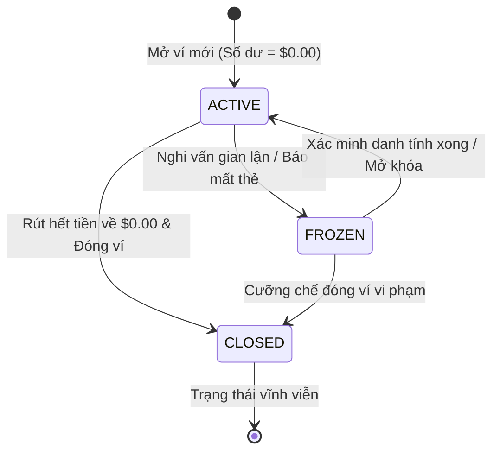
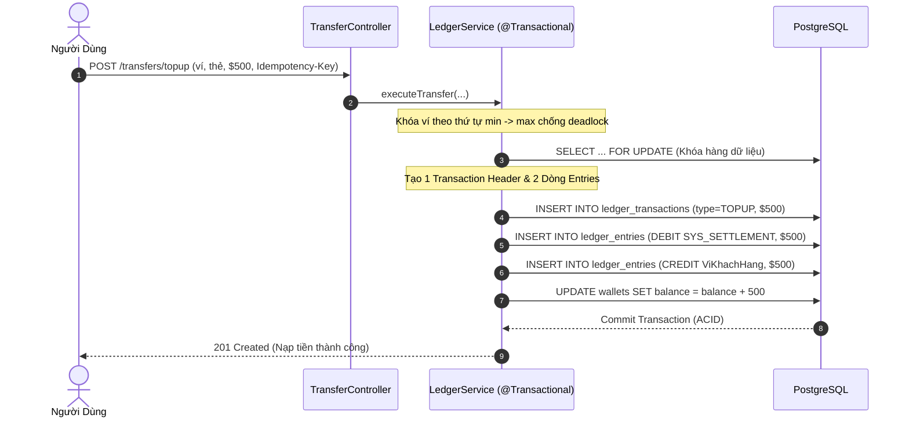

# Đặc Tả Nghiệp Vụ Ví Điện Tử (Core Ledger Service)

Tài liệu giải thích toàn diện và chuyên sâu về nghiệp vụ ví điện tử, mô hình sổ cái kép (Double-Entry Bookkeeping), cơ chế kiểm soát số dư, chống gian lận và các nguyên tắc an toàn tài chính trong dự án **Mini Digital Wallet**.

Tài liệu được biên soạn theo phong cách trực quan, dễ hiểu, giúp các kỹ sư mới (Fresher / Junior) nhanh chóng nắm bắt bản chất cốt lõi của ngân hàng số mà không bị ngợp bởi các thuật ngữ hàn lâm.

---

## Mục Lục
1. [Nền Tảng: Ví Điện Tử Thực Chất Hoạt Động Như Thế Nào?](#1-nền-tảng-ví-điện-tử-thực-chất-hoạt-động-như-thế-nào)
2. [Hai Khái Niệm Bất Di Bất Dịch: Số Dư Hiển Thị vs Sổ Nhật Ký](#2-hai-khái-niệm-bất-di-bất-dịch-số-dư-hiển-thị-vs-sổ-nhật-ký)
3. [Vòng Đời & Trạng Thái Ví (Wallet State Machine)](#3-vòng-đời--trạng-thái-ví-wallet-state-machine)
4. [Các Luồng Giao Dịch Tài Chính Cốt Lõi](#4-các-luồng-giao-dịch-tài-chính-cốt-lõi)
   - [4.1 Mở Ví & Cấp Số Tài Khoản (Onboarding)](#41-mở-ví--cấp-số-tài-khoản-onboarding)
   - [4.2 Quản Lý Thẻ & Mã Hóa Token PCI-DSS](#42-quản-lý-thẻ--mã-hóa-token-pci-dss)
   - [4.3 Nạp Tiền Vào Ví (Top-up)](#43-nạp-tiền-vào-ví-top-up)
   - [4.4 Rút Tiền Khỏi Ví (Withdrawal)](#44-rút-tiền-khỏi-ví-withdrawal)
   - [4.5 Chuyển Tiền P2P Sổ Kép (P2P Transfer)](#45-chuyển-tiền-p2p-sổ-kép-p2p-transfer)
   - [4.6 Hoàn Tiền Không Tẩy Xóa (Reversals)](#46-hoàn-tiền-không-tẩy-xóa-reversals)
   - [4.7 Mã PIN Bảo Vệ Giao Dịch (Transaction PIN)](#47-mã-pin-bảo-vệ-giao-dịch-transaction-pin)
   - [4.8 Kiểm Soát Hạn Mức Giao Dịch (Transaction Limits)](#48-kiểm-soát-hạn-mức-giao-dịch-transaction-limits)
   - [4.9 Danh Bạ Thụ Hưởng (Saved Contacts)](#49-danh-bạ-thụ-hưởng-saved-contacts)
   - [4.10 Sao Kê & Xuất Dữ Liệu CSV Dạng Stream](#410-sao-kê--xuất-dữ-liệu-csv-dạng-stream)
   - [4.11 Đối Soát Hàng Đêm (Nightly Reconciliation)](#411-đối-soát-hàng-đêm-nightly-reconciliation)
5. [Các Quy Tắc Tài Chính Bất Biến (Financial Invariants)](#5-các-quy-tắc-tài-chính-bất-biến-financial-invariants)
6. [Giải Pháp Cho Những Tình Huống Xung Đột Kinh Điển](#6-giải-pháp-cho-những-tình-huống-xung-đột-kinh-điển)

---

## 1. Nền Tảng: Ví Điện Tử Thực Chất Hoạt Động Như Thế Nào?

Hãy bắt đầu bằng một hình dung đơn giản ngoài đời thực:
- Khi bạn mở chiếc ví da của mình, bạn thấy có 300.000đ. Bạn đếm tổng được 300.000đ.
- Nhưng nếu hỏi: *"Tại sao bạn lại có 300.000đ này? Ai đưa cho bạn hay bạn vừa tiêu những gì?"*, bạn phải nhớ lại hoặc mở cuốn sổ thu chi cá nhân ra xem.

Trong ngân hàng và ví điện tử cũng chính xác như vậy:
1. Con số số dư hiện trên ứng dụng điện thoại thực chất chỉ là một **bản chụp nhanh (snapshot)** giúp người dùng tra cứu tức thì.
2. Bản chất thật sự của tiền bạc lại nằm hoàn toàn ở cuốn sổ nhật ký kế toán bất biến: từng lần nạp tiền, từng cốc trà sữa bạn thanh toán đều được ghi thành một dòng bút toán, không bao giờ được phép dùng bút xóa tẩy đi.

Cuốn sổ nhật ký đó trong ngân hàng được gọi là **Core Ledger** (Sổ Cái Cốt Lõi). Nó chính là **Nguồn Chân Lý Duy Nhất (Single Source of Truth)**. Nếu con số số dư hiển thị trên app bị lỗi do cache hay bị sửa đổi trái phép, hệ thống chỉ cần tính tổng lại từ cuốn sổ nhật ký là khôi phục chính xác số tiền thực tế.

---

## 2. Hai Khái Niệm Bất Di Bất Dịch: Số Dư Hiển Thị vs Sổ Nhật Ký

Người mới học lập trình backend tài chính thường mắc một sai lầm nghiêm trọng: *"Tạo một bảng `wallets`, mỗi lần chuyển tiền thì chạy lệnh `UPDATE wallets SET balance = balance - 100` là xong"*.

Cách làm này trong fintech bị cấm tuyệt đối vì hai lý do:
- Nếu ai đó sửa trực tiếp vào database hoặc lệnh update bị chạy lặp lại do lag mạng, bạn sẽ hoàn toàn mất dấu vết: không biết tiền biến mất đi đâu, ai chuyển cho ai, vào thời điểm nào.
- Khi khách hàng khiếu nại, bạn hoàn toàn không có bằng chứng để đối soát kiểm toán.

Vì vậy, hệ thống tách biệt thành hai tầng dữ liệu rõ ràng:

### 2.1 Số Dư Hiển Thị (Materialized Snapshot - Bảng `wallets`)
- Là con số được tính sẵn và lưu trữ để phục vụ việc hiển thị lên màn hình điện thoại với tốc độ $O(1)$ và kiểm tra nhanh điều kiện `available_balance >= amount`.
- `available_balance`: Số dư khả dụng mà khách hàng có thể rút hoặc chuyển đi ngay lúc này.
- `ledger_balance`: Số dư kế toán đã được chốt sổ.

### 2.2 Sổ Nhật Ký Kế Toán Kép (Double-Entry Ledger)
Gồm hai bảng dữ liệu luôn gắn liền với nhau:
1. **Bảng `ledger_transactions` (Tiêu đề giao dịch)**:
   - Lưu thông tin chung của giao dịch: Mã tham chiếu duy nhất (`reference_id`), loại giao dịch (`transaction_type`: `TOPUP`, `WITHDRAW`, `P2P_TRANSFER`, `REVERSAL`), tổng số tiền, loại tiền tệ (`USD`), ghi chú và thời gian phát sinh.
2. **Bảng `ledger_entries` (Các dòng bút toán thành phần)**:
   - Mỗi giao dịch luôn sinh ra **ít nhất 2 dòng bút toán** đối xứng nhau: một dòng Ghi nợ (`DEBIT`) và một dòng Ghi có (`CREDIT`).
   - Bảng này là **Append-Only** (Chỉ ghi thêm). Tuyệt đối không bao giờ chạy lệnh `UPDATE` hay `DELETE` trên bảng này.

> **Định Lý Bất Biến Kế Toán**:
> - Với ví người dùng (`USER`), mỗi lần `CREDIT` là tiền vào (tăng số dư), mỗi lần `DEBIT` là tiền ra (giảm số dư):
>   $$\text{Số Dư Khả Dụng} = \sum \text{Các Khoản CREDIT} - \sum \text{Các Khoản DEBIT}$$
> - Trên mỗi giao dịch đơn lẻ cũng như trên toàn bộ hệ thống:
>   $$\sum \text{Tổng Tiền DEBIT} = \sum \text{Tổng Tiền CREDIT}$$
>   *(Tiền không tự sinh ra và không tự mất đi, chỉ chuyển từ tài khoản này sang tài khoản khác).*

---

## 3. Vòng Đời & Trạng Thái Ví (Wallet State Machine)

Mỗi chiếc ví trong hệ thống chuyển dịch qua các trạng thái rõ ràng, áp dụng mẫu thiết kế **State Pattern**:

### Bảng Phân Quyền Theo Trạng Thái

| Thao tác | Ví `ACTIVE` (Hoạt động) | Ví `FROZEN` (Đóng băng) | Ví `CLOSED` (Đã đóng) |
| :--- | :---: | :---: | :---: |
| **Xem số dư & sao kê** | Cho phép | Cho phép | Cho phép |
| **Nạp tiền (Top-up)** | Cho phép | **Từ chối (400)** | **Từ chối (400)** |
| **Rút tiền (Withdraw)** | Cho phép | **Từ chối (400)** | **Từ chối (400)** |
| **Chuyển tiền đi (Transfer Out)** | Cho phép | **Từ chối (400)** | **Từ chối (400)** |
| **Nhận tiền đến (Transfer In)** | Cho phép | **Từ chối (400)** | **Từ chối (400)** |

Nhờ áp dụng **State Pattern** (`ActiveWalletState`, `FrozenWalletState`, `ClosedWalletState`), mã nguồn loại bỏ hoàn toàn các khối `if-else` lồng nhau phức tạp, giúp việc kiểm tra quyền hạn luôn an toàn và dễ bảo trì.

---

## 4. Các Luồng Giao Dịch Tài Chính Cốt Lõi

### 4.1 Mở Ví & Cấp Số Tài Khoản (Onboarding)
- **Mục tiêu**: Cấp phát ví thanh toán mới cho khách hàng sau khi đăng ký tài khoản thành công.
- **Quy tắc nghiệp vụ**:
  - Số dư khởi tạo ban đầu: Luôn bằng `0 USD` (0 cents).
  - Đơn vị tiền tệ: `USD` (lưu dưới dạng số nguyên cents, ví dụ: 1.00 USD = 100 cents).
  - Trạng thái mặc định: `ACTIVE`, loại ví: `USER`.
  - **Số tài khoản 12 chữ số (`account_number`)**: Hệ thống tự động sinh một dãy 12 số duy nhất bắt đầu bằng tiền tố `8820` (ví dụ: `8820 1234 5678`). Khách hàng chỉ cần đọc số này cho bạn bè để chuyển tiền, không cần sao chép chuỗi UUID dài dòng.
  - **Bảo mật quyền sở hữu (BOLA)**: Ví tạo ra luôn gắn liền với người đang đăng nhập. Nếu client cố tình gửi `owner_id` của người khác, server sẽ bỏ qua và tự động lấy ID của người gọi.

---

### 4.2 Quản Lý Thẻ & Mã Hóa Token PCI-DSS
- **Mục tiêu**: Cho phép khách hàng liên kết thẻ thanh toán quốc tế (Visa, Mastercard) để nạp và rút tiền.
- **Tiêu chuẩn bảo mật thẻ PCI-DSS**:
  - Hệ thống **tuyệt đối không lưu số thẻ thật (PAN 16 chữ số)** hay mã bảo mật CVV vào database.
  - Khi khách hàng nhập thẻ, cổng thanh toán (Payment Gateway) xác thực và trả về một mã đại diện duy nhất (`payment_token`).
  - Database chỉ lưu số thẻ đã che mặt (`masked_number`: `**** **** **** 4242`), tên chủ thẻ, nhà phát hành và `payment_token`.
- **Ranh giới sở hữu**: Khách hàng chỉ có quyền xem, sử dụng hoặc xóa thẻ do chính mình tạo ra.

---

### 4.3 Nạp Tiền Vào Ví (Top-up)
- **Mục tiêu**: Ghi nhận dòng tiền nạp từ thẻ liên kết vào ví người dùng.
- **Đối ứng kế toán kép**:
  - Để bảo toàn nguyên tắc kế toán kép, hệ thống khởi tạo sẵn một ví hệ thống đặc biệt gọi là **Ví Thanh Toán Ngoài (`SYS_EXTERNAL_SETTLEMENT`)**.
  - Khi nạp tiền thành công:
    - **DEBIT** ví `SYS_EXTERNAL_SETTLEMENT` (đại diện cho khoản tiền cổng thanh toán đang giữ của hệ thống).
    - **CREDIT** ví của khách hàng (số dư ví khách hàng tăng lên).
  - Tổng tiền DEBIT luôn bằng tổng tiền CREDIT, đảm bảo cân bằng tuyệt đối.

---

### 4.4 Rút Tiền Khỏi Ví (Withdrawal)
- **Mục tiêu**: Chuyển tiền từ ví điện tử về lại thẻ ngân hàng liên kết.
- **Quy trình xử lý**:
  - Xác thực mã PIN giao dịch 6 chữ số nếu tài khoản đã cài đặt PIN.
  - Kiểm tra hạn mức giao dịch (tối đa 10.000 USD/lệnh và không quá 50.000 USD/ngày).
  - Kiểm tra số dư: `available_balance >= amount` ngay dưới khóa hàng bi quan (`SELECT ... FOR UPDATE`).
  - Ghi bút toán sổ kép ngược lại với nạp tiền:
    - **DEBIT** ví khách hàng (số dư giảm xuống).
    - **CREDIT** ví `SYS_EXTERNAL_SETTLEMENT` (nghĩa vụ chi trả tiền ra bên ngoài).

---

### 4.5 Chuyển Tiền P2P Sổ Kép (P2P Transfer)
- **Mục tiêu**: Chuyển tiền tức thời giữa 2 ví nội bộ (từ ví A sang ví B).
- **Trải nghiệm thân thiện**:
  - Người gửi chỉ cần nhập **số tài khoản 12 chữ số** (`destination_account_number`).
  - Hỗ trợ API xem trước thông tin người nhận (`GET /api/v1/wallets/account/{accountNumber}`) chỉ trả về loại ví và tiền tệ, bảo mật số dư và thông tin cá nhân.
- **Quy trình thực thi**:
  - Xác thực mã PIN 6 số của chủ ví gửi tiền.
  - Sắp xếp khóa hai tài khoản theo thứ tự UUID: `min(UUID_A, UUID_B) -> max(UUID_A, UUID_B)` để triệt tiêu Deadlock.
  - Kiểm tra số dư ví nguồn: `available_balance >= amount`.
  - Cập nhật số dư cả 2 ví và ghi 1 dòng giao dịch `P2P_TRANSFER` cùng 2 dòng bút toán (`line_no = 1` cho DEBIT, `line_no = 2` cho CREDIT).
  - Commit toàn bộ trong cùng một database transaction.

---

### 4.6 Hoàn Tiền Không Tẩy Xóa (Reversals)
- **Mục tiêu**: Hoàn trả tiền khi chuyển nhầm hoặc khi có tranh chấp mà không vi phạm tính bất biến của sổ cái.
- **Quy tắc xử lý**:
  - Tuyệt đối không xóa hay sửa đổi giao dịch cũ.
  - Tạo một giao dịch mới mang loại `REVERSAL` và liên kết trường `reversal_of_transaction_id` về ID của giao dịch ban đầu.
  - Tạo 2 dòng bút toán đảo ngược dòng tiền: DEBIT ví người nhận cũ và CREDIT ví người gửi cũ.
  - **Chống hoàn tiền 2 lần (Double Reversal)**: Chỉ mục duy nhất `UNIQUE(reversal_of_transaction_id)` ở tầng database đảm bảo một giao dịch chỉ được phép hoàn tiền đúng 1 lần duy nhất, ngăn ngừa rủi ro race condition khi hai nhân viên cùng bấm hoàn tiền.

---

### 4.7 Mã PIN Bảo Vệ Giao Dịch (Transaction PIN)
- **Mục tiêu**: Bảo vệ tiền của khách hàng ngay cả khi phiên đăng nhập bị chiếm quyền hoặc người khác cầm vào máy điện thoại đang mở sẵn app.
- **Quy tắc an toàn**:
  - Mã PIN gồm đúng 6 chữ số (`000000` đến `999999`), được băm an toàn bằng thuật toán BCrypt và lưu tại cột `users.pin_hash`.
  - **Graceful Opt-in**: Người dùng mới chưa cài đặt PIN vẫn có thể giao dịch bình thường để trải nghiệm. Sau khi đã cài đặt tại `POST /api/v1/auth/pin`, mọi lệnh Rút tiền và Chuyển tiền P2P bắt buộc phải gửi kèm header `X-Transaction-Pin`.
  - **Chống dò mã PIN (Brute-Force Protection)**: Bộ đếm `PinRateLimiter` theo dõi số lần nhập sai. Nhập sai 5 lần liên tiếp sẽ bị khóa chức năng PIN trong 15 phút (HTTP 429 `too-many-requests`). Khi nhập đúng, bộ đếm tự động reset về 0.

---

### 4.8 Kiểm Soát Hạn Mức Giao Dịch (Transaction Limits)
- **Mục tiêu**: Phòng ngừa gian lận, rò rỉ tài chính và chặn các lệnh chuyển nhầm số tiền quá lớn.
- **Hai tầng hạn mức**:
  1. **Hạn mức mỗi giao dịch**: Tối đa **10.000 USD** (1.000.000 cents). Kiểm tra ở tầng controller/service.
  2. **Hạn mức lũy kế trong ngày**: Tối đa **50.000 USD** (5.000.000 cents) cho tổng lượng tiền chuyển/rút ra khỏi ví trong ngày tính từ 00:00:00 UTC.
- **Chống gian lận đồng thời (TOCTOU Race Condition)**:
  - Việc kiểm tra hạn mức ngày được thực hiện **bên trong transaction sổ cái ngay sau khi đã khóa hàng ví nguồn (`LedgerGuard`)**. Nhờ vậy, hai giao dịch gửi cùng lúc không thể cùng đọc một tổng cũ để vượt trần hạn mức.

---

### 4.9 Danh Bạ Thụ Hưởng (Saved Contacts)
- **Mục tiêu**: Giúp khách hàng lưu lại số tài khoản của người thân, bạn bè để chuyển tiền nhanh chóng, tránh gõ nhầm số.
- **Ràng buộc an toàn**:
  - Số tài khoản lưu trong danh bạ phải tồn tại thật trên hệ thống.
  - Người dùng không được phép tự lưu số tài khoản của chính mình (HTTP 400 `cannot-add-self`).
  - Mỗi tài khoản chỉ được lưu một lần duy nhất (`UNIQUE(owner_id, account_number)`).
  - Hỗ trợ đánh dấu yêu thích (`is_favorite = true`) để đưa lên đầu danh sách chuyển tiền.

---

### 4.10 Sao Kê & Xuất Dữ Liệu CSV Dạng Stream
- **Mục tiêu**: Cung cấp công cụ tra cứu lịch sử minh bạch và xuất file báo cáo chi tiêu.
- **Tối ưu hóa bộ nhớ**:
  - Khi xuất file CSV (`GET /api/v1/ledger/wallets/{id}/statement/export`), thay vì tải toàn bộ hàng vạn dòng giao dịch vào bộ nhớ RAM gây nguy cơ tràn bộ nhớ (`OutOfMemoryError`), hệ thống đọc phân trang và ghi trực tiếp từng khối dữ liệu ra luồng HTTP (`HttpServletResponse.getWriter()`). Bộ nhớ máy chủ luôn duy trì ở mức tối thiểu.

---

### 4.11 Đối Soát Hàng Đêm (Nightly Reconciliation)
- **Mục tiêu**: Đảm bảo "ngủ ngon mỗi đêm" - chứng minh toàn bộ sổ sách tài chính hoàn toàn khớp lệnh, không bị thất thoát dù chỉ 1 cent.
- **Quy trình tự động**:
  - Tự động chạy vào lúc 2:00 sáng mỗi ngày (`app.reconciliation.cron`).
  - Kiểm tra 2 bất biến:
    1. Số dư hiện tại của từng ví có bằng tổng CREDIT trừ đi tổng DEBIT trong lịch sử hay không?
    2. Toàn bộ hệ thống có cân bằng Zero-Sum (Tổng DEBIT = Tổng CREDIT) hay không?
  - **Tối ưu hiệu năng**: Thực hiện truy vấn set-based với `GROUP BY` và `HAVING` trực tiếp trên database, chi phí là hằng số O(1) không phụ thuộc vào số lượng ví.
  - Chỉ quản trị viên (`ROLE_ADMIN`) mới có quyền kích hoạt chạy đối soát thủ công hoặc xem danh sách các lần đối soát.

---

## 5. Các Quy Tắc Tài Chính Bất Biến (Financial Invariants)

Bảng tổng hợp 11 quy tắc cốt lõi bảo vệ hệ thống tài chính:

| # | Quy tắc bất biến | Cơ chế kỹ thuật đảm bảo | Hậu quả nếu vi phạm |
| :-: | :--- | :--- | :--- |
| **1** | **Không bao giờ âm số dư ví người dùng** | Ràng buộc DB `CHECK (wallet_type = 'SYSTEM' OR available_balance >= 0)` | Thất thoát tiền, khách hàng tiêu âm |
| **2** | **Sổ cái bất biến (Append-Only)** | Bảng `ledger_entries` chỉ ghi thêm, cấm UPDATE/DELETE; sửa sai bằng Reversal | Mất dấu vết kiểm toán tài chính |
| **3** | **Cân bằng sổ kép (Zero-Sum)** | Mỗi giao dịch bắt buộc: Tổng Debit = Tổng Credit | Tiền tự nhiên biến mất hoặc tự sinh ra |
| **4** | **Loại trừ hoàn toàn sai số dấu phẩy động** | Lưu toàn bộ số tiền bằng số nguyên `Long` cents, không dùng `float`/`double` | Sai lệch tích lũy tiền tệ do làm tròn nhị phân |
| **5** | **Chống trùng lặp giao dịch (Idempotency)** | Bảng `idempotency_records` (SHA-256 hash + lease 30s) + `UNIQUE(reference_id)` | Khách bấm 2 lần bị trừ tiền 2 lần |
| **6** | **Mỗi giao dịch chỉ hoàn tiền đúng 1 lần** | Chỉ mục duy nhất `UNIQUE(reversal_of_transaction_id)` trên database | Bị hoàn tiền 2 lần khi bị spam click |
| **7** | **Bảo vệ sở hữu tài nguyên (Chống BOLA)** | Kiểm tra chủ sở hữu trên mọi API, người ngoài không xem được ví/thẻ của nhau | Lộ số dư hoặc tiêu trộm tiền của người khác |
| **8** | **Số tài khoản duy nhất 12 chữ số** | Ràng buộc `UNIQUE(account_number)` + format đầu `8820` | Không tìm được người nhận hoặc chuyển nhầm |
| **9** | **Bảo vệ xác thực hai lớp bằng PIN 6 số** | Băm BCrypt `users.pin_hash`, header `X-Transaction-Pin`, khóa sau 5 lần sai | Mất sạch tiền nếu bị lộ cookie phiên đăng nhập |
| **10** | **Kiểm soát trần rủi ro (Limits)** | Ranh giới 10.000 USD/lệnh và 50.000 USD/ngày ngay dưới row-lock | Rủi ro mất khoản tiền lớn khi bị gian lận |
| **11** | **Toàn vẹn danh bạ (Contacts)** | Ràng buộc `UNIQUE(owner_id, account_number)`, cấm tự lưu chính mình | Gây rối loạn danh bạ người dùng |

---

## 6. Giải Pháp Cho Những Tình Huống Xung Đột Kinh Điển

### 6.1 Rút Tiền Cùng Lúc Ở 2 Nơi (Double-Spending)
- **Tình huống**: Ví có 100 USD. Khách hàng bấm "Rút 100 USD" trên 2 điện thoại cùng một phần nghìn giây.
- **Nếu xử lý sai**: Cả hai luồng cùng đọc ra số dư 100 USD >= 100 USD, cả hai cùng cho rút. Khách hàng rút được 200 USD, tài khoản bị âm 100 USD.
- **Giải pháp**: Khóa bi quan `SELECT ... FOR UPDATE`. Luồng thứ nhất lấy được khóa, trừ 100 USD còn 0 USD rồi commit. Luồng thứ hai phải đứng chờ; khi lấy được khóa thì số dư đã là 0 USD, hệ thống từ chối ngay với lỗi `Insufficient Balance` (HTTP 400).

### 6.2 Bế Tắc Khi Chuyển Tiền Chéo Nhau (Deadlock)
- **Tình huống**: Người A chuyển cho B, đúng lúc đó người B cũng bấm chuyển cho A.
- **Nếu xử lý sai**: Luồng 1 giữ khóa ví A và chờ khóa ví B. Luồng 2 giữ khóa ví B và chờ khóa ví A. Hai bên chờ nhau mãi mãi gây Deadlock treo cứng database.
- **Giải pháp**: Sắp xếp thứ tự khóa theo UUID: `min(A, B) -> max(A, B)`. Cả hai luồng đều bắt buộc phải xin khóa ví có UUID nhỏ hơn trước, loại bỏ hoàn toàn chu trình chờ đợi vòng tròn (Circular Wait).

### 6.3 Mạng Chập Chờn, Khách Bấm Gửi Nhiều Lần (Idempotency)
- **Tình huống**: Khách hàng bấm chuyển tiền, mạng lag quay vòng tròn, khách sốt ruột bấm tiếp lần nữa.
- **Giải pháp 2 tầng**:
  - **Tầng 1**: Client gửi kèm `Idempotency-Key`. Hệ thống lưu trạng thái vào bảng `idempotency_records`. Nếu request thứ hai đến khi request thứ nhất đang chạy, hệ thống trả về HTTP 409. Nếu request thứ nhất đã chạy xong, hệ thống gửi lại ngay kết quả cũ mà không trừ tiền thêm lần nào.
  - **Tầng 2**: Ràng buộc database `UNIQUE(reference_id)` trên bảng `ledger_transactions` là chốt chặn vật lý cuối cùng ngăn mọi dòng ghi đúp.
