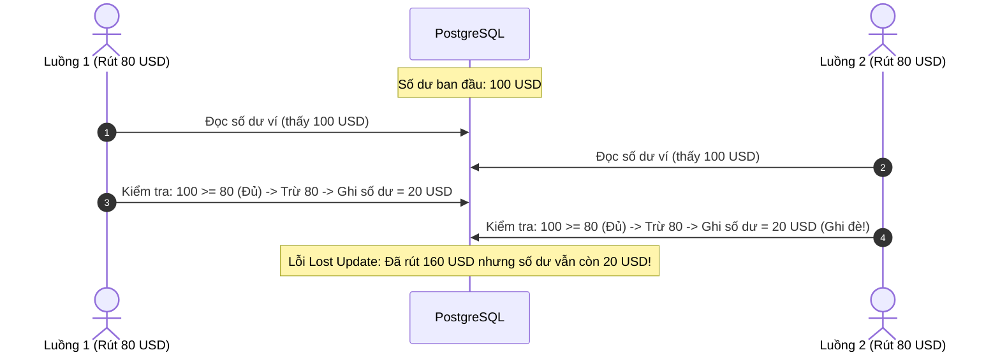
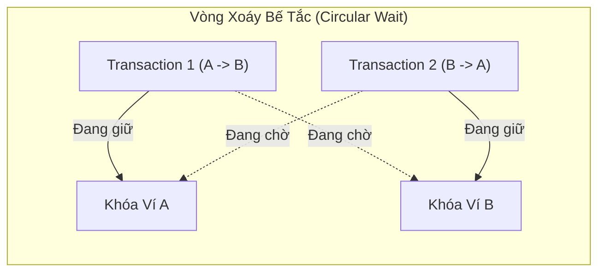
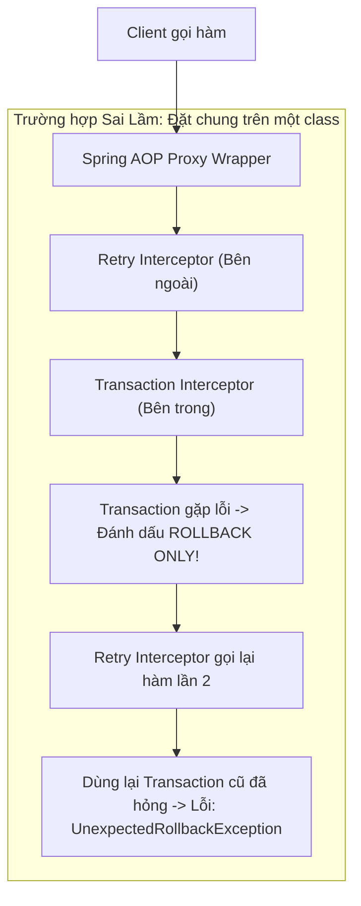
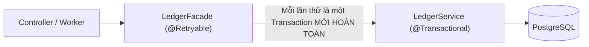

# Lý Thuyết Đồng Thời & Triệt Tiêu Deadlock (Concurrency & Deadlock Prevention)

Tài liệu phân tích chuyên sâu về các cấp độ cô lập ACID, cơ chế khóa dòng bi quan của cơ sở dữ liệu quan hệ, 4 điều kiện deadlock của Coffman, và kiến trúc AOP Proxy trong Spring Boot.

---

## Mục Lục
1. [Mô Hình Giao Dịch ACID & Mức Độ Cô Lập PostgreSQL](#1-mô-hình-giao-dịch-acid--mức-độ-cô-lập-postgresql)
2. [Khóa Bi Quan (Pessimistic Write Lock: `SELECT ... FOR UPDATE`)](#2-khóa-bi-quan-pessimistic-write-lock-select--for-update)
3. [Hiện Tượng Deadlock & 4 Điều Kiện Coffman (1971)](#3-hiện-tượng-deadlock--4-điều-kiện-coffman-1971)
4. [Triệt Tiêu Deadlock Bằng Sắp Xếp Thứ Tự Khóa (Deterministic Lock Ordering)](#4-triệt-tiêu-deadlock-bằng-sắp-xếp-thứ-tự-khóa-deterministic-lock-ordering)
5. [Kiến Trúc Spring AOP Proxy: Tách Biệt `@Retryable` & `@Transactional`](#5-kiến-trúc-spring-aop-proxy-tách-biệt-retryable--transactional)
6. [Tài Liệu Tham Khảo (References & Citations)](#6-tài-liệu-tham-khảo-references--citations)

---

## 1. Mô Hình Giao Dịch ACID & Mức Độ Cô Lập PostgreSQL

Trong hệ thống thanh toán ngân hàng, tính toàn vẹn của dữ liệu phụ thuộc vào nguyên tắc ACID:
- **Atomicity (Nguyên tử)**: Toàn bộ các bước (trừ tiền người gửi, cộng tiền người nhận, ghi sổ cái) đều thành công hoặc không bước nào được áp dụng (Rollback).
- **Consistency (Nhất quán)**: Dữ liệu luôn tuân theo các ràng buộc nghiệp vụ (không âm tiền, tổng giao dịch bằng 0).
- **Isolation (Cô lập)**: Các giao dịch diễn ra đồng thời không nhìn thấy trạng thái dở dang của nhau.
- **Durability (Bền vững)**: Khi đã commit thành công, dữ liệu được ghi xuống đĩa cứng và không bị mất ngay cả khi server mất điện đột ngột.

### Mức độ cô lập mặc định: Read Committed
PostgreSQL mặc định sử dụng mức cô lập **Read Committed**. 
Ở mức này, một câu lệnh SQL chỉ nhìn thấy các bản ghi đã commit trước khi câu lệnh đó bắt đầu chạy. Tuy nhiên, nếu hai luồng cùng đọc số dư là 100 USD rồi cùng trừ 80 USD, cả hai luồng đều nghĩ số dư đủ tiền, dẫn tới hiện tượng mất mát cập nhật (Lost Update) và số dư bị âm!



---

## 2. Khóa Bi Quan (Pessimistic Write Lock: `SELECT ... FOR UPDATE`)

Để giải quyết triệt để lỗi Lost Update trong thanh toán, hệ thống áp dụng kỹ thuật **Khóa bi quan độc quyền dòng (Pessimistic Row-Level Write Lock)**.

### Cơ chế hoạt động
Khi thực hiện truy vấn:
```sql
SELECT * FROM wallets WHERE id = 'wallet-A-uuid' FOR UPDATE;
```
PostgreSQL sẽ:
1. Đặt một khóa độc quyền (Exclusive Row Lock) trên bản ghi ví A trong bộ nhớ chia sẻ (Shared Memory).
2. Nếu có một luồng khác cũng gọi `SELECT ... FOR UPDATE` hoặc `UPDATE/DELETE` trên ví A, luồng đó sẽ bị chặn (Block) và chuyển sang trạng thái ngủ (Sleep/Waiting) cho đến khi giao dịch của luồng thứ nhất gọi `COMMIT` hoặc `ROLLBACK`.
3. Khi luồng thứ hai được đánh thức, nó được đọc lại bản ghi ví A đã cập nhật mới nhất.

---

## 3. Hiện Tượng Deadlock & 4 Điều Kiện Coffman (1971)

Mặc dù `SELECT ... FOR UPDATE` bảo vệ số dư không bị trừ sai, nó mở ra nguy cơ gặp phải **Deadlock** khi có nhiều giao dịch chuyển tiền qua lại giữa các ví cùng lúc.

### Nghiên cứu kinh điển của Edward G. Coffman Jr. (1971)
Trong bài báo khoa học nổi tiếng *"System Deadlocks"* (ACM Computing Surveys, 1971), Coffman và các cộng sự đã chứng minh rằng một Deadlock chỉ có thể xảy ra khi hội đủ **cả 4 điều kiện sau đây**:

1. **Mutual Exclusion (Độc quyền tài nguyên)**: Tài nguyên chỉ có thể được sở hữu bởi một tiến trình/luồng tại một thời điểm (Bản chất của row-level write lock).
2. **Hold and Wait (Giữ và chờ đợi)**: Một tiến trình đang giữ một tài nguyên và tiếp tục yêu cầu thêm tài nguyên mới mà tài nguyên đó đang bị tiến trình khác giữ.
3. **No Preemption (Không thể cướp đoạt)**: Cơ sở dữ liệu không thể ép buộc thu hồi khóa đang được giữ hợp lệ bởi một transaction khác (trừ khi bắn lỗi hủy giao dịch).
4. **Circular Wait (Chờ đợi vòng tròn)**: Tồn tại một chuỗi các tiến trình $\{P_1, P_2, \dots, P_n\}$ sao cho $P_1$ chờ tài nguyên của $P_2$, $P_2$ chờ tài nguyên của $P_3$, và $P_n$ chờ tài nguyên của $P_1$.



Khi Deadlock xảy ra, PostgreSQL có tiến trình nền `deadlock_timeout` (mặc định 1 giây). Sau 1 giây phát hiện vòng tròn chờ đợi, PostgreSQL buộc phải ném lỗi:
`ERROR: deadlock detected (SQLState: 40P01)` và tự động rollback một trong hai transaction.

---

## 4. Triệt Tiêu Deadlock Bằng Sắp Xếp Thứ Tự Khóa (Deterministic Lock Ordering)

Để không bao giờ để xảy ra Deadlock, chúng ta chỉ cần **bẻ gãy 1 trong 4 điều kiện của Coffman**. Điều kiện khả thi và thanh lịch nhất để triệt tiêu là **Circular Wait**.

### Kỹ thuật sắp xếp thứ tự tài nguyên (Ordered Resource Allocation)
Thuật toán do Dijkstra và Havender đề xuất: Nếu mọi tiến trình trong toàn hệ thống đều tuân thủ một trật tự xin cấp phát tài nguyên duy nhất, đồ thị quan hệ tài nguyên sẽ trở thành một **Đồ thị có hướng không chu trình (Directed Acyclic Graph - DAG)**. Đã là DAG thì về mặt toán học không thể tồn tại chu trình, tức là **Deadlock bị triệt tiêu 100%**.

Trong hệ thống chuyển tiền giữa Ví 1 và Ví 2:
1. Không quan tâm ai là người chuyển (Sender), ai là người nhận (Receiver).
2. Lấy chuỗi UUID của hai ví và so sánh thứ tự bảng chữ cái (Lexicographical Order):
   $$\text{firstLock} = \min(\text{UUID}_1, \text{UUID}_2)$$
   $$\text{secondLock} = \max(\text{UUID}_1, \text{UUID}_2)$$
3. Luôn luôn gọi `SELECT ... FOR UPDATE` với `firstLock` trước, rồi mới gọi `secondLock`.

```mermaid
flowchart TD
    START["Chuyển tiền giữa Ví A và Ví B"] --> CMP{"So sánh UUID: Ví A và Ví B"}
    CMP -->|UUID(A) < UUID(B)| PATH1["Luôn khóa Ví A trước -> Rồi mới khóa Ví B"]
    CMP -->|UUID(B) < UUID(A)| PATH2["Luôn khóa Ví B trước -> Rồi mới khóa Ví A"]
    PATH1 --> EXEC["Thực hiện giao dịch an toàn (Không bao giờ vòng tròn)"]
    PATH2 --> EXEC
```

---

## 5. Kiến Trúc Spring AOP Proxy: Tách Biệt `@Retryable` & `@Transactional`

Trong thực tế, ngoài deadlock ứng dụng, hệ thống phân tán vẫn có thể gặp các lỗi quá hạn khóa tạm thời (Lock Acquisition Timeout) hoặc ngắt kết nối mạng chập chờn. Giải pháp là cơ chế Thử lại (Retry Pattern).

Tuy nhiên, trong Spring Framework, một sai lầm chết người của lập trình viên là đặt chung hai annotation này trên cùng một hàm:
```java
// SAI LẦM NGUY HIỂM: Đặt chung trên cùng một hàm
@Service
public class LedgerService {
    @Retryable(retryFor = TransientException.class)
    @Transactional
    public void transferMoney(...) { ... }
}
```

### Tại sao lại sai? Bản chất Spring AOP Proxy
Spring quản lý Transaction và Retry bằng cách bọc Class của bạn trong một đối tượng trung gian gọi là **Dynamic Proxy**:



Nếu transaction gặp lỗi kết nối cơ sở dữ liệu hoặc bị đánh dấu `rollback-only`, việc gọi lại chính hàm đó bên trong cùng một phiên làm việc sẽ làm hỏng kết nối JDBC và ném lỗi `Transaction rolled back because it has been marked as rollback-only`.

### Kiến trúc chuẩn: Phân tách hai tầng Facade & Service
Giải pháp triệt để là tách làm hai Bean độc lập:



1. **`LedgerFacade`**: Đảm nhận tầng Retry. Nếu tầng dưới ném ra ngoại lệ thoáng qua (Transient Exception), Facade sẽ bắt lấy và khởi tạo một lần gọi mới.
2. **`LedgerService`**: Đảm nhận tầng Transaction. Mỗi lần được gọi từ Facade, một Transaction Spring mới tinh và một JDBC Connection độc lập được mở ra, bảo đảm trạng thái sạch sẽ tuyệt đối.

---

## 6. Tài Liệu Tham Khảo (References & Citations)

1. **Coffman, E. G., Elphick, M., & Shoshani, A.** (1971). *System Deadlocks*. ACM Computing Surveys (CSUR), 3(2), 67-78.
   - Bài báo khoa học gốc chứng minh 4 điều kiện dẫn tới Deadlock trong khoa học máy tính.
   - DOI: [10.1145/356586.356588](https://doi.org/10.1145/356586.356588)
2. **PostgreSQL Global Development Group.** (2024). *PostgreSQL Documentation - Chapter 13: Concurrency Control*.
   - Chi tiết về Transaction Isolation Levels, Row-Level Locks (`FOR UPDATE`), và Explicit Locking.
   - Đọc thêm tại: [PostgreSQL Concurrency Control](https://www.postgresql.org/docs/current/mvcc.html)
3. **Havender, J. W.** (1968). *Avoiding deadlock in multitasking systems*. IBM Systems Journal, 7(2), 74-84.
   - Tài liệu kinh điển đề xuất chiến lược loại bỏ Deadlock bằng cách áp đặt thứ tự tuyến tính trên tài nguyên (Ordered Resource Allocation).
4. **Spring Framework Documentation.** (2024). *Transaction Management & Aspect-Oriented Programming (AOP) Proxies*.
   - Giải thích cơ chế lồng Interceptor của Spring AOP và vòng đời của `@Transactional`.
   - Đọc thêm tại: [Spring Transaction Management](https://docs.spring.io/spring-framework/reference/data-access/transaction.html)
