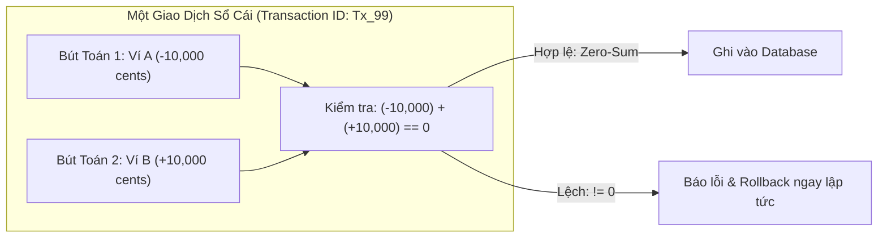
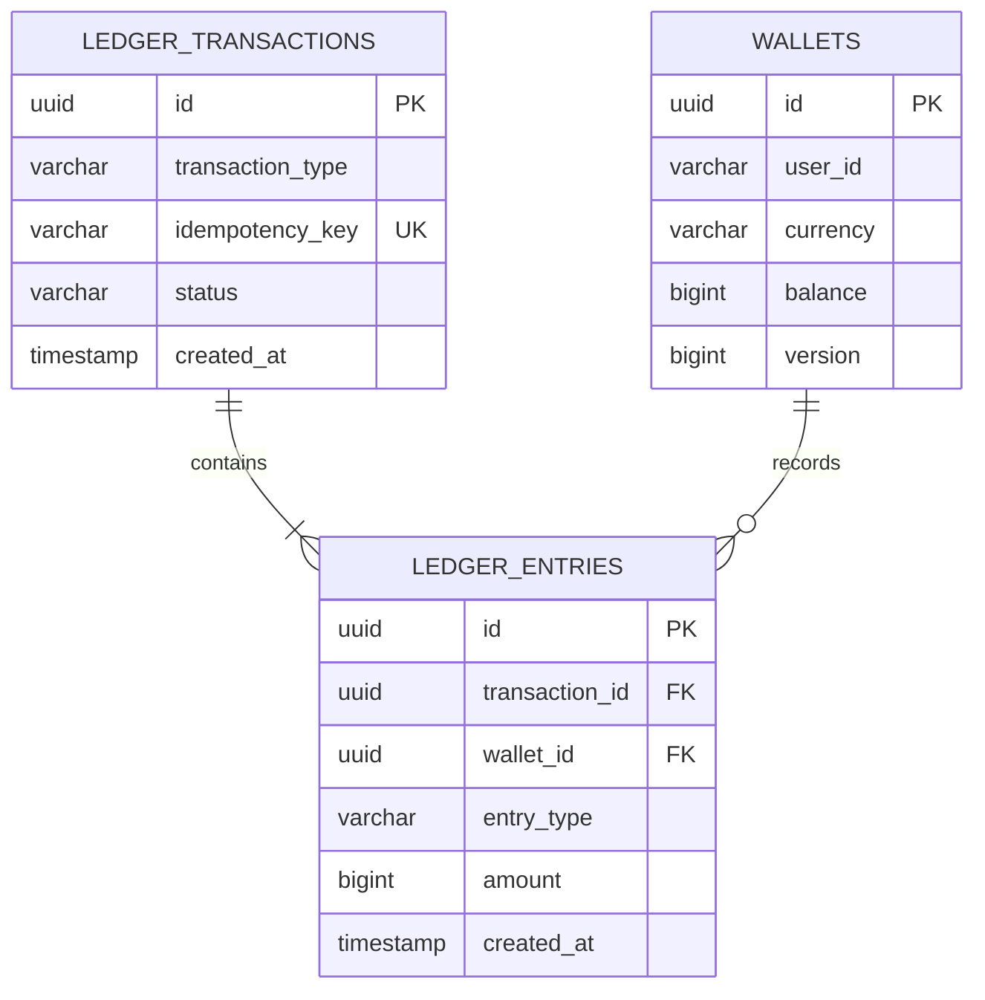

# Nguyên Lý Kế Toán Kép (Double-Entry Bookkeeping) & Bất Biến Sổ Cái (Ledger Invariants)

Tài liệu chuyên sâu phân tích cơ sở lý thuyết, nguồn gốc lịch sử, mô hình dữ liệu quan hệ, và các định luật bảo toàn giá trị được hiện thực hóa trong hệ thống `core-ledger-service`.

---

## Mục Lục
1. [Nguồn Gốc Lịch Sử & Bản Chất Kế Toán Kép](#1-nguồn-gốc-lịch-sử--bản-chất-kế-toán-kép)
2. [Định Luật Bảo Toàn Tiền Tệ (Conservation of Money)](#2-định-luật-bảo-toàn-tiền-tệ-conservation-of-money)
3. [Dòng Sự Kiện Bất Biến: Chỉ Ghi Thêm (Append-Only Event Stream)](#3-dòng-sự-kiện-bất-biến-chỉ-ghi-thêm-append-only-event-stream)
4. [Thiết Kế Cơ Sở Dữ Liệu: Transaction Headers & Line Entries](#4-thiết-kế-cơ-sở-dữ-liệu-transaction-headers--line-entries)
5. [Toán Tử Số Dư Tổng Hợp (Materialized Balance vs Calculated Balance)](#5-toán-tử-số-dư-tổng-hợp-materialized-balance-vs-calculated-balance)
6. [Tài Liệu Tham Khảo (References & Citations)](#6-tài-liệu-tham-khảo-references--citations)

---

## 1. Nguồn Gốc Lịch Sử & Bản Chất Kế Toán Kép

### Lịch sử
Phương pháp kế toán ghi sổ kép (Double-Entry Bookkeeping) được ghi chép và hệ thống hóa lần đầu tiên vào năm **1494** bởi tu sĩ dòng Franciscan kiêm nhà toán học người Ý **Fra Luca Bartolomeo de Pacioli** trong tác phẩm kinh điển *Summa de arithmetica, geometria, proportioni et proportionalita* (Venezia, 1494).

Trước khi có sổ kép, kế toán đơn thức (Single-entry) chỉ ghi nhận thu/chi một chiều. Nếu ghi nhầm hoặc gian lận một dòng, không ai phát hiện được trừ khi đi đếm lại toàn bộ tiền mặt trong kho.

### Bản chất
Nguyên lý cốt lõi của sổ kép: **Tiền không bao giờ tự nhiên sinh ra và cũng không bao giờ tự nhiên mất đi; nó chỉ chuyển dịch từ tài khoản này sang tài khoản khác**.

Mọi biến động tài chính đều là một giao dịch chuyển đổi giữa hai trạng thái:
- **Nguồn (Source)**: Nơi xuất phát của dòng tiền.
- **Đích (Destination)**: Nơi tiếp nhận dòng tiền.

Trong thuật ngữ kế toán quốc tế:
- **Nợ (Debit)**: Đại diện cho việc ghi tăng tài sản hoặc giảm nợ phải trả.
- **Có (Credit)**: Đại diện cho việc ghi giảm tài sản hoặc tăng nợ phải trả.

---

## 2. Định Luật Bảo Toàn Tiền Tệ (Conservation of Money)

Trong hệ thống máy tính ngân hàng, mỗi giao dịch tài chính (Financial Transaction) gồm ít nhất hai bút toán dòng (Entries): một dòng ghi âm/giảm và một dòng ghi dương/tăng.

### Bất biến số cái (Ledger Invariant)
Tổng đại số số tiền của tất cả các dòng bút toán trong cùng một giao dịch bắt buộc phải bằng đúng 0:

$$\sum_{i=1}^{n} \text{amount}_i = 0 \quad (\text{Zero-Sum Invariant})$$

Ví dụ về giao dịch chuyển khoản 100 USD (tương đương 10,000 cents) từ ví A sang ví B:

| Dòng Bút Toán | Tài Khoản / Ví | Loại Bút Toán | Số Tiền (Cents) | Diễn Giải |
|---|---|---|---|---|
| Dòng 1 | Ví A (Gửi) | DEBIT | -10,000 | Trừ tiền khỏi ví nguồn |
| Dòng 2 | Ví B (Nhận) | CREDIT | +10,000 | Cộng tiền vào ví đích |
| **Tổng Cộng** | | | **0** | **Cân bằng số cái tuyệt đối** |

Ví dụ về giao dịch nạp tiền qua cổng thanh toán thẻ (Top-up):
- Dòng 1: Tài khoản công nợ đối tác trung gian / Ngân hàng bảo trợ (Clearing Account) ghi `-50,000 cents`.
- Dòng 2: Ví số dư khách hàng ghi `+50,000 cents`.
- Tổng vẫn luôn bằng `0`.



---

## 3. Dòng Sự Kiện Bất Biến: Chỉ Ghi Thêm (Append-Only Event Stream)

### Điều cấm kỵ trong phần mềm tài chính
Trong thiết kế ứng dụng thông thường (CRUD), khi người dùng cập nhật thông tin, lập trình viên thường gọi lệnh `UPDATE` để ghi đè dữ liệu cũ.

**Trong kỹ thuật sổ cái tài chính, hành vi `UPDATE` hoặc `DELETE` dòng bút toán lịch sử bị cấm tuyệt đối.**

Lý do:
1. **Toàn vẹn kiểm toán (Auditability)**: Mọi con số trong quá khứ phải được giữ nguyên vẹn để phục vụ cơ quan thanh tra tài chính và kiểm toán độc lập.
2. **Không làm giả được lịch sử**: Nếu cho phép sửa dòng cũ, một lỗi phần mềm hoặc kẻ tấn công nội bộ có thể sửa số tiền giao dịch mà không để lại dấu vết.

### Cách xử lý sai sót: Bút toán đảo (Reversal Transaction)
Nếu một giao dịch bị ghi nhận nhầm, hệ thống không bao giờ xóa hoặc sửa giao dịch đó. Thay vào đó, một **Giao dịch đảo (Reversal Entry)** mới được sinh ra để bù trừ:

```
Giao dịch ban đầu (Tx 101):
  - Ví A: -10,000 cents
  - Ví B: +10,000 cents

Phát hiện nhầm lẫn, tạo Giao dịch đảo (Tx 102):
  - Ví A: +10,000 cents (hoàn tiền)
  - Ví B: -10,000 cents (thu hồi)
```

Kết quả: Toàn bộ lịch sử từ lúc sai cho đến lúc sửa chữa được thể hiện minh bạch, không mất mát một bit dữ liệu nào.

---

## 4. Thiết Kế Cơ Sở Dữ Liệu: Transaction Headers & Line Entries

Kiến trúc chuẩn của Martin Fowler trong mẫu *Accounting Patterns* chia sổ cái làm hai bảng quan hệ quan trọng:



### Bảng `ledger_transactions` (Header)
Đại diện cho sự kiện nghiệp vụ ở mức kinh doanh tổng thể (ví dụ: Chuyển tiền giữa bạn bè, Nạp tiền từ MoMo, Rút tiền về ngân hàng).
- Lưu giữ mã giao dịch duy nhất (`id`).
- Lưu khóa chống trùng lặp (`idempotency_key`) đảm bảo không bao giờ thực hiện một yêu cầu hai lần.
- Thời điểm phát sinh (`created_at`).

### Bảng `ledger_entries` (Lines / Postings)
Đại diện cho từng nhánh tác động lên từng ví riêng biệt.
- Khóa ngoại `transaction_id` trỏ về bảng header.
- Khóa ngoại `wallet_id` chỉ rõ tài khoản chịu tác động.
- Cột `amount`: Lưu số nguyên cents. Quy ước: Số âm biểu thị nguồn tiền đi ra, số dương biểu thị nguồn tiền đi vào.

---

## 5. Toán Tử Số Dư Tổng Hợp (Materialized Balance vs Calculated Balance)

Trong sổ cái kế toán thuần túy, một tài khoản thực chất không cần cột `balance`. Số dư của một ví tại thời điểm $T$ được định nghĩa bằng tổng tất cả các bút toán lịch sử từ lúc mở ví:

$$\text{Balance}(W, T) = \sum_{e \in \text{Entries}(W, t \le T)} e.\text{amount}$$

Tuy nhiên, nếu ví có 1,000,000 giao dịch, mỗi lần khách hàng kiểm tra số dư hoặc thanh toán một đơn hàng cà phê, database phải thực hiện hàm `SUM()` trên 1 triệu dòng, khiến CPU quá tải và độ trễ tăng vọt.

### Kỹ thuật Materialized Balance (Số dư hiện thời)
Để tối ưu tốc độ đọc thời gian thực (đáp ứng hàng chục nghìn lượt truy vấn mỗi giây với độ trễ dưới 5ms):
1. Bảng `wallets` lưu một cột `balance` đại diện cho giá trị tổng hợp hiện thời.
2. Mỗi lần có giao dịch mới:
   - Thêm các dòng vào `ledger_entries`.
   - Cập nhật số dư `balance = balance + amount` trong bảng `wallets`.
3. Hệ thống đối soát định kỳ (Reconciliation Job) sẽ quét và kiểm tra xem:
   $$\text{wallets.balance} \stackrel{?}{=} \sum \text{ledger\_entries.amount}$$
   Nếu hai con số này khớp nhau 100%, hệ thống đạt trạng thái toàn vẹn dữ liệu. Nếu có sai lệch, hệ thống phát tín hiệu cảnh báo khẩn cấp cho đội kỹ thuật.

---

## 6. Tài Liệu Tham Khảo (References & Citations)

1. **Pacioli, Luca.** (1494). *Summa de arithmetica, geometria, proportioni et proportionalita*. Venezia: Paganino Paganini.
   - Tài liệu gốc khai sinh ra hệ thống kế toán kép trên thế giới.
2. **Fowler, Martin.** (1997). *Analysis Patterns: Reusable Object Models*. Addison-Wesley Professional.
   - Chương 7: *Accounting Patterns* (Phân tích chi tiết mô hình Account, Entry, Transaction, và Two-legged Transactions).
   - Đọc thêm tại: [Martin Fowler - Accounting Patterns](https://martinfowler.com/eaaDev/AccountingNarrative.html)
3. **Kleppmann, Martin.** (2017). *Designing Data-Intensive Applications: The Big Ideas Behind Reliable, Scalable, and Maintainable Systems*. O'Reilly Media.
   - Chương 11: *Stream Processing - The Philosophy of Double-Entry Bookkeeping & Immutable Logs* (Giải thích tại sao log ghi thêm là nền tảng của hệ thống phân tán và bảo toàn dữ liệu).
4. **Stripe Engineering.** (2021). *Designing robust and predictable APIs with idempotency and ledger architecture*.
   - Khảo sát kiến trúc sổ cái bất biến quy mô toàn cầu của Stripe xử lý hàng tỷ USD mỗi ngày.
