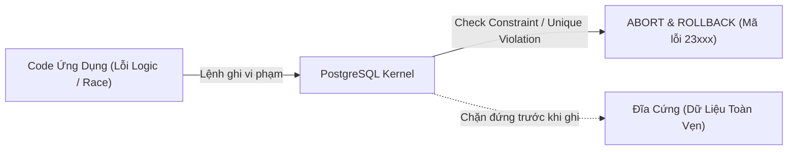
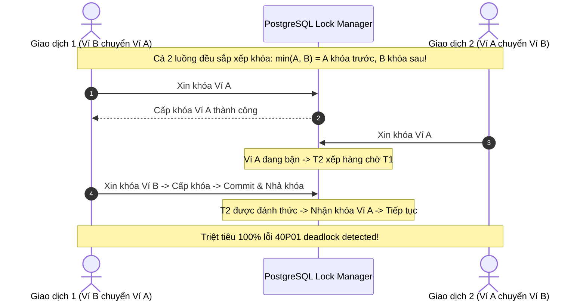

# Lý Thuyết PostgreSQL Áp Dụng Trong Core Ledger (PostgreSQL Engineering in Practice)

Tài liệu đúc kết toàn bộ các lý thuyết và cơ chế lõi của PostgreSQL được áp dụng trực tiếp trong hệ thống `core-ledger-service`. Nội dung được tinh gọn tối đa, tập trung vào bản chất động cơ bên dưới (under the hood), giải thích vì sao chọn giải pháp này (tradeoffs) để fresher nắm bắt nhanh và senior dễ dàng trao đổi kỹ thuật.

---

## Mục Lục
1. [Lý Thuyết Kiểu Dữ Liệu & Tối Ưu Lưu Trữ](#1-lý-thuyết-kiểu-dữ-liệu--tối-ưu-lưu-trữ)
2. [Hệ Thống Ràng Buộc Vật Lý (Database Invariants)](#2-hệ-thống-ràng-buộc-vật-lý-database-invariants)
3. [Lý Thuyết Đồng Thời: MVCC & Khóa Dòng Bi Quan](#3-lý-thuyết-đồng-thời-mvcc--khóa-dòng-bi-quan)
4. [Lý Thuyết Triệt Tiêu Deadlock (Deterministic Lock Ordering)](#4-lý-thuyết-triệt-tiêu-deadlock-deterministic-lock-ordering)
5. [Chiến Lược Chỉ Mục B-Tree & Streaming Scan](#5-chiến-lược-chỉ-mục-b-tree--streaming-scan)
6. [Sức Mạnh Xử Lý Tập Hợp (Set-Based Processing)](#6-sức-mạnh-xử-lý-tập-hợp-set-based-processing)
7. [Quản Trị Tài Nguyên & Fail-Fast Timeouts](#7-quản-trị-tài-nguyên--fail-fast-timeouts)
8. [Bảng Tra Cứu Lý Thuyết Cốt Lõi Dự Án](#8-bảng-tra-cứu-lý-thuyết-cốt-lõi-dự-án)

---

## 1. Lý Thuyết Kiểu Dữ Liệu & Tối Ưu Lưu Trữ

### 1.1 `BIGINT` Minor Units (Cents) vs `FLOAT` / `NUMERIC`
- **Lý thuyết**: Chuẩn dấu phẩy động nhị phân **IEEE 754** không thể biểu diễn chính xác phân số cơ số 10 (ví dụ: $0.1 + 0.2 \neq 0.3$). Kiểu `NUMERIC`/`DECIMAL` tuy chính xác nhưng lưu trữ dạng chuỗi byte biến thiên, tính toán bằng thuật toán phần mềm của database nên chậm hơn từ 10 đến 20 lần so với số nguyên.
- **Áp dụng trong dự án**:
  - Toàn bộ số tiền (`available_balance`, `ledger_balance`, `amount`) được quy đổi về **đơn vị nhỏ nhất (Minor Units / Cents)** và lưu bằng `BIGINT` (8 bytes cố định).
  - $1.00\text{ USD} = 100\text{ cents}$.
  - CPU thực thi trực tiếp bằng tập lệnh số học số nguyên phần cứng (Hardware Integer ALU): Tốc độ tính toán nhanh nhất, bộ nhớ cố định và triệt tiêu 100% sai số làm tròn.

### 1.2 Native `UUID` (16 bytes) vs `BIGSERIAL` (Auto-Increment)
- **Lý thuyết**: Auto-increment sequence $(1, 2, 3\dots)$ làm lộ tốc độ tăng trưởng kinh doanh (Enumeration Attack) và tạo rủi ro bảo mật ID đoán trước (BOLA / IDOR).
- **Áp dụng trong dự án**:
  - Dùng extension `pgcrypto` với hàm `gen_random_uuid()` sinh UUID v4 ngẫu nhiên mật mã học.
  - PostgreSQL lưu `UUID` bằng kiểu bản địa đúng **16 bytes**, tối ưu gấp đôi so với chuỗi `VARCHAR(36)` (tốn 37-40 bytes kèm chi phí xử lý bảng mã).

### 1.3 `TIMESTAMPTZ` (UTC Normalization) vs `TIMESTAMP`
- **Lý thuyết**: `TIMESTAMP` không lưu múi giờ, dẫn tới dữ liệu thời gian bị sai lệch khi server ứng dụng, client và database đặt ở các múi giờ khác nhau.
- **Áp dụng trong dự án**:
  - Cột `created_at`, `updated_at` dùng `TIMESTAMPTZ`.
  - PostgreSQL tự động chuyển đổi mọi mốc thời gian đầu vào về chuẩn giờ quốc tế **UTC** trước khi ghi vào đĩa, đảm bảo dữ liệu giao dịch toàn cầu có thứ tự thời gian chuẩn xác tuyệt đối.

---

## 2. Hệ Thống Ràng Buộc Vật Lý (Database Invariants)

Ứng dụng có thể có lỗi, nhưng cơ sở dữ liệu là phòng tuyến bảo vệ dữ liệu cuối cùng.



### 2.1 Ràng Buộc `CHECK` Số Dư Không Âm
- **Lý thuyết**: Ràng buộc toàn vẹn miền giá trị (Domain Integrity).
- **Áp dụng trong dự án**:
  ```sql
  CONSTRAINT chk_wallet_available_balance CHECK (wallet_type = 'SYSTEM' OR available_balance >= 0)
  ```
  Ngăn chặn triệt để nguy cơ người dùng tiêu âm tài khoản. Ngay cả khi code ứng dụng bị lỗi tính toán hoặc gặp race condition, kernel PostgreSQL lập tức từ chối lệnh với mã lỗi `23514 (check_violation)`.

### 2.2 Composite `UNIQUE` Thứ Tự Dòng Sổ Kép
- **Lý thuyết**: Tính toàn vẹn thực thể quan hệ (Entity Integrity).
- **Áp dụng trong dự án**:
  ```sql
  CONSTRAINT uq_ledger_entries_tx_line UNIQUE (transaction_id, line_no)
  ```
  Bảo đảm mỗi giao dịch sổ kép luôn gồm đúng 2 dòng: dòng 1 (Ghi nợ - DEBIT) và dòng 2 (Ghi có - CREDIT). Loại bỏ nguy cơ ghi trùng dòng bút toán trong cùng 1 giao dịch.

### 2.3 Ràng Buộc `UNIQUE` Với Giá Trị `NULL` (Chống Hoàn Tiền 2 Lần)
- **Lý thuyết**: Chuẩn ANSI SQL quy định `NULL != NULL`. Do đó một chỉ mục `UNIQUE` cho phép chứa vô hạn giá trị `NULL`, nhưng chỉ cho phép tối đa một giá trị cụ thể không phải `NULL`.
- **Áp dụng trong dự án**:
  ```sql
  CONSTRAINT uq_reversal_of_transaction UNIQUE (reversal_of_transaction_id)
  ```
  - Hàng triệu giao dịch thông thường có `reversal_of_transaction_id = NULL` cùng tồn tại an toàn.
  - Khi một giao dịch hoàn tiền được tạo, cột này mang UUID của giao dịch gốc. Ràng buộc `UNIQUE` lập tức kích hoạt, chặn đứng hoàn toàn kịch bản 2 nhân viên cùng bấm hoàn tiền cho 1 đơn hàng (Double-Reversal).

### 2.4 Khóa Ngoại `ON DELETE RESTRICT` (Append-Only Invariant)
- **Lý thuyết**: Toàn vẹn tham chiếu (Referential Integrity).
- **Áp dụng trong dự án**:
  Toàn bộ khóa ngoại từ `ledger_entries` trỏ về `wallets` và `ledger_transactions` đều cấu hình `ON DELETE RESTRICT`. Ngăn chặn bất kỳ lệnh `DELETE` vô tình nào làm mất dấu vết kiểm toán của dòng tiền.

---

## 3. Lý Thuyết Đồng Thời: MVCC & Khóa Dòng Bi Quan

### 3.1 Bản Chất MVCC Trong PostgreSQL
- **Lý thuyết**: Multi-Version Concurrency Control. Mỗi dòng trong bảng là một **Tuple** chứa hai trường ẩn:
  - `xmin`: Transaction ID tạo ra tuple.
  - `xmax`: Transaction ID xóa hoặc cập nhật tuple.
- **Hệ quả**: Câu lệnh `UPDATE` thực chất là **DELETE tuple cũ + INSERT tuple mới** (Write Amplification). Bảng sổ cái `ledger_entries` được thiết kế theo mô hình **Chỉ Ghi Thêm (Append-Only)** nên hoàn toàn không sinh ra dead tuples, giúp triệt tiêu hiện tượng phình to bảng (Table Bloat) và giảm tải cho tiến trình `Autovacuum`.

### 3.2 Khóa Bi Quan `SELECT ... FOR UPDATE`
- **Lý thuyết**: Pessimistic Concurrency Control (PCC).
- **Áp dụng trong dự án**:
  ```sql
  SELECT * FROM wallets WHERE id = :walletId FOR UPDATE;
  ```
  - Dưới tầng động cơ, PostgreSQL ghi Transaction ID hiện tại vào trường `xmax` của tuple trên trang đĩa 8KB và bật cờ `HEAP_XMAX_EXCL_LOCK`.
  - Khóa dòng không tốn RAM trong Lock Table (khóa được hàng triệu dòng mà không lo tràn bộ nhớ).
  - Các giao dịch đồng thời khác muốn sửa số dư dòng này buộc phải dừng lại chờ luồng trước hoàn tất (Commit/Rollback), triệt tiêu hoàn toàn lỗi **Lost Update** và **Double-Spending** (chi tiêu kép).

### 3.3 Tại Sao Chọn `Read Committed + FOR UPDATE` Thay Vì `Serializable`?
- Mức cô lập `Serializable` (SSI) kiểm tra lạc quan và tự động ném mã lỗi `40001 serialization_failure` khi có xung đột, ép ứng dụng phải viết logic retry phức tạp.
- Kết hợp `Read Committed` cùng `SELECT ... FOR UPDATE` cho phép các luồng xếp hàng tuần tự trong vài mili-giây tại tầng database, logic code đơn giản, không bị lỗi retry bất ngờ và thông lượng (throughput) đạt tối đa.

---

## 4. Lý Thuyết Triệt Tiêu Deadlock (Deterministic Lock Ordering)

### 4.1 Hiện Tượng Deadlock & 4 Điều Kiện Coffman (1971)
Deadlock chỉ xảy ra khi hội tụ đủ 4 điều kiện:
1. Loại trừ lẫn nhau (Mutual Exclusion).
2. Giữ và chờ tài nguyên (Hold and Wait).
3. Không thể trưng dụng khóa (No Preemption).
4. **Chờ đợi vòng tròn (Circular Wait)**.

### 4.2 Giải Pháp: Sắp Xếp Thứ Tự Khóa Theo UUID
Để loại bỏ điều kiện số 4 (Circular Wait), hệ thống chuẩn hóa thứ tự xin khóa hai tài khoản trước khi thực thi:

$$\text{Khóa lần 1: } \min(\text{UUID}_A, \text{UUID}_B) \longrightarrow \text{Khóa lần 2: } \max(\text{UUID}_A, \text{UUID}_B)$$



---

## 5. Chiến Lược Chỉ Mục B-Tree & Streaming Scan

### 5.1 Cấu Trúc B-Tree Index
- Cây B-Tree tự cân bằng (Lehman-Yao algorithm) giúp thời gian tìm kiếm đạt $O(\log N)$.
- Các node lá được liên kết đôi (Doubly-Linked List), tối ưu cho truy vấn duyệt khoảng (`BETWEEN`, `<`, `>`).

### 5.2 Composite Index `(wallet_id, created_at DESC)` Cho Sao Kê
- **Áp dụng trong dự án**:
  ```sql
  CREATE INDEX idx_ledger_entries_wallet_created ON ledger_entries(wallet_id, created_at DESC);
  ```
- **Bản chất kỹ thuật**:
  - Khi người dùng xuất sao kê lịch sử giao dịch: `WHERE wallet_id = :id ORDER BY created_at DESC LIMIT 20`.
  - Nhờ composite index đã sắp xếp sẵn theo `created_at DESC` cho từng `wallet_id`, PostgreSQL chỉ cần thực hiện **Index Scan** xuôi theo các node lá và lấy dữ liệu ra ngay.
  - Loại bỏ hoàn toàn thao tác sắp xếp tốn kém (`Sort / Top-N Heapsort`) trong bộ nhớ RAM, cho phép stream dữ liệu hàng triệu dòng mà chi phí bộ nhớ chỉ là $O(1)$.

---

## 6. Sức Mạnh Xử Lý Tập Hợp (Set-Based Processing)

### 6.1 Row-by-Row (Chậm) vs Set-Based (Tối Ưu)
- **Sai lầm phổ biến**: Tải toàn bộ ví vào RAM của Java rồi chạy vòng lặp `for` để tính tổng (gây tràn RAM và lỗi $N+1$ query).
- **Lý thuyết Quan Hệ (Relational Set Theory - E. F. Codd)**: Xử lý dữ liệu dưới dạng tập hợp trực tiếp tại database engine tận dụng bộ nhớ đệm chia sẻ và giải thuật gom nhóm bằng bảng băm (HashAggregate).

### 6.2 Truy Vấn Đối Soát Sổ Cái Hàng Đêm ($O(1)$ Network Overhead)
```sql
SELECT 
    w.id AS wallet_id,
    w.available_balance AS snapshot_balance,
    COALESCE(SUM(CASE WHEN le.entry_type = 'CREDIT' THEN le.amount ELSE -le.amount END), 0) AS calculated_balance
FROM wallets w
LEFT JOIN ledger_entries le ON w.id = le.wallet_id
GROUP BY w.id, w.available_balance
HAVING w.available_balance != COALESCE(SUM(CASE WHEN le.entry_type = 'CREDIT' THEN le.amount ELSE -le.amount END), 0);
```
- Mệnh đề `HAVING` lọc trực tiếp tại database. Nếu hệ thống cân bằng, kết quả trả về qua mạng là **0 dòng** (chỉ tốn vài bytes băng thông).
- Kiểm tra toàn bộ 1 triệu ví chỉ trong vài giây mà ứng dụng tiêu tốn gần như 0MB bộ nhớ RAM phụ trội.

---

## 7. Quản Trị Tài Nguyên & Fail-Fast Timeouts

### 7.1 Mô Hình Process-per-Connection & HikariCP
- PostgreSQL phân bổ một tiến trình độc lập (OS Process) chiếm 5-10MB RAM cho mỗi kết nối.
- Sử dụng **HikariCP** duy trì một pool nhỏ kết nối cố định (20-30 kết nối) thay vì mở hàng ngàn kết nối trực tiếp, giúp tránh cạn kiệt RAM và giảm chi phí chuyển đổi ngữ cảnh CPU (Context Switching).

### 7.2 Phòng Thủ Bằng Timeouts Tường Minh
Tránh hiện tượng giao dịch bị treo giữ khóa vĩnh viễn gây tê liệt hệ thống:
```properties
spring.datasource.hikari.connection-init-sql=SET statement_timeout = '5000'; SET lock_timeout = '3000';
```
- `lock_timeout = 3000` (3 giây): Nếu câu lệnh xin khóa bi quan phải đợi quá 3 giây, PostgreSQL tự động hủy lệnh và ném lỗi thay vì treo luồng ứng dụng.
- `statement_timeout = 5000` (5 giây): Ngắt cưỡng chế bất kỳ câu truy vấn báo cáo nào chạy vượt quá 5 giây, bảo vệ tài nguyên tính toán cho các giao dịch thanh toán trực tiếp.

---

## 8. Bảng Tra Cứu Lý Thuyết Cốt Lõi Dự Án

| Kỹ Thuật Áp Dụng | Bản Chất Lý Thuyết | Vấn Đề Thực Tế Giải Quyết |
| :--- | :--- | :--- |
| **`BIGINT` Minor Units** | Định dạng số thực IEEE 754 vs Số nguyên 64-bit ALU | Triệt tiêu 100% sai số làm tròn tiền tệ, tăng tốc phép toán số học. |
| **`TIMESTAMPTZ`** | Chuẩn hóa thời gian quốc tế UTC | Chống lệch múi giờ giao dịch giữa client và máy chủ. |
| **`CHECK (balance >= 0)`** | Ràng buộc toàn vẹn miền giá trị (Domain Integrity) | Chặn đứng việc tài khoản bị tiêu âm ở tầng lưu trữ vật lý. |
| **Nullable `UNIQUE`** | Ngữ nghĩa ANSI SQL: `NULL != NULL` | Chống hoàn tiền 2 lần (Double-Reversal) mà vẫn cho phép nhiều giao dịch gốc. |
| **`ON DELETE RESTRICT`** | Toàn vẹn tham chiếu (Referential Integrity) | Bảo đảm nguyên tắc sổ cái bất biến (Append-Only), chống mồ côi dòng sổ. |
| **`SELECT ... FOR UPDATE`** | Kiểm soát đồng thời bi quan (Pessimistic Concurrency) | Khóa dòng qua `xmax`, triệt tiêu lỗi Lost Update và Double-Spending. |
| **Sort `min/max` UUID** | Phá vỡ điều kiện Circular Wait của Coffman (1971) | Loại bỏ hoàn toàn mã lỗi Deadlock `40P01` trên PostgreSQL. |
| **Composite Index `(id, time DESC)`** | B-Tree Clustered Order & Index Scan | Loại bỏ nút `Sort` trong RAM, xuất sao kê dữ liệu lớn với bộ nhớ $O(1)$. |
| **`GROUP BY` + `HAVING`** | Lý thuyết tập hợp quan hệ (Relational Set-Based) | Đối soát toàn bộ số dư sổ cái trong 1 truy vấn duy nhất, không tốn RAM máy chủ. |
| **`lock_timeout = 3000`** | Nguyên lý Thất Bại Nhanh (Fail-Fast) | Ngăn chặn giao dịch treo giữ khóa làm cạn kiệt Connection Pool của ứng dụng. |
