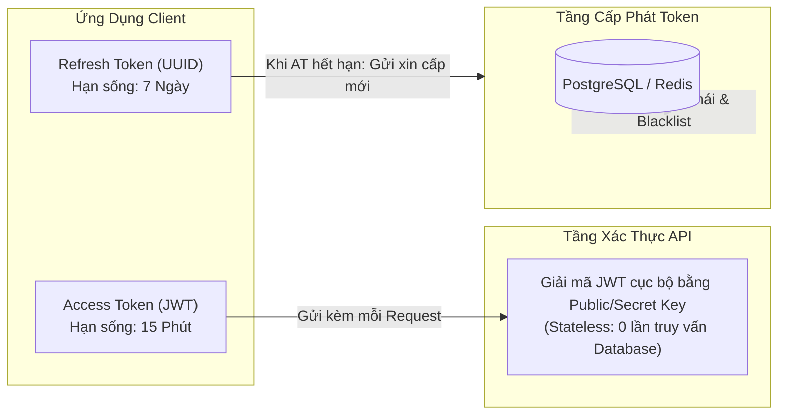
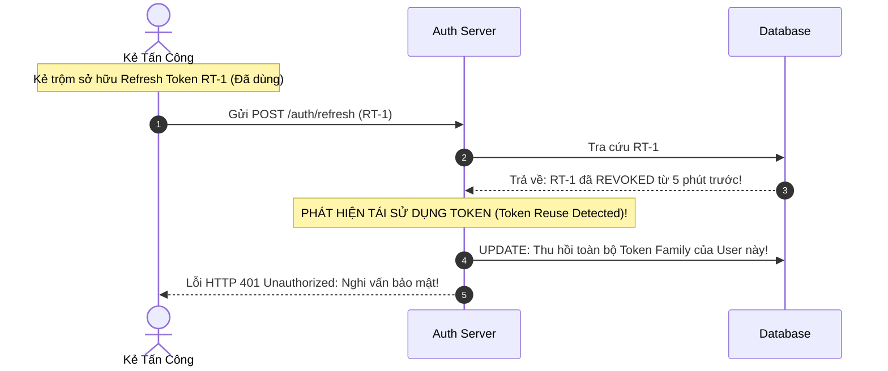

# An Ninh & Phân Quyền Trong Hệ Thống Tài Chính (Security, Authentication & Authorization)

Tài liệu phân tích chuyên sâu các mô hình an ninh mạng và mật mã ứng dụng trong `core-ledger-service`, bao gồm cơ chế băm mật khẩu thích ứng BCrypt, xoay vòng Refresh Token chống rò rỉ (RFC 6819), và phòng chống lỗ hổng BOLA (OWASP API Security Top 1).

---

## Mục Lục
1. [Lưu Trữ Mật Khẩu An Toàn: BCrypt Adaptive Hashing](#1-lưu-trữ-mật-khẩu-an-toàn-bcrypt-adaptive-hashing)
2. [Cơ Chế Xác Thực Kép: Access Token (Stateless) & Refresh Token (Stateful)](#2-cơ-chế-xác-thực-kép-access-token-stateless--refresh-token-stateful)
3. [Xoay Vòng Refresh Token & Phát Hiện Tái Sử Dụng (Token Rotation & Reuse Detection - RFC 6819)](#3-xoay-vòng-refresh-token--phát-hiện-tái-sử-dụng-token-rotation--reuse-detection---rfc-6819)
4. [Phòng Ngừa Lỗ Hổng BOLA / IDOR (OWASP API Security Top 1)](#4-phòng-ngừa-lỗ-hổng-bola--idor-owasp-api-security-top-1)
5. [Tài Liệu Tham Khảo (References & Citations)](#5-tài-liệu-tham-khảo-references--citations)

---

## 1. Lưu Trữ Mật Khẩu An Toàn: BCrypt Adaptive Hashing

### Vì sao MD5 và SHA-256 không thể dùng để lưu mật khẩu?
Các hàm băm như MD5, SHA-1, hay SHA-256 được thiết kế với mục tiêu **tính toán cực nhanh** cho việc kiểm tra toàn vẹn tập tin. Với phần cứng hiện đại (GPU, ASIC), một card đồ họa phổ thông có thể thử nghiệm hàng tỷ phép tính băm SHA-256 mỗi giây. Nếu cơ sở dữ liệu bị lộ, kẻ tấn công có thể bẻ khóa mật khẩu bằng tấn công từ điển (Dictionary Attack) hoặc Bảng cầu vồng (Rainbow Table) trong vài phút.

### Thuật toán BCrypt (Niels Provos & David Mazières - USENIX 1999)
BCrypt được xây dựng dựa trên thuật toán mã hóa khối Blowfish và sở hữu các đặc tính bảo vệ vượt trội:
1. **Muối ngẫu nhiên (Cryptographic Salt)**: Tự động sinh chuỗi muối 128-bit ngẫu nhiên cho mỗi mật khẩu. Hai người dùng có mật khẩu giống hệt nhau (`password123`) sẽ sinh ra hai chuỗi băm hoàn toàn khác biệt trong database, vô hiệu hóa 100% tấn công Rainbow Table.
2. **Hệ số chi phí thích ứng (Adaptive Work Factor / Cost)**: Cho phép điều chỉnh độ trễ tính toán bằng công thức $2^{\text{cost}}$ vòng lặp.
   - Khi phần cứng máy tính ngày càng nhanh hơn theo Định luật Moore, ta chỉ cần nâng `cost` (ví dụ từ 10 lên 12) để duy trì thời gian băm ở mức an toàn (~200ms - 500ms cho mỗi lần đăng nhập).
   - Với thời gian tính 200ms/lần, kẻ tấn công hoàn toàn bất khả thi khi muốn thử vét cạn (Brute-force) hàng tỷ mật khẩu.

```
Cấu trúc chuỗi băm BCrypt:
$2a$12$e8kZ1VjJ9X.L2wO5K3m2nOaB1c2D3e4F5g6H7i8J9k0L1m2N3o4P5
\_/ \_/ \____________________/\_____________________________/
 |   |            |                          |
Thuật Hệ số     Muối ngẫu nhiên         Giá trị băm mật mã
toán  chi phí     (22 ký tự)                 (31 ký tự)
```

---

## 2. Cơ Chế Xác Thực Kép: Access Token (Stateless) & Refresh Token (Stateful)

Để cân bằng giữa **hiệu năng cao** và **khả năng thu hồi quyền hạn ngay lập tức**, hệ thống áp dụng mô hình phân tách hai loại token:



1. **Access Token (JSON Web Token - RFC 7519)**:
   - Thời gian sống rất ngắn (ví dụ: 15 phút).
   - Chứa thông tin người dùng (`sub`, `roles`).
   - Các API Service chỉ cần giải mã chữ ký mật mã (Cryptographic Signature Verification) mà không cần truy vấn database, giúp giảm tải tối đa cho hệ thống.
2. **Refresh Token**:
   - Thời gian sống dài (ví dụ: 7 ngày).
   - Được lưu vết trong database (`refresh_tokens`).
   - Chỉ được dùng duy nhất tại endpoint `/api/v1/auth/refresh` để xin một Access Token mới khi cái cũ hết hạn.

---

## 3. Xoay Vòng Refresh Token & Phát Hiện Tái Sử Dụng (Token Rotation & Reuse Detection - RFC 6819)

### Rủi ro tiềm ẩn
Nếu một kẻ tấn công đánh cắp được Refresh Token từ thiết bị của người dùng, kẻ đó có thể liên tục xin Access Token mới và duy trì quyền truy cập trái phép vĩnh viễn.

### Giải pháp: Chuẩn bảo mật OAuth 2.0 Threat Model (RFC 6819 Mục 5.2.2.3)
Quy tắc **Refresh Token Rotation (RTR)**:
- Mỗi Refresh Token chỉ được sử dụng **đúng 1 lần duy nhất (Single-Use Token)**.
- Khi người dùng gọi endpoint Refresh, hệ thống thu hồi (Revoke) ngay Refresh Token cũ và phát hành một cặp token hoàn toàn mới.

### Cơ chế phát hiện tái sử dụng (Token Reuse Detection)
Nếu kẻ tấn công đánh cắp Refresh Token cũ và cố tình gọi API Refresh:
1. Hệ thống kiểm tra database và thấy Refresh Token này **đã từng được sử dụng trước đó**.
2. Hệ thống suy luận ngay lập tức: **Một trong hai bên (người dùng thật hoặc kẻ trộm) đang bị xâm nhập!**
3. **Phản ứng khẩn cấp (Panic Revocation)**: Hệ thống lập tức hủy bỏ (Revoke) toàn bộ cây gia đình token (Token Family) và đăng xuất người dùng khỏi tất cả các thiết bị ngay lập tức. Kẻ tấn công bị chặn đứng hoàn toàn.



---

## 4. Phòng Ngừa Lỗ Hổng BOLA / IDOR (OWASP API Security Top 1)

Lỗ hổng phân quyền cấp đối tượng bị phá vỡ (Broken Object Level Authorization - BOLA, trước đây gọi là Insecure Direct Object References - IDOR) liên tục giữ vị trí **Nguy hiểm số 1 trong bảng xếp hạng OWASP API Security Top 10**.

### Kịch bản tấn công BOLA
Kẻ tấn công Alice đăng nhập vào tài khoản của mình. Alice kiểm tra ví của mình qua API:
`GET /api/v1/wallets/11111111-1111-1111-1111-111111111111`

Sau đó, Alice tò mò sửa UUID trên đường dẫn URL thành UUID của Bob:
`GET /api/v1/wallets/22222222-2222-2222-2222-222222222222`

Nếu backend chỉ kiểm tra: *"Người gọi đã đăng nhập hay chưa?"* (Authentication) mà không kiểm tra *"Người gọi có phải chủ sở hữu của chiếc ví này không?"* (Authorization), Alice sẽ xem được toàn bộ số dư và lịch sử giao dịch bí mật của Bob!

### Tấm lá chắn bảo vệ trong Codebase
Trong `core-ledger-service`, mọi thao tác truy vấn tài nguyên nhạy cảm đều áp dụng cơ chế xác thực chủ quyền chặt chẽ (Ownership Verification):

```java
// Lấy ID người dùng từ Security Context đã được xác thực qua JWT
UUID currentUserId = SecurityUtils.getCurrentUserId();

// Bắt buộc truy vấn kết hợp cả ID tài nguyên VÀ ID chủ sở hữu
Wallet wallet = walletRepository.findById(walletId)
    .orElseThrow(() -> new ResourceNotFoundException("Ví không tồn tại"));

if (!wallet.getUserId().equals(currentUserId)) {
    // Không ném 403 Forbidden để tránh lộ sự tồn tại của ID, ném 404 hoặc 403 tùy chính sách
    throw new AccessDeniedException("Bạn không có quyền truy cập ví này");
}
```

---

## 5. Tài Liệu Tham Khảo (References & Citations)

1. **Provos, Niels, & Mazières, David.** (1999). *A Future-Adaptable Password Scheme*. Proceedings of the FREENIX Track: 1999 USENIX Annual Technical Conference.
   - Tài liệu gốc khai sinh thuật toán băm mật khẩu BCrypt.
   - Link: [USENIX 1999 Paper on BCrypt](https://www.usenix.org/legacy/publications/library/proceedings/usenix99/provos.html)
2. **Lodderstedt, T., McGloin, M., & Hunt, P.** (2013). *RFC 6819: OAuth 2.0 Threat Model and Security Considerations*. Internet Engineering Task Force (IETF).
   - Mục 5.2.2.3: *Refresh Token Rotation* (Khuyến nghị chuẩn mực toàn cầu về xoay vòng Refresh Token và thu hồi khi bị tái sử dụng).
   - Link: [RFC 6819 Section 5.2.2.3](https://www.rfc-editor.org/rfc/rfc6819#section-5.2.2.3)
3. **Jones, M., Bradley, J., & Sakimura, N.** (2015). *RFC 7519: JSON Web Token (JWT)*. Internet Engineering Task Force (IETF).
   - Bản đặc tả kỹ thuật chuẩn về định dạng, cấu trúc chữ ký mật mã của JSON Web Token.
   - Link: [RFC 7519](https://www.rfc-editor.org/rfc/rfc7519)
4. **OWASP Foundation.** (2023). *OWASP Top 10 API Security Risks - API1:2023 Broken Object Level Authorization (BOLA)*.
   - Hướng dẫn nhận diện và phòng ngừa lỗ hổng phân quyền đối tượng phổ biến nhất trên các API hiện đại.
   - Link: [OWASP API Security Top 10 - BOLA](https://owasp.org/API-Security/editions/2023/en/0xa1-broken-object-level-authorization/)
