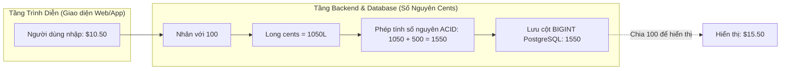
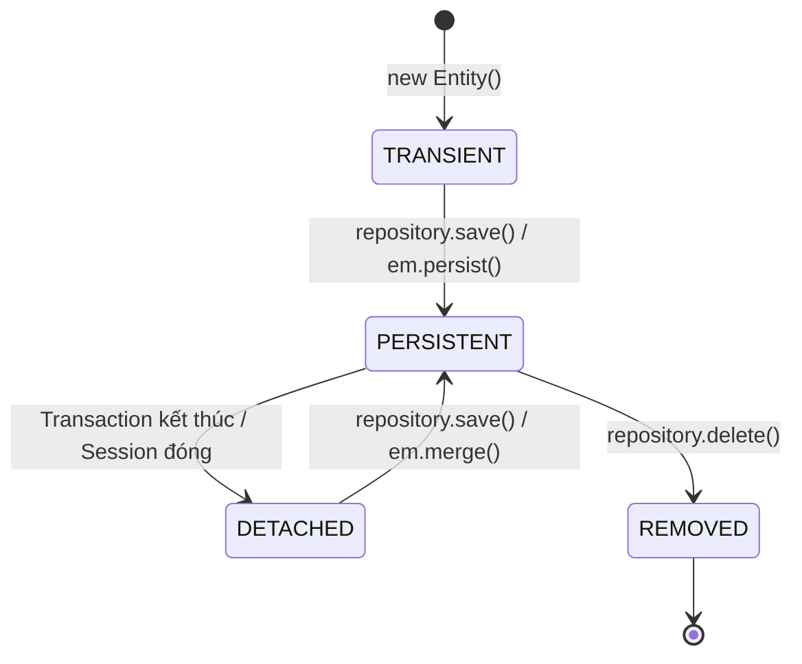
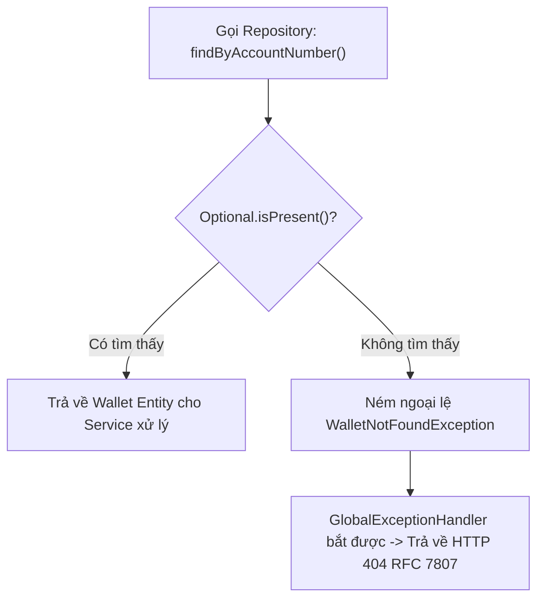
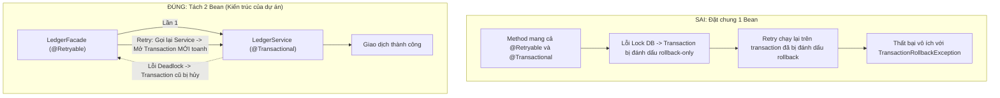

# Nền Tảng Kỹ Thuật: Java 21 & Spring Boot Core Foundations

Tài liệu tổng hợp những khái niệm lập trình và kiến trúc cốt lõi nhất trong hệ thống Mini Digital Wallet, được giải thích bằng ngôn ngữ trực quan để các lập trình viên mới (Fresher / Junior) hiểu sâu bản chất "Tại sao lại phải viết như thế này?".

---

## Mục Lục
1. [Lưu Trữ Tiền Tệ: IEEE 754 vs Số Nguyên `Long` Cents](#1-lưu-trữ-tiền-tệ-ieee-754-vs-số-nguyên-long-cents)
2. [Java 21 `record`: Tính Bất Biến & An Toàn Đa Luồng](#2-java-21-record-tính-bất-biến--an-toàn-đa-luồng)
3. [Vòng Đời Entity Trong Hibernate & Khóa Lạc Quan (@Version)](#3-vòng-đời-entity-trong-hibernate--khóa-lạc-quan-version)
4. [Spring Data JPA & Nguyên Tắc Không Trả Về Null (`Optional<T>`)](#4-spring-data-jpa--nguyên-tắc-không-trả-về-null-optionalt)
5. [Kiểm Tra Dữ Liệu Đầu Vào (Fail-Fast) & Chuẩn Hóa Lỗi RFC 7807](#5-kiểm-tra-dữ-liệu-đầu-vào-fail-fast--chuẩn-hóa-lỗi-rfc-7807)
6. [Vì Sao `@Retryable` Phải Tách Riêng Khỏi `@Transactional`?](#6-vì-sao-retryable-phải-tách-riêng-khỏi-transactional)
7. [Sắp Xếp Thứ Tự Khóa Để Triệt Tiêu Deadlock (Deterministic Lock Ordering)](#7-sắp-xếp-thứ-tự-khóa-để-triệt-tiêu-deadlock-deterministic-lock-ordering)
8. [Tài Liệu Tham Khảo (References & Citations)](#8-tài-liệu-tham-khảo-references--citations)

---

## 1. Lưu Trữ Tiền Tệ: IEEE 754 vs Số Nguyên `Long` Cents

### Câu chuyện ngoài đời
Giả sử bạn ra tiệm tạp hóa mua 3 cái kẹo, mỗi cái giá 0.10 USD.
Người bán hàng tính nhẩm: `0.1 + 0.1 + 0.1 = 0.30` đô la.
Nhưng nếu bạn viết bằng Java dùng kiểu số thực `double`:
```java
System.out.println(0.1 + 0.1 + 0.1);
// Kết quả in ra màn hình: 0.30000000000000004
```
Nếu câu lệnh rẽ nhánh kiểm tra: `if (balance == 0.30)` thì biểu thức sẽ trả về `false`! Cứ mỗi lần cộng trừ qua lại, vài phần tỷ đô la bị dư ra hoặc mất đi. Với hàng triệu giao dịch mỗi ngày, ngân hàng sẽ bị lệch sổ sách hàng nghìn đô la.

### Bản chất khoa học máy tính
Máy tính chỉ hiểu hệ nhị phân (0 và 1). Chuẩn IEEE 754 biểu diễn số thực bằng 3 thành phần: bit dấu (sign), số mũ (exponent) và phần định trị (mantissa).
Tương tự như phân số $1/3$ trong hệ thập phân là $0.33333...$ vô hạn tuần hoàn, thì con số $0.1$ trong hệ nhị phân cũng là một chuỗi vô hạn:
$$0.0001100110011..._2$$
Khi bị cắt gọn trong 64-bit (kiểu `double`), chắc chắn sẽ sinh ra sai số làm tròn (rounding error).

### Giải pháp trong hệ thống
1. **Quy đổi toàn bộ số tiền sang đơn vị nhỏ nhất (Minor Units)**:
   - Với đồng USD, đơn vị nhỏ nhất là **Cent** (1.00 USD = 100 cents).
   - Số tiền 10.50 USD được lưu trữ dưới dạng số nguyên `1050`.
2. **Kiểu dữ liệu**: `java.lang.Long` (Số nguyên có dấu 64-bit).
   - Giá trị tối đa: $2^{63} - 1 \approx 9.22 \times 10^{18}$ cents (hơn 92 tỷ tỷ USD). Không bao giờ lo tràn số.
3. **Quy tắc tính toán**:
   - 100% phép tính trong database và backend là phép cộng trừ số nguyên chính xác tuyệt đối.
   - Chỉ chuyển đổi sang số thập phân ở tầng giao diện (Web UI / Mobile App) bằng cách chia cho 100 để người dùng dễ nhìn.



> **[Hành Động]**: Dùng `Long` minor units (cents) cho mọi trường liên quan đến số dư và số tiền.  
> **[Lý Thuyết]**: Chuẩn số thực dấu phẩy động nhị phân IEEE 754.  
> **[Mẫu Thiết Kế]**: Value Object Pattern (`Money`).  
> **[Thảm Họa Tránh Được]**: Mất tiền và lệch cân bằng sổ kép do tích lũy sai số làm tròn nhị phân.  
> **[Phỏng Vấn TL;DR]**: "Máy tính không thể biểu diễn chính xác phân số thập phân như 0.1 bằng hệ nhị phân. Lưu trữ tiền bằng số nguyên cents đảm bảo tính toán số học chính xác tuyệt đối."

---

## 2. Java 21 `record`: Tính Bất Biến & An Toàn Đa Luồng

### Vấn đề thường gặp
Các lập trình viên thường quen tay dùng `@Data` của Lombok trên mọi class. Điều này làm cho mọi thuộc tính đều có thể bị thay đổi (mutable) bằng hàm `setter`:
```java
// Nguy hiểm: Một service khác có thể vô tình sửa đổi giá trị
request.setAmount(999999);
```
Trong môi trường đa luồng (multi-threading), nếu hai luồng cùng chia sẻ một object và một luồng sửa đổi dữ liệu, luồng còn lại sẽ đọc ra dữ liệu sai (Race Condition), cực kỳ khó tái hiện để debug.

### Giải pháp với Java 21 `record`
`record` là tính năng của Java hiện đại được thiết kế chuyên biệt để làm **Vật chứa dữ liệu bất biến (Immutable Data Carrier)**:
- Tất cả các trường được tự động đánh dấu là `private final`.
- Không có hàm `setter`.
- Tự động sinh constructor đầy đủ, hàm đọc giá trị (`field()`), `equals()`, `hashCode()` và `toString()`.
- Hỗ trợ **Compact Constructor** để kiểm tra tính hợp lệ ngay khi đối tượng vừa được sinh ra:

```java
public record CreateWalletRequest(
    String currency
) {
    public CreateWalletRequest {
        if (currency == null || !currency.matches("^[A-Z]{3}$")) {
            throw new IllegalArgumentException("currency phải gồm đúng 3 chữ cái in hoa");
        }
    }
}
```

> **[Hành Động]**: Dùng `record` thay cho class thông thường trên tất cả các DTO request và response.  
> **[Lý Thuyết]**: Immutable Object Pattern & Thread Safety.  
> **[Mẫu Thiết Kế]**: Data Transfer Object (DTO) Pattern.  
> **[Thảm Họa Tránh Được]**: Bị đột biến trạng thái ngoài ý muốn khi truyền tham chiếu qua nhiều tầng service.  
> **[Phỏng Vấn TL;DR]**: "Record đảm bảo tính bất biến nông, giúp code an toàn 100% trong môi trường đa luồng và loại bỏ hoàn toàn boilerplate code thừa."

---

## 3. Vòng Đời Entity Trong Hibernate & Khóa Lạc Quan (@Version)

### Vòng đời của một Entity trong Hibernate
Khi làm việc với Spring Data JPA và Hibernate, mỗi entity đều đi qua 4 trạng thái:



1. **Transient**: Đối tượng mới được tạo bằng từ khóa `new`, chưa có ID và chưa hề được Hibernate quản lý.
2. **Persistent**: Đối tượng đang nằm trong phạm vi một `@Transactional`.
   - **Cơ chế Dirty Checking cực kỳ quan trọng**: Bạn không cần gọi `repository.save(wallet)` sau khi thay đổi thuộc tính. Trước khi commit transaction, Hibernate tự động so sánh trạng thái hiện tại với bản snapshot lúc đầu đọc lên; nếu có thay đổi, nó sẽ tự động tạo câu lệnh `UPDATE` gửi xuống cơ sở dữ liệu.
3. **Detached**: Transaction đã hoàn tất, connection được trả về connection pool. Entity vẫn mang ID nhưng không còn được Hibernate theo dõi nữa.
4. **Removed**: Entity được đánh dấu để xóa khỏi cơ sở dữ liệu khi transaction commit.

### Lưu Enum An Toàn: `STRING` vs `ORDINAL`
- JPA mặc định lưu enum theo vị trí số (`ORDINAL`: 0, 1, 2...). Nếu ai đó chèn một giá trị enum mới vào giữa danh sách, toàn bộ số liệu cũ trong database sẽ bị hiểu sai hoàn toàn!
- **Quy tắc bắt buộc**: Luôn khai báo `@Enumerated(EnumType.STRING)` để lưu trực tiếp chuỗi chữ (`ACTIVE`, `FROZEN`, `CLOSED`).

### Khóa Lạc Quan (Optimistic Concurrency Control với `@Version`)
Khi hai người quản trị viên cùng mở màn hình xem ví và cùng muốn cập nhật trạng thái ví tại cùng một thời điểm:
- Không cần phải khóa cứng cả bảng dữ liệu.
- Entity `Wallet` có trường `@Version private Long version;`.
- Khi Hibernate chạy câu lệnh UPDATE:
  $$\text{UPDATE wallets SET status = 'FROZEN', version = 2 WHERE id = ? AND version = 1}$$
- Nếu người quản trị thứ nhất đã update trước (đẩy version lên 2), câu lệnh của người thứ hai sẽ tìm không thấy dòng nào có `version = 1`. Hibernate sẽ lập tức ném lỗi `OptimisticLockException` để cảnh báo dữ liệu đã bị thay đổi bởi người khác.

> **[Hành Động]**: Khai báo `@Version` trên `Wallet` và `@Enumerated(EnumType.STRING)` trên mọi trường Enum.  
> **[Lý Thuyết]**: Optimistic Concurrency Control (OCC).  
> **[Mẫu Thiết Kế]**: Version Number Pattern.  
> **[Thảm Họa Tránh Được]**: Mất cập nhật (Lost Update) khi nhiều người cùng sửa metadata của ví.  
> **[Phỏng Vấn TL;DR]**: "Khóa lạc quan phát hiện xung đột sửa đổi thông qua số phiên bản mà không cần giữ khóa trên database, giúp hệ thống đạt throughput cao với các thao tác ít tranh chấp."

---

## 4. Spring Data JPA & Nguyên Tắc Không Trả Về Null (`Optional<T>`)

### Dynamic Proxy trong Spring Data
Khi bạn khai báo một method trong interface mà không cần viết một dòng mã thực thi nào:
```java
public interface WalletRepository extends JpaRepository<Wallet, UUID> {
    Optional<Wallet> findByAccountNumber(String accountNumber);
}
```
Spring Data sử dụng cơ chế **Java Dynamic Proxy** lúc khởi động ứng dụng. Nó phân tích tên hàm thành cây cú pháp (AST) và tự động sinh ra câu lệnh SQL tương ứng xuống PostgreSQL.

### Nguyên tắc phòng ngừa Lỗi Tỷ Đô (The Billion-Dollar Mistake)
Nhà khoa học máy tính Sir Tony Hoare - người phát minh ra giá trị `null` năm 1965 - đã gọi đây là "Sai lầm trị giá một tỷ đô la" vì nó là nguyên nhân gây ra hàng triệu vụ crash hệ thống trên toàn thế giới (`NullPointerException`).

Trong dự án này, chúng ta áp dụng nguyên tắc nghiêm ngặt:
- **Không bao giờ trả về `null` từ Repository hoặc Service**.
- Mọi câu truy vấn tìm kiếm một đối tượng bắt buộc trả về `Optional<T>`.
- Phía gọi hàm bắt buộc phải xử lý tình huống không tìm thấy dữ liệu trước khi sử dụng:
```java
Wallet wallet = walletRepository.findByAccountNumber(accountNumber)
    .orElseThrow(() -> new WalletNotFoundException("Không tìm thấy ví: " + accountNumber));
```



> **[Hành Động]**: Bắt buộc trả về `Optional<T>` trên tất cả các hàm trả về một đối tượng.  
> **[Lý Thuyết]**: Functional Null Handling (Monadic Optional).  
> **[Mẫu Thiết Kế]**: Null Object / Optional Pattern.  
> **[Thảm Họa Tránh Được]**: Sập ứng dụng do lỗi bất ngờ `NullPointerException` ở giữa luồng nghiệp vụ.

---

## 5. Kiểm Tra Dữ Liệu Đầu Vào (Fail-Fast) & Chuẩn Hóa Lỗi RFC 7807

### Kiểm tra ngay tại biên giới (Fail-Fast Boundary Validation)
Mọi dữ liệu mà Client gửi lên qua HTTP đều là dữ liệu chưa được tin cậy (Untrusted Input).
Thay vì để dữ liệu sai lọt sâu vào tận tầng Service hay Database mới biết, chúng ta phải chặn lại ngay lập tức tại tầng Controller (Fail-Fast):
- `@NotBlank`: Không được null, không rỗng, không chỉ chứa toàn dấu cách.
- `@Positive`: Số tiền bắt buộc phải $> 0$.
- `@Pattern(regexp = "^[0-9]{12}$")`: Số tài khoản phải đúng 12 chữ số.

### Chuẩn Hóa Báo Lỗi Theo RFC 7807 (Problem Details)
Mỗi công ty thường tự thiết kế format báo lỗi JSON khác nhau, làm cho các đối tác và client rất khó tích hợp. Hệ thống của chúng ta áp dụng chuẩn **RFC 7807 Problem Details** của IETF:

```json
{
  "type": "https://minidigitalwallet.com/errors/insufficient-funds",
  "title": "Insufficient Balance",
  "status": 400,
  "detail": "Ví WAL_123 không đủ số dư. Hiện có: 5000 cents, yêu cầu: 10000 cents",
  "instance": "/api/v1/transfers/withdraw"
}
```

Toàn bộ ngoại lệ được gom về xử lý tập trung tại một nơi duy nhất: `@RestControllerAdvice` trong `GlobalExceptionHandler`. Không cần phải viết các khối `try-catch` lặp đi lặp lại trong từng Controller.

---

## 6. Vì Sao `@Retryable` Phải Tách Riêng Khỏi `@Transactional`?

Một câu hỏi phỏng vấn rất hay: *"Tại sao không gắn thẳng `@Retryable` lên hàm `@Transactional executeTransfer` trong `LedgerServiceImpl` cho gọn mà phải tạo thêm class `LedgerFacade`?"*.

### Lý do kỹ thuật cốt lõi
Cả hai annotation này đều hoạt động dựa trên cơ chế **Spring AOP Proxy** (một lớp vỏ bọc bên ngoài method).
1. Khi database xảy ra lỗi Deadlock, PostgreSQL sẽ ngắt câu lệnh và báo mã lỗi `40P01`.
2. Tầng `TransactionInterceptor` của Spring lập tức đánh dấu transaction đó là **Rollback-Only** (Transaction này đã chết, không thể commit được nữa).
3. Nếu `@Retryable` nằm cùng trên một method với `@Transactional`:
   - Spring sẽ thực hiện lần thử lại (Retry) **trên chính transaction đã chết đó**.
   - Kết quả là mọi lần retry đều thất bại ngay lập tức với lỗi `TransactionRollbackException`.
4. Khi tách thành hai Bean riêng biệt:
   - `LedgerFacade` nằm ngoài, chỉ giữ `@Retryable`.
   - `LedgerServiceImpl` nằm trong, chỉ giữ `@Transactional`.
   - Khi Service ném lỗi deadlock ra ngoài, transaction cũ bị hủy hoàn toàn. Facade bắt được lỗi và gọi lại Service, Spring sẽ mở một transaction mới toanh với database connection sạch sẽ.



> **[Hành Động]**: Đặt `@Retryable` trên `LedgerFacade` và `@Transactional` trên `LedgerService`.  
> **[Lý Thuyết]**: Spring AOP Proxy Lifecycle & Transaction Propagation.  
> **[Mẫu Thiết Kế]**: Facade Pattern kết hợp Retry Pattern.  
> **[Thảm Họa Tránh Được]**: Thực hiện retry vô ích trên connection đã bị hỏng.

---

## 7. Sắp Xếp Thứ Tự Khóa Để Triệt Tiêu Deadlock (Deterministic Lock Ordering)

### Hiện tượng Deadlock xảy ra khi nào?
Nhà khoa học máy tính Edward G. Coffman Jr. đã chỉ ra rằng Deadlock chỉ xảy ra khi hội đủ 4 điều kiện:
1. Độc quyền tài nguyên (Mutual Exclusion).
2. Giữ và chờ đợi tài nguyên tiếp theo (Hold and Wait).
3. Không thể cướp đoạt tài nguyên (No Preemption).
4. **Chờ đợi vòng tròn (Circular Wait)**: Luồng 1 giữ A chờ B, Luồng 2 giữ B chờ A.

### Giải pháp triệt để
Trong hệ thống chuyển tiền giữa 2 ví, chúng ta không thể bỏ điều kiện độc quyền (vì cập nhật tiền bắt buộc phải khóa). Nhưng chúng ta có thể **bẻ gãy hoàn toàn điều kiện Chờ đợi vòng tròn (Circular Wait)**.

Quy tắc cực kỳ đơn giản:
- Khi chuyển tiền giữa ví A và ví B, không quan tâm ai là người gửi, ai là người nhận.
- So sánh mã UUID của 2 ví theo thứ tự từ điển:
  `Khóa Thứ Nhất = min(UUID_A, UUID_B), Khóa Thứ Hai = max(UUID_A, UUID_B)`
- Cả hai luồng đều bắt buộc phải xin khóa ví có UUID nhỏ hơn trước, sau đó mới được xin khóa ví lớn hơn.
- Đồ thị chờ đợi tài nguyên biến thành **Đồ thị có hướng không chu trình (Directed Acyclic Graph - DAG)**. Deadlock về mặt lý thuyết bị triệt tiêu 100%!

```mermaid
flowchart TD
    REQ["Yêu cầu chuyển tiền: Ví A <-> Ví B"] --> COMP{"So sánh UUID(A) và UUID(B)"}
    COMP -->|UUID(A) < UUID(B)| ORDER1["Khóa Ví A trước -> Khóa Ví B sau"]
    COMP -->|UUID(B) < UUID(A)| ORDER2["Khóa Ví B trước -> Khóa Ví A sau"]
    ORDER1 --> RUN["Thực hiện Debit & Credit dưới khóa"]
    ORDER2 --> RUN
    RUN --> COMMIT["Commit Transaction & Nhả Khóa"]
```

> **[Hành Động]**: Sắp xếp thứ tự xin khóa `min(A, B) -> max(A, B)` trước khi gọi `SELECT ... FOR UPDATE`.  
> **[Lý Thuyết]**: Coffman's Deadlock Conditions & Directed Acyclic Graph (DAG).  
> **[Mẫu Thiết Kế]**: Deterministic Resource Allocation / Ordered Locking.  
> **[Thảm Họa Tránh Được]**: Treo toàn bộ hệ thống database khi khách hàng chuyển tiền qua lại tấp nập vào giờ cao điểm.

---

## 8. Tài Liệu Tham Khảo (References & Citations)

1. **IEEE Computer Society.** (2019). *IEEE Standard for Floating-Point Arithmetic (IEEE Std 754-2019)*. IEEE.
   - Tiêu chuẩn định dạng số thực dấu phẩy động nhị phân và nguyên nhân gây sai số làm tròn trong máy tính.
   - DOI: [10.1109/IEEESTD.2019.8766229](https://doi.org/10.1109/IEEESTD.2019.8766229)
2. **OpenJDK / Oracle.** (2020). *JEP 395: Records (Java 21)*.
   - Đặc tả chuẩn của Java Platform về lớp dữ liệu bất biến (Immutable Data Classes).
   - Link: [OpenJDK JEP 395](https://openjdk.org/jeps/395)
3. **Fowler, Martin.** (2002). *Patterns of Enterprise Application Architecture (PoEAA)*. Addison-Wesley Professional.
   - Các mẫu kiến trúc kinh điển áp dụng trong hệ thống: *Optimistic Offline Lock* (trang 416), *Value Object* (`Money`, trang 486), *Data Transfer Object* (trang 401).
4. **Nottingham, M., Wilde, E., & Celik, E.** (2016). *RFC 7807: Problem Details for HTTP APIs*. Internet Engineering Task Force (IETF).
   - Bản đặc tả kỹ thuật chuẩn về định dạng JSON trả về lỗi cho RESTful API.
   - Link: [RFC 7807](https://www.rfc-editor.org/rfc/rfc7807)
5. **Coffman, E. G., Elphick, M., & Shoshani, A.** (1971). *System Deadlocks*. ACM Computing Surveys, 3(2), 67-78.
   - Tài liệu chứng minh 4 điều kiện sinh ra Deadlock và thuật toán phá vỡ chu trình chờ đợi tài nguyên.

