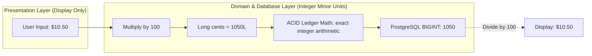
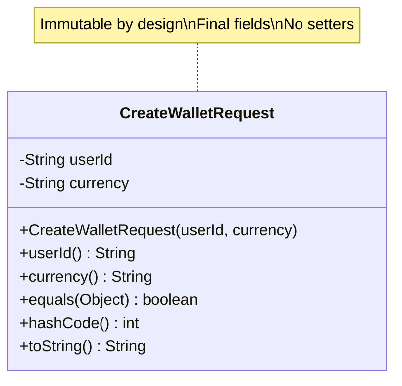
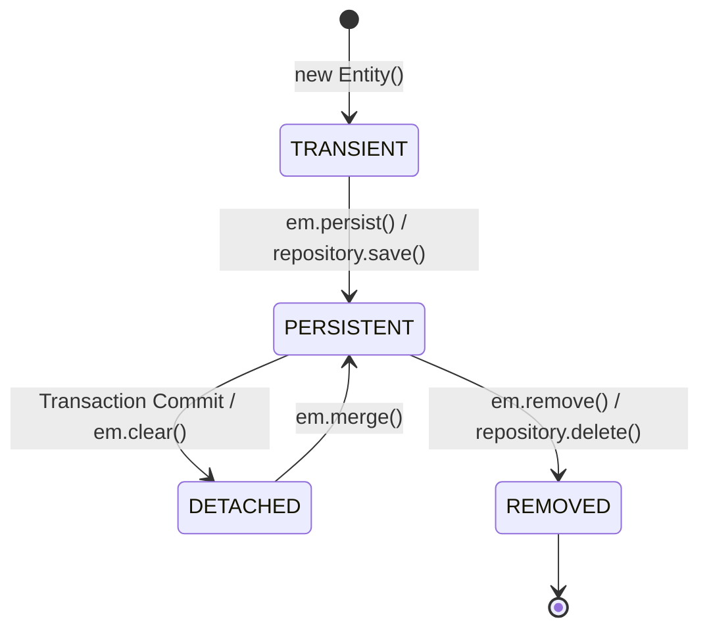
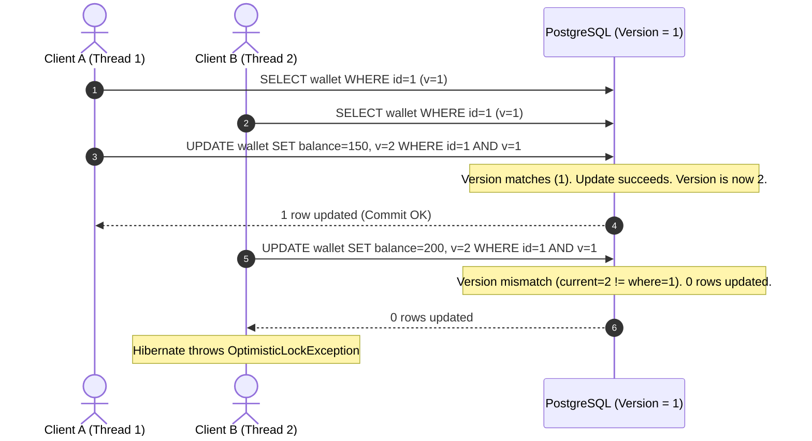
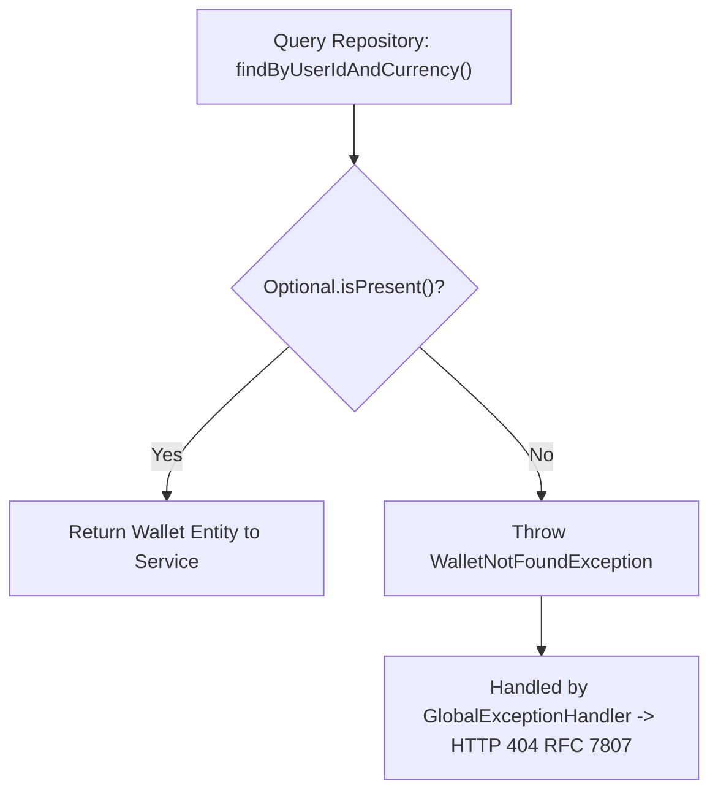
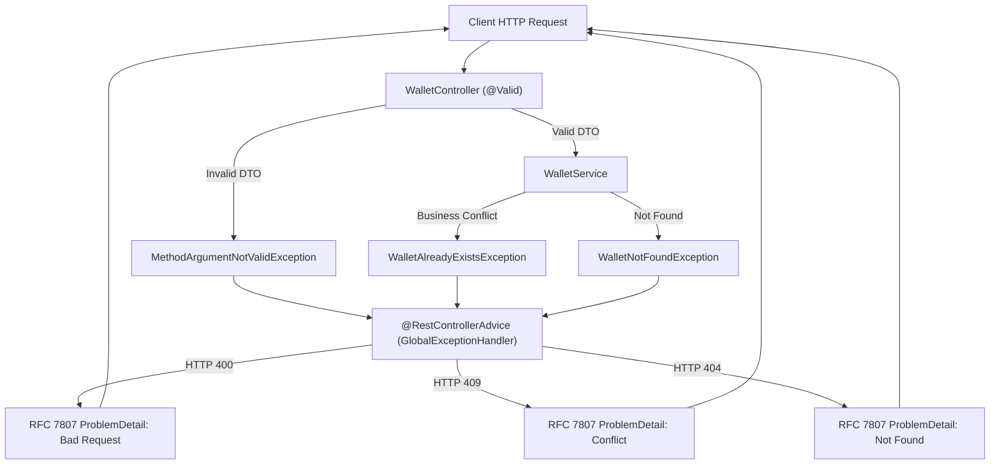

# Java 21 & Spring Boot Core Foundations

Tài liệu tổng hợp nền tảng lý thuyết khoa học máy tính, chuẩn ngôn ngữ Java 21 và framework Spring Boot được áp dụng xuyên suốt hệ thống Mini Digital Wallet.

---

## 1. Biểu Diễn Tiền Tệ: Chuẩn IEEE 754 vs Integer Minor Units (`Long` Cents)

### Vấn đề thực tế
Khách hàng nạp $0.10 ba lần liên tiếp vào ví. Nếu hệ thống dùng kiểu dữ liệu số thực `double` hoặc `float`:
`0.1 + 0.1 + 0.1 = 0.30000000000000004`
Khi so sánh điều kiện số dư `balance == 0.30`, biểu thức trả về `false`. Khi trừ tiền, hệ thống tích lũy sai số làm tròn (rounding error), dẫn tới thất thoát tài chính hoặc không thể đối soát sổ cái.

### Cơ sở lý thuyết
Chuẩn IEEE 754 biểu diễn số thực bằng dạng nhị phân với 3 thành phần: bit dấu (sign), phần mũ (exponent) và phần định trị (mantissa). Các phân số thập phân như $1/10$ ($0.1$) trở thành số vô hạn tuần hoàn trong hệ nhị phân ($0.0001100110011..._2$). Việc làm tròn trên số lượng bit cố định (32-bit cho float, 64-bit cho double) chắc chắn sinh ra sai số.

### Giải pháp kỹ thuật
1. **Quy đổi toàn bộ số tiền sang đơn vị nhỏ nhất (Minor Units)**:
   - Với USD: Lưu trữ bằng **Cents** ($1.00 = 100 cents).
   - $10.50 được lưu dưới dạng số nguyên `1050`.
2. **Kiểu dữ liệu**: `java.lang.Long` (64-bit signed two's complement integer).
   - Giới hạn tối đa: $2^{63} - 1 \approx 9.22 \times 10^{18}$ cents, tương đương hơn 92 tỷ tỷ USD. Không có rủi ro tràn số (overflow) trong vòng đời ứng dụng.
3. **Quy tắc tính toán**:
   - 100% phép cộng/trừ trong sổ cái là số nguyên.
   - Chỉ chuyển đổi sang số thập phân ở tầng trình diễn (Web UI / Mobile App) bằng cách chia cho 100.



> **[Action]**: Dùng `Long` minor units (cents) cho toàn bộ trường số dư, số tiền giao dịch và phí.  
> **[Theory Recall]**: Chuẩn số thực dấu phẩy động IEEE 754 (Binary Floating-Point Arithmetic).  
> **[Design Pattern]**: Value Object Pattern.  
> **[Catastrophe Prevented]**: Thất thoát tiền và lệch cân bằng sổ kép do tích lũy sai số làm tròn nhị phân.  
> **[Interview TL;DR]**: "Số thực dấu phẩy động nhị phân không thể biểu diễn chính xác các phân số thập phân như 0.1. Lưu trữ số tiền bằng số nguyên cents bảo đảm tính toán số học chính xác tuyệt đối."

---

## 2. Tính Bất Biến & An Toàn Dữ Liệu Với Java 21 `record`

### Vấn đề thực tế
Data Transfer Object (DTO) truyền qua mạng nếu cho phép thay đổi dữ liệu (mutable class với setter) có nguy cơ bị can thiệp trạng thái giữa các tầng kiến trúc, khó debug race condition trong môi trường đa luồng.

### Cơ sở lý thuyết
Nguyên lý bất biến (Immutability): Một đối tượng sau khi khởi tạo thành công thì trạng thái không thể thay đổi. Lợi ích:
- Thread-safe tuyệt đối mà không cần cơ chế khóa (synchronization).
- Ngăn chặn side-effects ngoài ý muốn khi truyền tham chiếu qua nhiều hàm.

### Giải pháp kỹ thuật
Java 21 `record` được dùng làm chuẩn cho toàn bộ DTO request/response:
- Tự động sinh `final` fields, canonical constructor, accessors dạng `field()`, `equals()`, `hashCode()`, `toString()`.
- Hỗ trợ **Compact Constructor** để validate dữ liệu ngay tại thời điểm khởi tạo:

```java
public record CreateWalletRequest(
    String userId,
    String currency
) {
    public CreateWalletRequest {
        if (userId == null || userId.isBlank()) {
            throw new IllegalArgumentException("userId is required");
        }
        if (currency == null || !currency.matches("^[A-Z]{3}$")) {
            throw new IllegalArgumentException("currency must be 3 uppercase letters");
        }
    }
}
```



> **[Action]**: Dùng Java 21 `record` thay cho class Lombok thông thường trên tất cả DTOs.  
> **[Theory Recall]**: Immutable Object Pattern & Functional Programming Data Carriers.  
> **[Design Pattern]**: Data Transfer Object (DTO) Pattern.  
> **[Catastrophe Prevented]**: Đột biến trạng thái ngoài ý muốn (accidental mutation) giữa các tầng Controller và Service.  
> **[Interview TL;DR]**: "Record bảo đảm tính bất biến nông (shallow immutability), loại bỏ code thừa và bảo đảm an toàn đa luồng (thread-safety) khi truyền tải dữ liệu qua mạng."

---

## 3. Quản Lý Vòng Đời Entity & Khóa Lạc Quan Với JPA / Hibernate

### Vòng đời Entity trong Hibernate Session



1. **Transient**: Đối tượng mới tạo qua toán tử `new`, chưa có ID, chưa thuộc quản lý của Hibernate Session (`EntityManager`).
2. **Persistent**: Đối tượng gắn với một Hibernate Session đang hoạt động.
   - **Dirty Checking**: Trong phạm vi `@Transactional`, Hibernate lưu lại snapshot ban đầu của entity. Trước khi commit transaction, Hibernate so sánh trạng thái hiện tại với snapshot. Nếu có thay đổi, câu lệnh SQL `UPDATE` được tự động sinh và thực thi mà không cần gọi `repository.save()` thủ công.
3. **Detached**: Transaction hoàn tất và Session đóng lại. Entity vẫn mang ID và dữ liệu nhưng không còn chịu sự theo dõi của Hibernate.

### Ánh xạ Enum An Toàn: `EnumType.STRING` vs `EnumType.ORDINAL`
- Mặc định JPA dùng `EnumType.ORDINAL` (lưu chỉ mục 0, 1, 2...). Nếu thêm một giá trị enum mới vào giữa danh sách, toàn bộ ý nghĩa dữ liệu số nguyên trong DB bị xáo trộn.
- Bắt buộc khai báo tường minh `@Enumerated(EnumType.STRING)` để lưu chuỗi ký tự (`ACTIVE`, `FROZEN`, `CLOSED`). Đảm bảo an toàn tuyệt đối khi tiến hóa schema.

### Khóa Lạc Quan (@Version - Optimistic Concurrency Control)
- Sử dụng trường `@Version private Long version;` trên entity `Wallet`.
- Cơ chế kiểm soát:
  $$\text{UPDATE wallets SET balance = ?, version = version + 1 WHERE id = ? AND version = ?}$$
- Nếu hai luồng cùng đọc phiên bản $V=1$, luồng thứ nhất commit thành công đẩy $V=2$. Luồng thứ hai thực hiện UPDATE với điều kiện `WHERE version = 1` sẽ có số dòng cập nhật là 0 $\rightarrow$ Hibernate ném ngoại lệ `OptimisticLockException`.



> **[Action]**: Khai báo `@Version` trên `Wallet` và `@Enumerated(EnumType.STRING)` trên mọi enum field.  
> **[Theory Recall]**: Optimistic Concurrency Control (OCC) & Schema Evolution Backward Compatibility.  
> **[Design Pattern]**: Version Number Pattern (Fowler PoEAA).  
> **[Catastrophe Prevented]**: Ghi đè dữ liệu (Lost Update) khi cập nhật metadata ví; hỏng dữ liệu DB khi sửa mã nguồn enum.  
> **[Interview TL;DR]**: "Khóa lạc quan phát hiện xung đột ghi đồng thời qua số phiên bản mà không cần giữ khóa cơ sở dữ liệu, cho phép ứng dụng fail-fast ngay khi xảy ra tranh chấp."

---

## 4. Spring Data JPA & Nguyên Tắc Null-Safety

### Dynamic Proxy Query Derivation
- Khi khai báo method trong repository interface:
  ```java
  public interface WalletRepository extends JpaRepository<Wallet, UUID> {
      Optional<Wallet> findByUserIdAndCurrency(String userId, String currency);
      boolean existsByUserIdAndCurrency(String userId, String currency);
  }
  ```
- Spring Data sử dụng cơ chế Java Dynamic Proxy để sinh mã thực thi lúc khởi động ứng dụng. Method name được phân tích cú pháp thành cây AST (Abstract Syntax Tree) và sinh ra câu lệnh JPQL/SQL tương ứng.

### Null-Safety Contract với `Optional<T>`
- **Quy tắc thiết kế**: Không bao giờ trả về giá trị `null` từ Repository hoặc Service.
- Hàm truy vấn đơn dòng bắt buộc trả về `java.util.Optional<T>`. Phía gọi hàm buộc phải xử lý tường minh trường hợp dữ liệu không tồn tại:
  ```java
  Wallet wallet = walletRepository.findByUserIdAndCurrency(userId, currency)
      .orElseThrow(() -> new WalletNotFoundException("Wallet not found for user: " + userId));
  ```
- Triệt tiêu 100% rủi ro `NullPointerException` (lỗi tỷ đô - Billion Dollar Mistake).



> **[Action]**: Trả về `Optional<Wallet>` trên tất cả các hàm tìm kiếm đơn bản ghi.  
> **[Theory Recall]**: Tony Hoare's Billion Dollar Mistake & Functional Null Handling (Monadic Optional).  
> **[Design Pattern]**: Null Object Pattern / Optional Wrapper.  
> **[Catastrophe Prevented]**: Lỗi sập ứng dụng do NullPointerException rải rác trong tầng Service.  
> **[Interview TL;DR]**: "Trả về Optional bắt buộc phía gọi phải xử lý tường minh trường hợp dữ liệu rỗng ngay lúc biên dịch, triệt tiêu hoàn toàn lỗi NullPointerException khi chạy."

---

## 5. Phòng Thủ Biên Giới (Fail-Fast Boundary Validation) & Chuẩn Hóa Lỗi RFC 7807

### Fail-Fast Tại Trust Boundary
Tất cả dữ liệu từ Client gửi tới Controller đều nằm ngoài ranh giới tin cậy (untrusted input). Phải kiểm tra tính hợp lệ ngay tại tầng Controller trước khi chuyển dữ liệu vào Service.

- Sử dụng **Jakarta Bean Validation**:
  - `@NotBlank`: Chuỗi ký tự không được null, không rỗng, không chứa toàn khoảng trắng.
  - `@NotNull`: Đối tượng không được phép null.
  - `@Pattern`: Kiểm tra cấu trúc chuỗi theo biểu thức chính quy (ISO-4217 Currency Code `^[A-Z]{3}$`).
  - `@PositiveOrZero`: Giá trị số nguyên phải $\ge 0$.

### Chuẩn Hóa Lỗi Toàn Cục: RFC 7807 (Problem Details for HTTP APIs)
- Thay vì tự định nghĩa cấu trúc JSON lỗi tùy tiện, hệ thống áp dụng chuẩn RFC 7807 của IETF.
- Xử lý tập trung qua Spring AOP `@RestControllerAdvice` + `@ExceptionHandler`:

```json
{
  "type": "https://api.minidigitalwallet.com/errors/wallet-not-found",
  "title": "Wallet Not Found",
  "status": 404,
  "detail": "Wallet for user USR_001 with currency USD does not exist",
  "instance": "/api/v1/wallets/me",
  "timestamp": "2026-09-11T13:59:00Z"
}
```



> **[Action]**: Triển khai Bean Validation trên Controller DTOs và bắt lỗi tập trung bằng `@RestControllerAdvice` theo RFC 7807.  
> **[Theory Recall]**: Fail-Fast Principle & Cross-Cutting Concerns Separation (Aspect-Oriented Programming).  
> **[Design Pattern]**: Interceptor Pattern / Around Advice.  
> **[Catastrophe Prevented]**: Dữ liệu rác lọt sâu gây lỗi tầng DB; response lỗi không đồng nhất gây khó khăn cho client tích hợp.  
> **[Interview TL;DR]**: "Kiểm tra tính hợp lệ của input ngay tại cửa ngõ API; ánh xạ toàn bộ ngoại lệ miền nghiệp vụ sang chuẩn RFC 7807 Problem Details qua Controller Advice tập trung."
