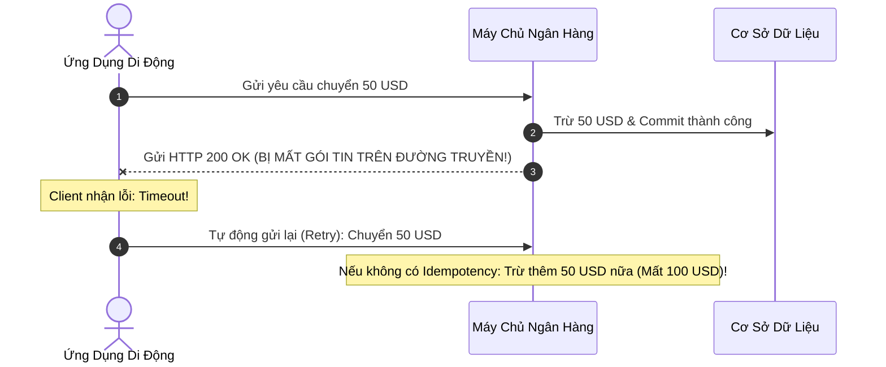
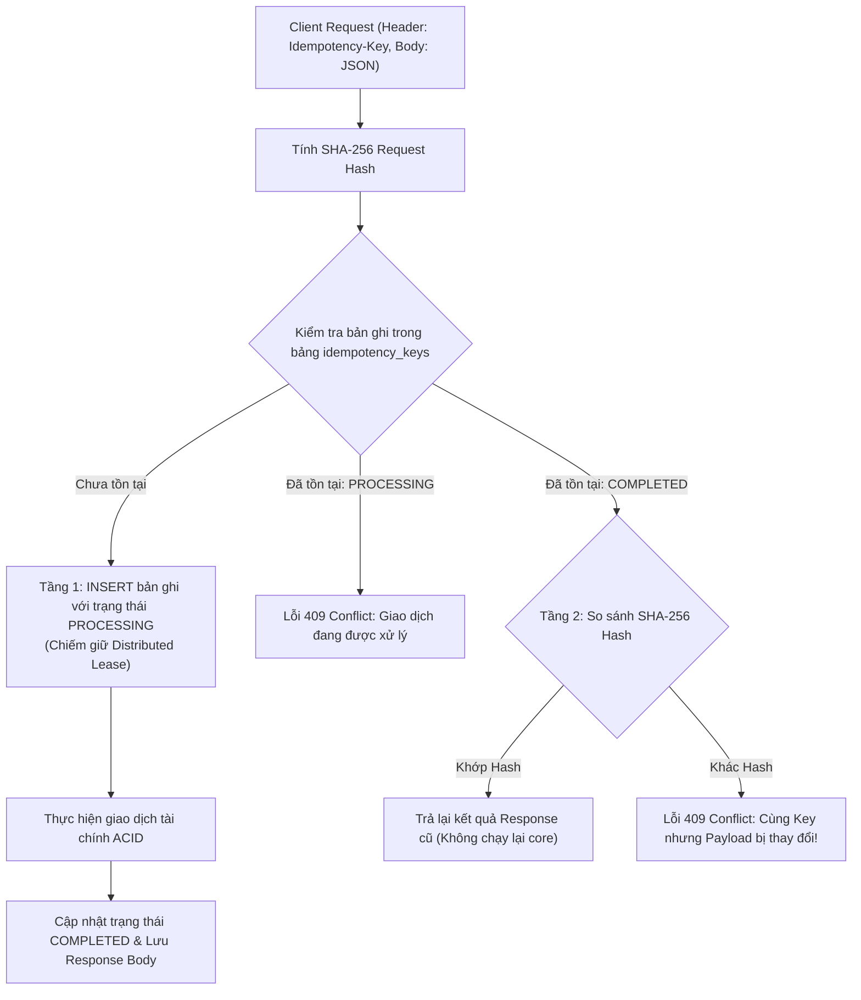
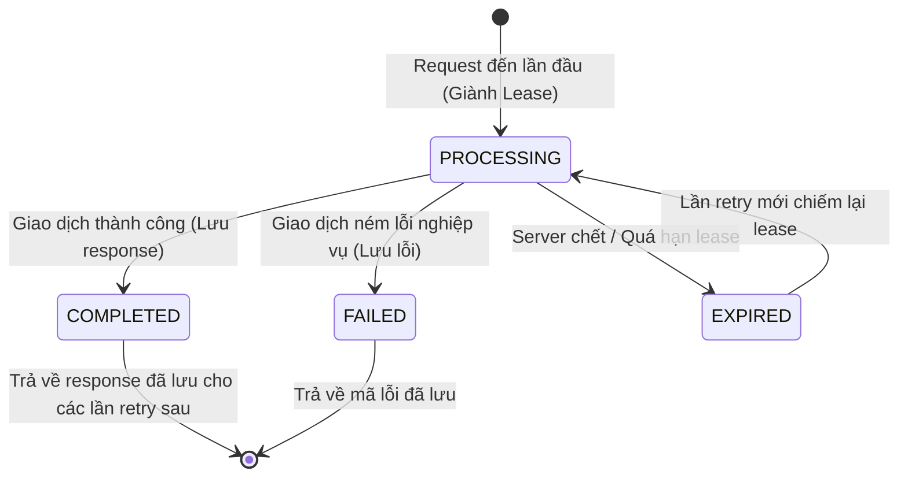

# Kiến Trúc Chống Trùng Lặp Hai Tầng (Two-Tier Idempotency Pattern)

Tài liệu phân tích chuyên sâu về bài toán Exactly-Once Semantics trong môi trường mạng không tin cậy, chuẩn HTTP Idempotency Key của IETF, và giải pháp bảo vệ hai tầng (Distributed Lease & Cryptographic Request Fingerprinting).

---

## Mục Lục
1. [Vấn Đề: Mạng Không Tin Cậy & Bài Toán Hai Vị Tướng](#1-vấn-đề-mạng-không-tin-cậy--bài-toán-hai-vị-tướng)
2. [Định Nghĩa Idempotency & Chuẩn IETF Draft RFC](#2-định-nghĩa-idempotency--chuẩn-ietf-draft-rfc)
3. [Hiểm Họa Khi Chỉ Dùng Một Khóa Đơn Lẻ (The Payload Mutation Attack)](#3-hiểm-họa-khi-chỉ-dùng-một-khóa-đơn-lẻ-the-payload-mutation-attack)
4. [Kiến Trúc Hai Tầng (Two-Tier Architecture)](#4-kiến-trúc-hai-tầng-two-tier-architecture)
   - [Tầng 1: Khóa Thuê Phân Tán (Distributed Lease & Timeout)](#tầng-1-khóa-thuê-phân-tán-distributed-lease--timeout)
   - [Tầng 2: Băm Dấu Vân Tay Mật Mã (SHA-256 Request Fingerprinting)](#tầng-2-băm-dấu-vân-tay-mật-mã-sha-256-request-fingerprinting)
5. [Quy Trình Xử Lý Trạng Thái Idempotency (State Machine)](#5-quy-trình-xử-lý-trạng-thái-idempotency-state-machine)
6. [Tài Liệu Tham Khảo (References & Citations)](#6-tài-liệu-tham-khảo-references--citations)

---

## 1. Vấn Đề: Mạng Không Tin Cậy & Bài Toán Hai Vị Tướng

Trong mạng máy tính phân tán (Distributed Networks), mạng luôn tiềm ẩn nguy cơ chập chờn, mất gói tin, hoặc quá thời gian chờ (Timeout).

Giả sử một khách hàng gửi yêu cầu thanh toán chuyển 50 USD:
1. Yêu cầu đi từ điện thoại đến máy chủ ngân hàng thành công.
2. Máy chủ ngân hàng đã trừ tiền trong ví và commit thành công vào database.
3. Đúng lúc máy chủ gửi phản hồi `200 OK` về điện thoại, cột sóng 4G bị mất tín hiệu đột ngột.
4. Điện thoại nhận được lỗi `Connection Timeout`. Người dùng hoặc ứng dụng tự động nhấn nút "Thanh toán lại" (Retry).

Nếu máy chủ không có cơ chế nhận biết yêu cầu này đã được xử lý từ trước, tài khoản của khách hàng sẽ bị trừ tiền hai lần (Double Spending).

---

## 2. Định Nghĩa Idempotency & Chuẩn IETF Draft RFC

Theo **RFC 9110 (HTTP Semantics)**: Một phương thức HTTP được gọi là **Idempotent** nếu tác động phụ (Side-effects) trên máy chủ của $N$ lần gửi giống hệt như của $1$ lần gửi duy nhất:

$$f(f(x)) = f(x)$$

Các phương thức `GET`, `PUT`, `DELETE` theo chuẩn là idempotent. Nhưng phương thức `POST` (dùng để tạo giao dịch thanh toán) theo mặc định **không phải là idempotent**.

Để giải quyết vấn đề này trong các API tài chính, nhóm chuyên gia Internet Engineering Task Force (IETF) đã công bố bản đặc tả kỹ thuật:
**`The Idempotency-Key HTTP Header Field` (IETF Internet-Draft)**:
- Client phải tự sinh ra một chuỗi định danh duy nhất (UUID v4) và truyền vào header: `Idempotency-Key: <unique-uuid>`.
- Máy chủ cam kết: Bất kể Client có gửi lại bao nhiêu lần với cùng một `Idempotency-Key`, giao dịch nghiệp vụ chỉ chạy duy nhất một lần.

---

## 3. Hiểm Họa Khi Chỉ Dùng Một Khóa Đơn Lẻ (The Payload Mutation Attack)

Nhiều lập trình viên chỉ đơn giản tạo bảng `idempotency_keys` và đặt khóa chính trên cột `key`. Điều này dẫn tới một lỗ hổng bảo mật và tính toán nghiêm trọng:

### Tình huống thay đổi nội dung (Payload Mutation)
1. Kẻ tấn công hoặc Client bị lỗi gửi: `Idempotency-Key: KEY-123`, Payload: `Chuyển 10 USD cho Bob`.
2. Máy chủ xử lý thành công, lưu lại kết quả của `KEY-123`.
3. Vài giây sau, Client lại gửi: `Idempotency-Key: KEY-123`, nhưng Payload bị sửa thành: `Chuyển 10,000 USD cho Alice`!
4. Nếu máy chủ chỉ so sánh mã khóa `KEY-123`, nó sẽ tưởng đây là yêu cầu cũ và trả về: `Đã chuyển thành công 10 USD cho Bob`. Trong khi đó, người gửi tin rằng họ vừa chuyển 10,000 USD cho Alice!

> **Quy tắc bắt buộc**: Nếu cùng một `Idempotency-Key` được gửi tới nhưng dữ liệu yêu cầu (Request Payload) bị thay đổi dù chỉ 1 ký tự, máy chủ phải lập tức từ chối và trả về mã lỗi `409 Conflict`.

---

## 4. Kiến Trúc Hai Tầng (Two-Tier Architecture)

Để giải quyết trọn vẹn cả bài toán mạng lag, xử lý đồng thời, và chống giả mạo payload, hệ thống triển khai kiến trúc hai tầng:

### Tầng 1: Khóa Thuê Phân Tán (Distributed Lease & Timeout)
Khi một request mới mang `Idempotency-Key` đến:
1. Thực hiện lệnh `INSERT` vào bảng `idempotency_keys` với trạng thái `PROCESSING`.
2. Khóa chính (Primary Key / Unique Constraint) của database đảm bảo nếu có hai luồng gửi cùng lúc, chỉ duy nhất một luồng insert thành công và chiếm được quyền thực thi (Distributed Lease). Luồng thứ hai sẽ bị ném lỗi khóa trùng lặp ngay tức khắc.
3. Bản ghi `PROCESSING` có kèm theo thời gian quá hạn (Lease Expiry, ví dụ: 2 phút). Nếu server xử lý bị sập nguồn giữa chừng, lần retry sau sẽ có thể thu hồi khóa thuê đã quá hạn một cách an toàn.

### Tầng 2: Băm Dấu Vân Tay Mật Mã (SHA-256 Request Fingerprinting)
1. Trước khi kiểm tra hoặc lưu trữ, toàn bộ nội dung body của request được đưa qua thuật toán băm an toàn **SHA-256** (FIPS PUB 180-4) để tạo thành một chuỗi 64 ký tự hex đại diện cho "dấu vân tay" của request:
   $$\text{RequestHash} = \text{SHA256}(\text{RequestBodyJSON})$$
2. Khi một request gửi lại với cùng `Idempotency-Key`, hệ thống so sánh chuỗi hash mới tính với chuỗi hash đã lưu trong database.
3. Bất kỳ sự sai lệch nào về số tiền, người nhận, loại tiền tệ đều bị phát hiện ngay lập tức với xác suất đụng độ băm gần như bằng 0 ($1/2^{256}$).

---

## 5. Quy Trình Xử Lý Trạng Thái Idempotency (State Machine)

Mỗi khóa Idempotency trải qua một vòng đời trạng thái nghiêm ngặt:

---

## 6. Tài Liệu Tham Khảo (References & Citations)

1. **Fielding, R., Nottingham, M., & Reschke, J.** (2022). *RFC 9110: HTTP Semantics*. Internet Engineering Task Force (IETF).
   - Phần 9.2.2: *Idempotent Methods* (Định nghĩa chính thức về tính lũy đẳng trong giao thức web).
   - Link: [RFC 9110 Section 9.2.2](https://www.rfc-editor.org/rfc/rfc9110.html#section-9.2.2)
2. **IETF Network Working Group.** (2023). *The Idempotency-Key HTTP Header Field (Draft-ietf-httpapi-idempotency-key-header)*.
   - Bản dự thảo tiêu chuẩn hóa quốc tế quy định cú pháp, hành vi của header `Idempotency-Key`, cách xử lý lỗi 409 Conflict, và quy tắc băm request fingerprint.
   - Link: [IETF Idempotency-Key Internet-Draft](https://datatracker.ietf.org/doc/draft-ietf-httpapi-idempotency-key-header/)
3. **National Institute of Standards and Technology (NIST).** (2015). *FIPS PUB 180-4: Secure Hash Standard (SHS)*. U.S. Department of Commerce.
   - Tiêu chuẩn mật mã học cho các hàm băm SHA (bao gồm SHA-256).
   - DOI: [10.6028/NIST.FIPS.180-4](https://doi.org/10.6028/NIST.FIPS.180-4)
4. **AWS Architecture Center.** (2020). *Making retries safe with idempotent APIs*. Amazon Web Services Builder's Library.
   - Cẩm nang thiết kế cơ chế retry an toàn trên các hệ thống thanh toán quy mô lớn của Amazon.
   - Link: [AWS Builders Library - Idempotent APIs](https://aws.amazon.com/builders-library/making-retries-safe-with-idempotent-APIs/)
