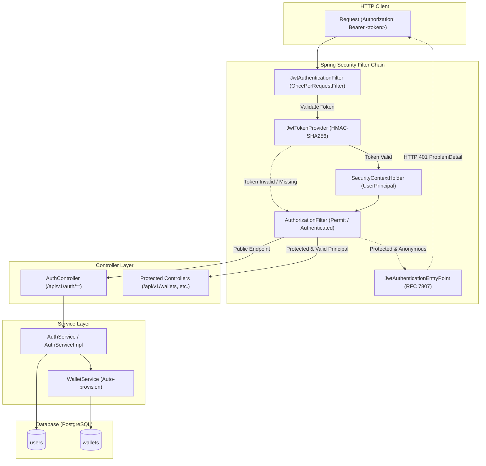
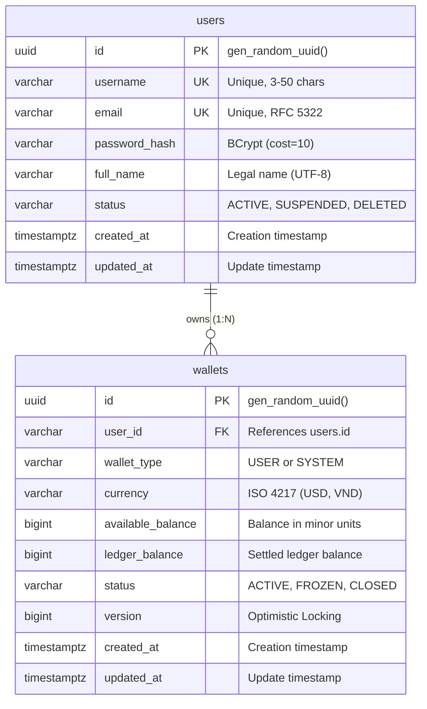
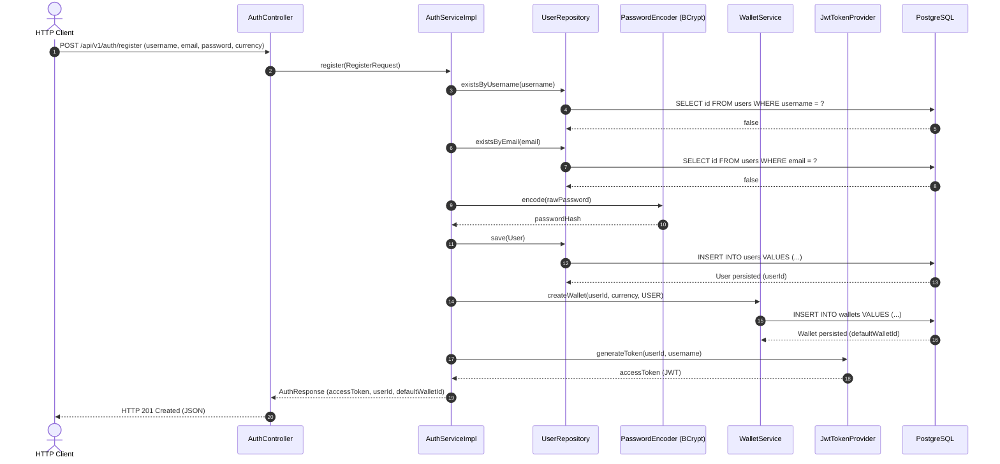
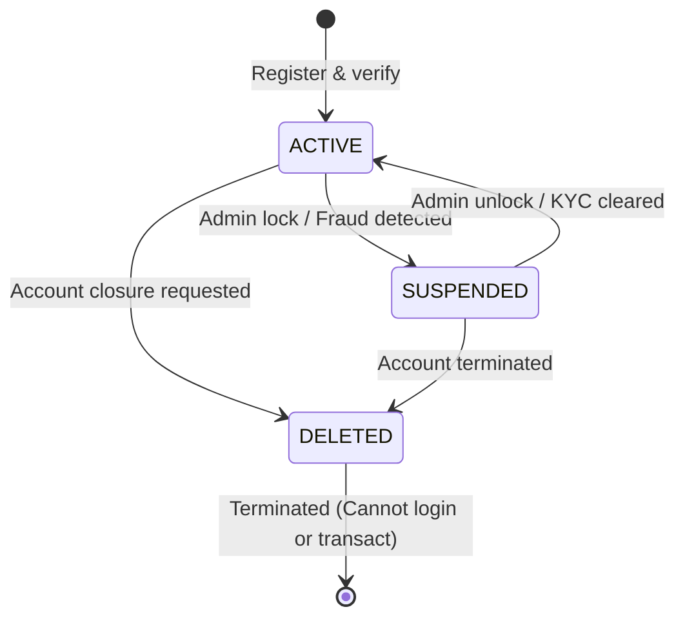

# Kiến Trúc & Luồng Tương Tác Module Authentication & JWT

Tài liệu thiết kế chi tiết kiến trúc tầng, mô hình dữ liệu và sequence diagram luồng xác thực Stateless JWT trong hệ thống.

---

## 1. Kiến Trúc Bộ Lọc Bảo Mật (Spring Security & JWT Filter Chain)

Hệ thống áp dụng mô hình bảo mật không lưu trạng thái phiên (stateless), xác thực qua Bearer Token:



---

## 2. Mô Hình Thực Thể Người Dùng & Quan Hệ Ví (ERD)



---

## 3. Luồng Đăng Ký Tài Khoản (Registration Sequence)

Người dùng đăng ký tài khoản mới; hệ thống băm mật khẩu, lưu thông tin và tự động mở một ví USER mặc định (USD) trong cùng một transaction:



---

## 4. Luồng Đăng Nhập & Cấp Phát Token (Login Sequence)

```mermaid
sequenceDiagram
    autonumber
    actor Client as HTTP Client
    participant AC as AuthController
    participant AS as AuthServiceImpl
    participant UR as UserRepository
    participant PE as PasswordEncoder (BCrypt)
    participant WS as WalletService
    participant JTP as JwtTokenProvider

    Client->>AC: POST /api/v1/auth/login (username, password)
    AC->>AS: login(LoginRequest)
    AS->>UR: findByUsername(username)
    alt User not found
        UR-->>AS: Optional.empty()
        AS-->>AC: throw InvalidCredentialsException (401)
        AC-->>Client: HTTP 401 Unauthorized (ProblemDetail)
    else User exists
        UR-->>AS: Optional.of(user)
        AS->>PE: matches(rawPassword, user.passwordHash)
        alt Password does not match
            PE-->>AS: false
            AS-->>AC: throw InvalidCredentialsException (401)
            AC-->>Client: HTTP 401 Unauthorized (ProblemDetail)
        else Password valid
            PE-->>AS: true
            AS->>WS: getWalletsByUserId(userId)
            WS-->>AS: List&lt;WalletResponse&gt;
            AS->>JTP: generateToken(userId, username)
            JTP-->>AS: accessToken
            AS-->>AC: AuthResponse (accessToken, userId, defaultWalletId)
            AC-->>Client: HTTP 200 OK (JSON)
        end
    end
```

---

## 5. Luồng Xác Thực Request Có Bearer Token (Authenticated Request Flow)

Xử lý các request truy cập tài nguyên được bảo vệ (ví dụ: `GET /api/v1/wallets`):

```mermaid
sequenceDiagram
    autonumber
    actor Client as HTTP Client
    participant JAF as JwtAuthenticationFilter
    participant JTP as JwtTokenProvider
    participant SCH as SecurityContextHolder
    participant WC as WalletController
    participant WS as WalletService

    Client->>JAF: GET /api/v1/wallets (Header: Authorization: Bearer &lt;token&gt;)
    JAF->>JAF: Extract Bearer token string
    alt Missing or Malformed Token
        JAF->>Client: Delegated to JwtAuthenticationEntryPoint (HTTP 401)
    else Token Present
        JAF->>JTP: validateToken(token)
        alt Token Valid
            JTP-->>JAF: true
            JAF->>JTP: getUserIdFromToken(token), getUsernameFromToken(token)
            JTP-->>JAF: userId, username
            JAF->>SCH: setAuthentication(UsernamePasswordAuthenticationToken)
            JAF->>WC: Proceed to Controller
            WC->>WC: Extract @AuthenticationPrincipal UserPrincipal
            WC->>WS: getWalletsByUserId(principal.userId)
            WS-->>WC: List&lt;WalletResponse&gt;
            WC-->>Client: HTTP 200 OK (JSON)
        else Token Expired or Invalid Signature
            JTP-->>JAF: false
            JAF->>Client: Delegated to JwtAuthenticationEntryPoint (HTTP 401)
        end
    end
```

---

## 6. Máy Trạng Thái Người Dùng (User Lifecycle State Machine)



- **ACTIVE**: Đăng nhập, mở ví, thực hiện nạp/rút/chuyển tiền bình thường.
- **SUSPENDED**: Bị khóa đăng nhập, từ chối cấp token mới, API báo `account-disabled`.
- **DELETED**: Tài khoản bị đóng vĩnh viễn, vô hiệu hóa toàn bộ quyền truy cập.
