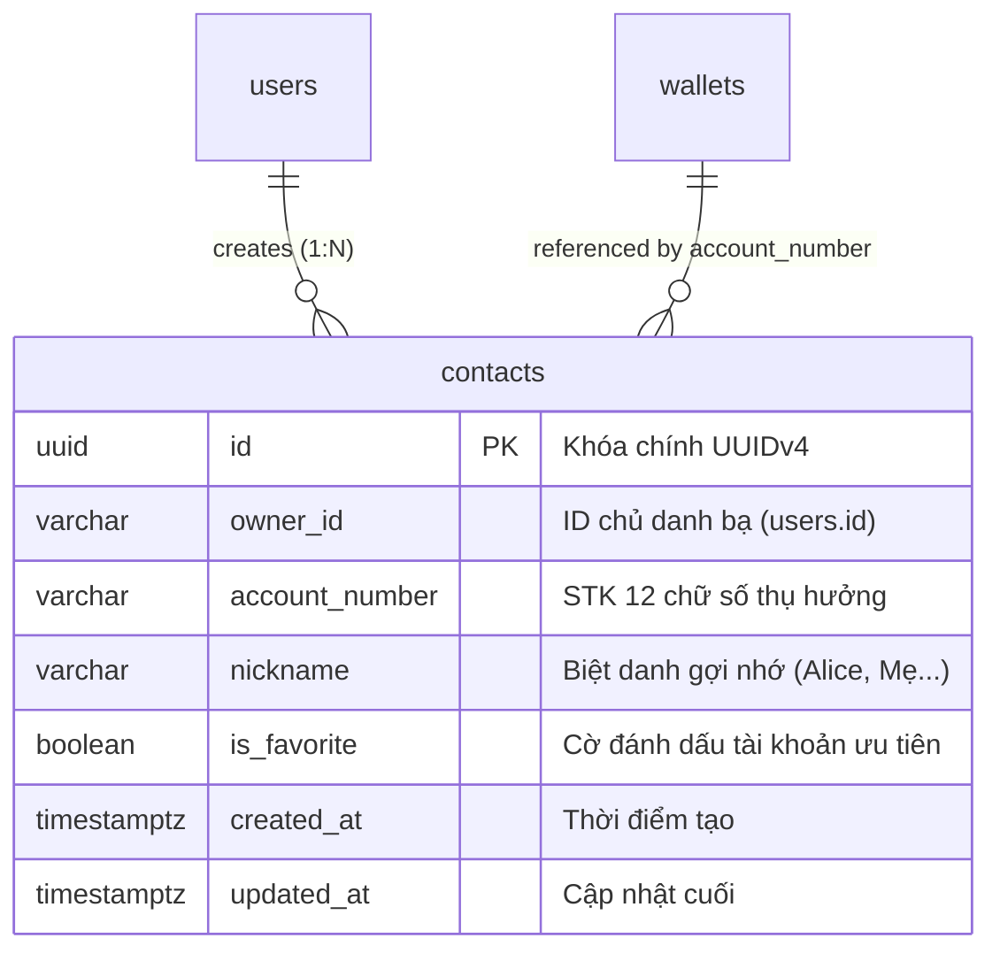
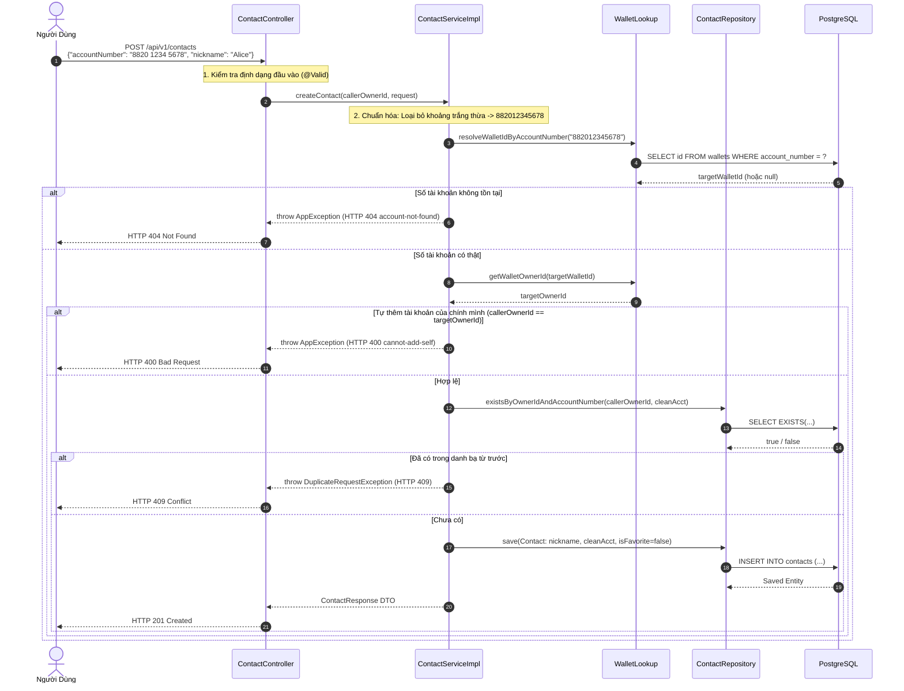
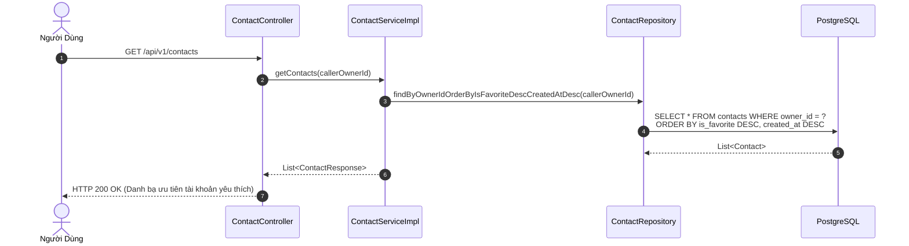
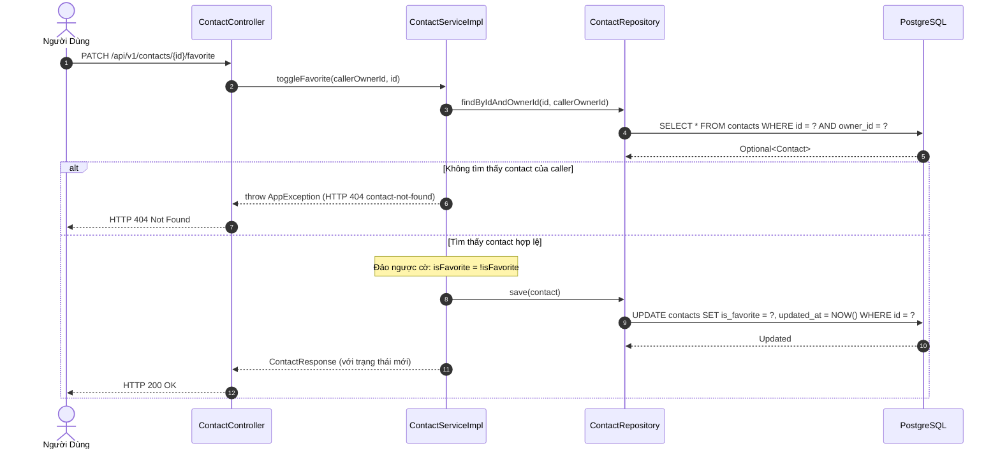

# Kiến Trúc & Luồng Tương Tác Contact Service (Danh Bạ Thụ Hưởng)

Tài liệu thiết kế chi tiết kiến trúc tầng, mô hình dữ liệu và các sequence diagram cho tính năng lưu danh bạ thụ hưởng chuyển tiền P2P theo **Số tài khoản 12 chữ số** trong **Mini Digital Wallet**.

---

## 1. Mục Đích & Nguyên Tắc Thiết Kế

Khi chuyển tiền giữa các cá nhân (P2P Transfer), việc yêu cầu người dùng nhập chuỗi UUID dài 36 ký tự (ví dụ: `5f425555-2f70-4d56-bc5e-828049fe93c6`) là điều bất khả thi và gây ức chế lớn cho khách hàng.

Hệ thống giải quyết vấn đề này bằng hai giải pháp kết hợp:
1. **Số tài khoản 12 chữ số thân thiện (`account_number`)**: Mỗi ví được cấp một số tài khoản 12 số dễ nhớ (đầu số `8820`).
2. **Danh bạ thụ hưởng (Saved Contacts)**: Cho phép lưu số tài khoản của bạn bè, đồng nghiệp kèm biệt danh (nickname) và đánh dấu người nhận yêu thích.

### Các Quy Tắc Bảo Vệ Toàn Vẹn Danh Bạ:
- **Tồn tại thực tế**: Số tài khoản muốn lưu bắt buộc phải tồn tại trên hệ thống (kiểm tra qua `WalletLookup`).
- **Không tự lưu chính mình**: Hệ thống từ chối lưu số tài khoản của chính bản thân người gọi (tránh tự chuyển tiền cho mình gây lãng phí tài nguyên và nhầm lẫn).
- **Không lưu trùng**: Mỗi người dùng chỉ được lưu một số tài khoản đúng 1 lần (`UNIQUE(owner_id, account_number)`).
- **Bảo mật BOLA**: Người dùng chỉ có quyền xem, sửa trạng thái yêu thích hoặc xóa danh bạ do chính mình tạo ra.

---

## 2. Mô Hình Dữ Liệu Danh Bạ (ERD)

---

## 3. Sequence Diagram: Luồng Lưu Người Thụ Hưởng Mới (`POST /api/v1/contacts`)

---

## 4. Sequence Diagram: Luồng Lấy Danh Sách Danh Bạ (`GET /api/v1/contacts`)

Hệ thống tối ưu hóa trải nghiệm người dùng bằng cách sắp xếp các tài khoản thường xuyên giao dịch hoặc được gắn sao yêu thích lên đầu danh sách:

---

## 5. Sequence Diagram: Bật/Tắt Yêu Thích (`PATCH /api/v1/contacts/{id}/favorite`)

---

## 6. Bảng Tổng Hợp Hành Động & Lý Thuyết (Action & Theory Summary)

> **[Hành Động]**: Kiểm tra `WalletLookup` và cấm tự thêm chính mình (`callerOwnerId != targetOwnerId`) trước khi lưu danh bạ.  
> **[Lý Thuyết]**: Domain Invariant Verification & Input Sanitization.  
> **[Mẫu Thiết Kế]**: Guard Clause Pattern.  
> **[Thảm Họa Tránh Được]**: Người dùng lưu số tài khoản ma hoặc tự chuyển tiền qua lại cho chính mình gây nghẽn log giao dịch.  
> **[Phỏng Vấn TL;DR]**: "Xác thực sự tồn tại của thực thể đích qua dịch vụ phân giải tài khoản và áp dụng guard clause chặn tự tham chiếu ngay tại tầng service."

---

> **[Hành Động]**: Thiết lập ràng buộc cơ sở dữ liệu `UNIQUE(owner_id, account_number)`.  
> **[Lý Thuyết]**: Database Level Uniqueness Constraint.  
> **[Mẫu Thiết Kế]**: Idempotent Data Model.  
> **[Thảm Họa Tránh Được]**: Người dùng bấm lưu danh bạ nhiều lần sinh ra các bản ghi trùng lặp gây rối danh bạ.  
> **[Phỏng Vấn TL;DR]**: "Chỉ mục duy nhất ở database là chốt chặn cuối cùng đảm bảo không bao giờ có 2 bản ghi trùng lặp số tài khoản cho cùng một chủ sở hữu."
