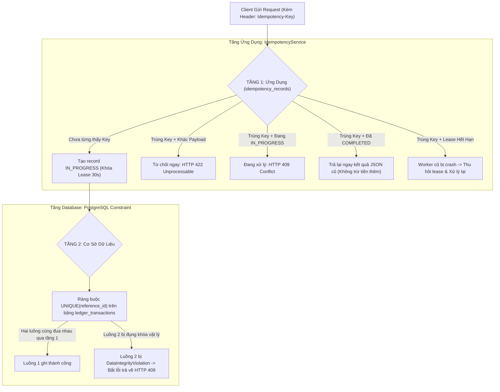
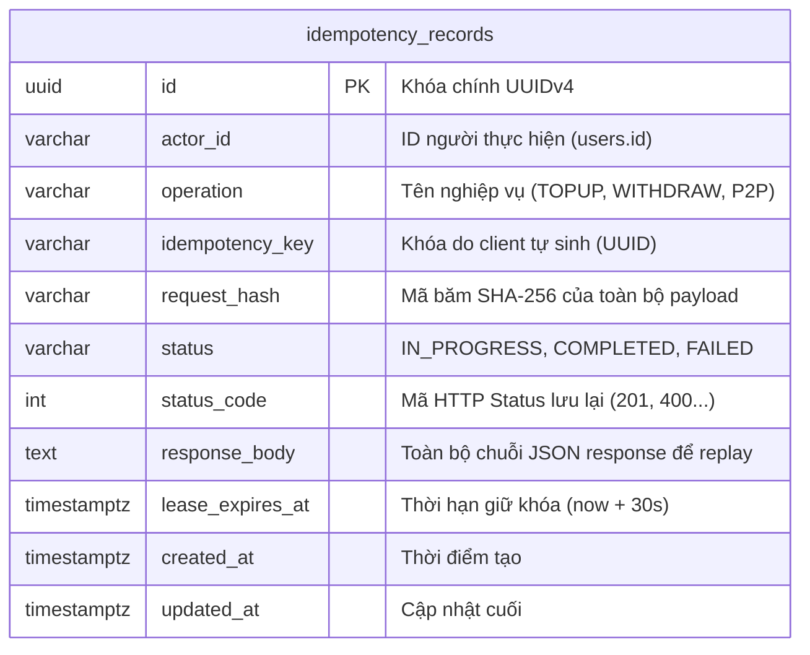
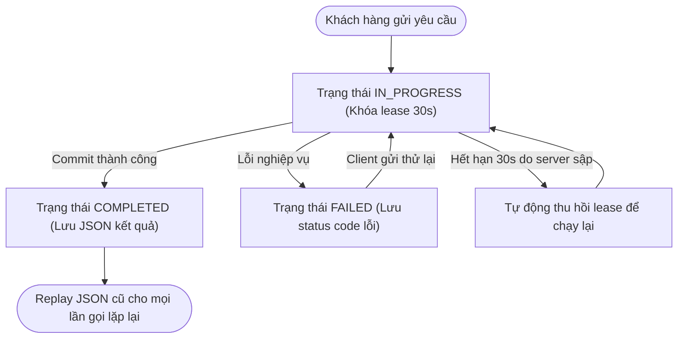
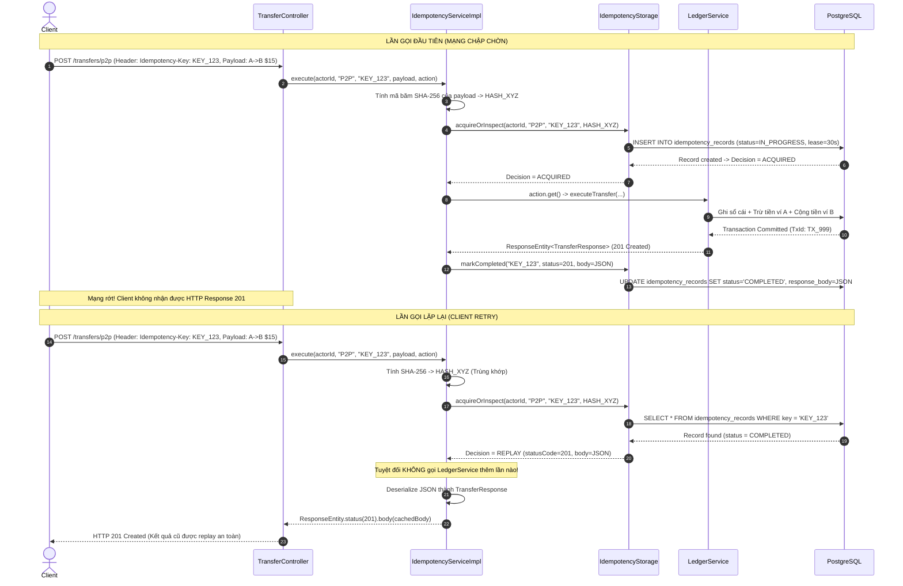
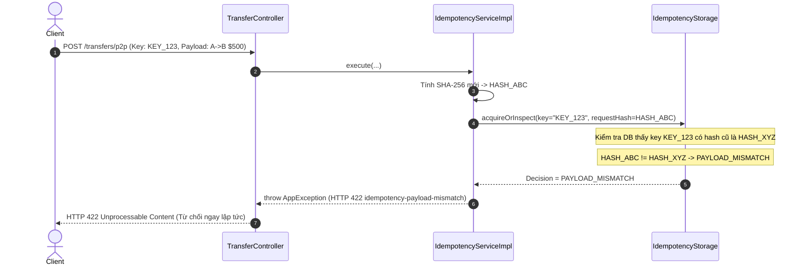

# Kiến Trúc & Cơ Chế Chống Trùng Lặp 2 Tầng (Idempotency Service)

Tài liệu thiết kế chi tiết cơ chế bảo đảm tính lũy thừa (**Two-Tier Idempotency**) và an toàn đa luồng trong các giao dịch tài chính tại **Mini Digital Wallet**.

---

## 1. Vấn Đề Thực Tế: Tại Sao Phải Cần Idempotency?

### Tình huống kinh điển ngoài đời thực
1. Khách hàng bấm nút *"Nạp 500 USD"* hoặc *"Chuyển 15 USD"*.
2. Điện thoại của khách hàng đột ngột mất sóng 4G/Wifi hoặc mạng bị chập chờn.
3. Ứng dụng điện thoại quay vòng tròn và không nhận được phản hồi (HTTP Timeout).
4. Khách hàng sốt ruột và bấm nút gửi lần thứ hai.

**Nếu hệ thống không có Idempotency**:
- Request thứ nhất thực ra đã đến máy chủ và trừ tiền thành công.
- Request thứ hai đến tiếp tục trừ tiền thêm một lần nữa. Khách hàng bị mất tiền oan và khiếu nại!

### Nguyên tắc Lũy Thừa (Idempotency)
Một thao tác được gọi là lũy thừa nếu việc thực thi nó một lần hay nhiều lần liên tiếp đều mang lại **cùng một kết quả duy nhất** và **không làm thay đổi trạng thái hệ thống nhiều hơn một lần**.
$$\forall N \ge 1: \quad f(f(...f(x))) \equiv f(x)$$

---

## 2. Kiến Trúc Idempotency 2 Tầng (Two-Tier Idempotency)

Hệ thống triển khai cơ chế phòng thủ 2 lớp nghiêm ngặt:

---

## 3. Mô Hình Dữ Liệu & Vòng Đời Trạng Thái (ERD & State Machine)

### Mô hình bảng `idempotency_records`

### Máy trạng thái (State Machine) của một Idempotency Record

---

## 4. Sequence Diagram: Luồng Xử Lý & Replay Kết Quả

Biểu đồ mô tả chi tiết trường hợp mạng lag, client gọi lại đúng key và hệ thống trả lại kết quả cũ mà không thực hiện giao dịch sổ cái thêm lần nào:

---

## 5. Sequence Diagram: Phát Hiện Xung Đột Payload (`HTTP 422`)

Nếu kẻ xấu hoặc client vô tình dùng lại `Idempotency-Key` cũ nhưng lại thay đổi số tiền từ 15 USD thành 500 USD:

---

## 6. Bảng Tổng Hợp Hành Động & Lý Thuyết (Action & Theory Summary)

> **[Hành Động]**: Kết hợp mã băm SHA-256 payload với `Idempotency-Key` trong bảng `idempotency_records`.  
> **[Lý Thuyết]**: Idempotent Receiver Pattern & Cryptographic Hash Verification.  
> **[Mẫu Thiết Kế]**: Two-Phase Idempotent Execution.  
> **[Thảm Họa Tránh Được]**: Dùng lại key cũ cho một giao dịch khác làm sai lệch trạng thái hoặc chuyển nhầm số tiền lớn.  
> **[Phỏng Vấn TL;DR]**: "Mã băm SHA-256 xác thực rằng request được thử lại có đúng nội dung ban đầu hay không; nếu khác nội dung, hệ thống lập tức từ chối với mã lỗi 422 Unprocessable Content."

---

> **[Hành Động]**: Thiết lập `lease_expires_at = now + 30s` cho các bản ghi `IN_PROGRESS`.  
> **[Lý Thuyết]**: Distributed Lease & Fault Tolerance.  
> **[Mẫu Thiết Kế]**: Auto-Expiring Lease Pattern.  
> **[Thảm Họa Tránh Được]**: Server bị crash giữa chừng lúc đang xử lý khiến key bị kẹt vĩnh viễn ở trạng thái IN_PROGRESS, khách hàng không thể thử lại.  
> **[Phỏng Vấn TL;DR]**: "Cơ chế khóa thuê có thời hạn tự động giải phóng tài nguyên sau 30 giây nếu worker bị sập nguồn đột ngột, cho phép request tiếp theo thu hồi và xử lý an toàn."
