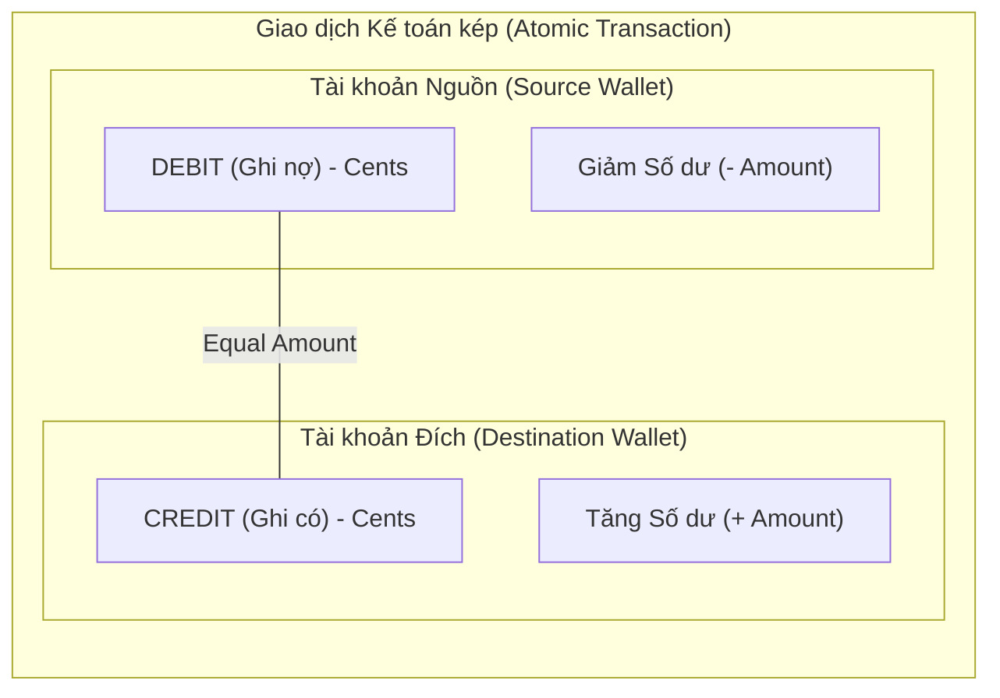
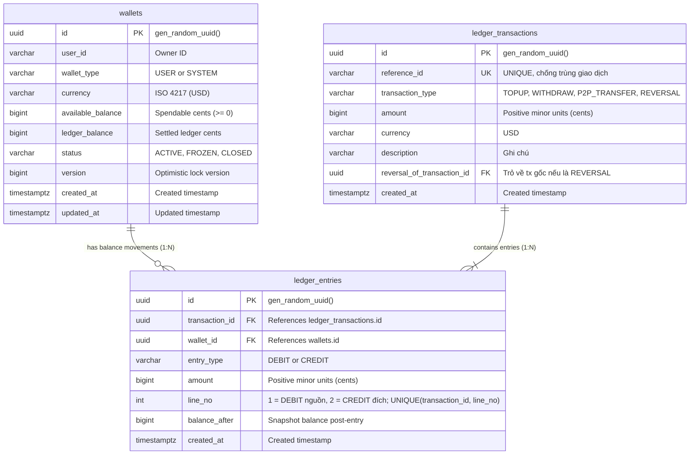
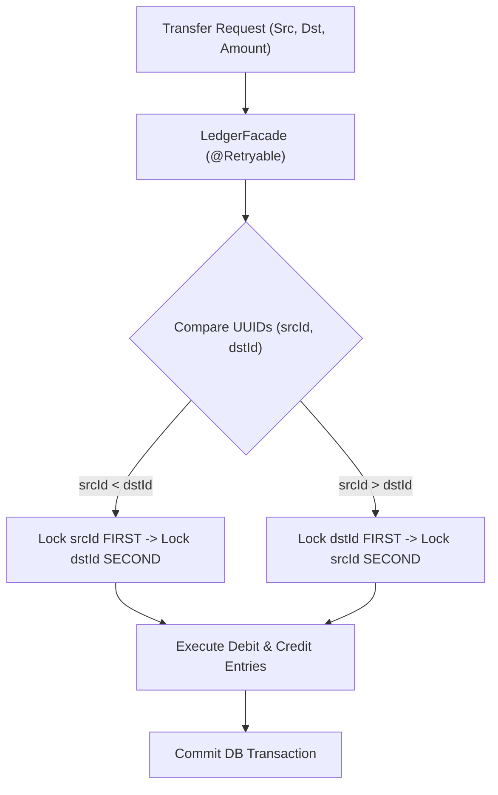
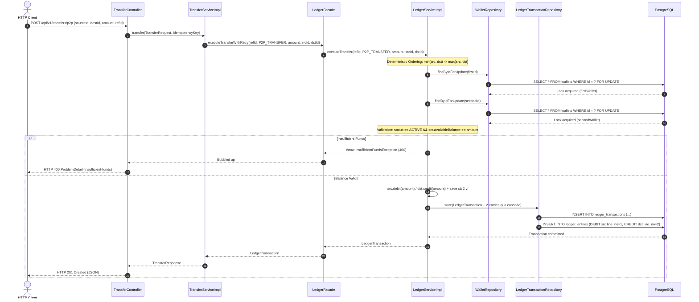
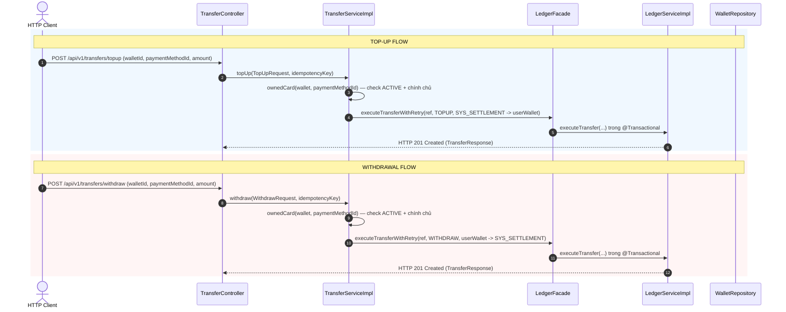
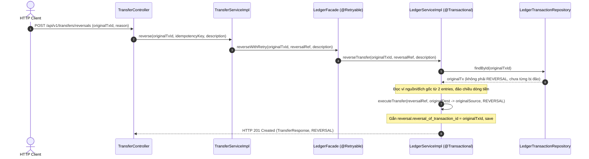
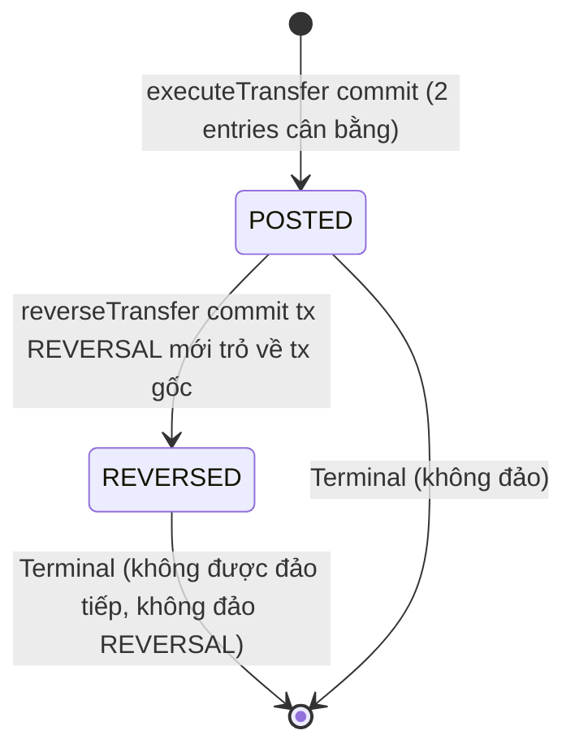
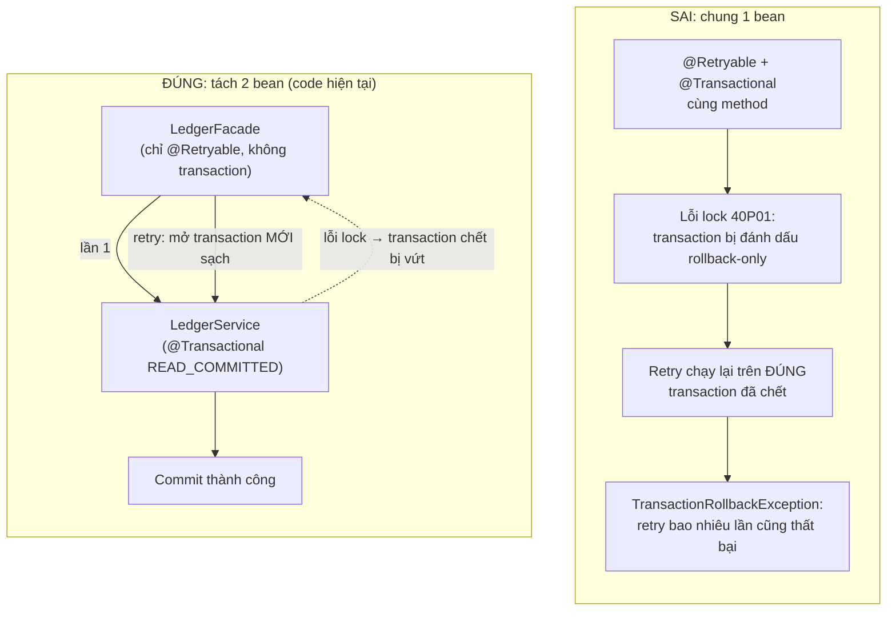

# Kiến Trúc & Luồng Tương Tác Core Double-Entry Ledger (Phase 2)

Tài liệu thiết kế chi tiết hệ thống sổ cái kế toán kép (Double-Entry Bookkeeping), cơ chế khóa chống deadlock và luồng giao dịch tiền tệ an toàn trong ngân hàng số.

---

## 1. Nguyên Lý Kế Toán Kép & Bất Biến Số Dư (Invariants)

Mọi giao dịch biến động số dư tài chính bắt buộc tuân thủ nguyên lý kế toán kép:
- **Không bao giờ tạo hoặc phá hủy tiền từ hư vô**: Tiền chỉ chuyển dịch giữa các tài khoản/ví.
- **Bất biến cân bằng (Balance Invariant)**: Tổng số tiền Ghi nợ (DEBIT) luôn bằng tổng số tiền Ghi có (CREDIT) trên từng mã giao dịch.
  $$\sum \text{Amount}_{\text{DEBIT}} = \sum \text{Amount}_{\text{CREDIT}}$$
- **Bất biến không âm (Non-negative Invariant)**: Ví người dùng (`USER`) không bao giờ được âm số dư khả dụng (`available_balance >= 0`). Ví hệ thống (`SYSTEM`) được phép âm tạm thời để phản ánh nguồn cấp vốn (Clearing/Settlement).

---

## 2. Mô Hình Dữ Liệu Sổ Cái (Ledger ERD)

---

## 3. Kiến Trúc Concurrency & Cơ Chế Khóa Chống Deadlock

Khi hai người dùng chuyển tiền chéo nhau đồng thời:
- Luồng 1: Ví A chuyển sang Ví B.
- Luồng 2: Ví B chuyển sang Ví A.

Nếu khóa theo thứ tự request (`A -> B` và `B -> A`), cơ sở dữ liệu sẽ gặp Deadlock (`ORA-00060 / PG Deadlock detected`).

### Giải pháp kỹ thuật:
1. **Deterministic Lock Ordering**: Luôn sắp xếp thứ tự khóa bi-directional theo thứ tự tự nhiên của khóa chính UUID (`UUID.compareTo`):
   $$\text{First Lock} = \min(\text{srcId}, \text{dstId}), \quad \text{Second Lock} = \max(\text{srcId}, \text{dstId})$$
2. **Pessimistic Lock (`PESSIMISTIC_WRITE`)**: Sử dụng lệnh SQL `SELECT ... FOR UPDATE` đảm bảo độc quyền ghi.
3. **Resilience Retry Layer (`@Retryable`)**: `LedgerFacade` tự động retry tối đa 3 lần (backoff 100ms $\times$ 2, mỗi lần là transaction mới) cho cả họ lỗi khóa transient: `CannotAcquireLockException`, `PessimisticLockingFailureException`, `DeadlockLoserDataAccessException`, `ConcurrencyFailureException`. Cố tình **không dùng `@Recover`** để lỗi nghiệp vụ (`InsufficientFunds`, trùng `reference_id`) luôn lan truyền nguyên dạng thay vì bị bọc nhầm thành 503.

---

## 4. Luồng Chuyển Tiền P2P Transfer (P2P Sequence)

---

## 5. Luồng Nạp Tiền (Top-Up) & Rút Tiền (Withdrawal)

Giao dịch Nạp và Rút tiền dùng chung ví hệ thống đối ứng cố định `SYS_EXTERNAL_SETTLEMENT` (`00000000-0000-0000-0000-000000000001`) để bảo toàn nguyên lý kế toán kép:
- **Top-Up**: `DEBIT` ví `SYS_EXTERNAL_SETTLEMENT` $\rightarrow$ `CREDIT` ví người dùng.
- **Withdrawal**: `DEBIT` ví người dùng $\rightarrow$ `CREDIT` ví `SYS_EXTERNAL_SETTLEMENT`.

---

## 6. Luồng Đảo Ngược Giao Dịch (Reversal Sequence)

Giao dịch trong sổ cái ngân hàng **không bao giờ bị DELETE hoặc UPDATE trực tiếp**. Để sửa sai hoặc hủy thanh toán, hệ thống ghi thêm giao dịch đảo ngược (`REVERSAL`) nhằm triệt tiêu hiệu ứng tài chính:

---

## 7. Vòng Đời Giao Dịch Sổ Cái (Ledger Transaction Lifecycle)

Bảng `ledger_transactions` hiện **không có cột trạng thái** — mỗi bản ghi đã commit là cuối cùng (bất biến). Vòng đời thực tế:

- **POSTED** (ngầm định): đã commit là xong; không có `PENDING`/`FAILED` lưu DB — request lỗi chỉ ném exception, không để lại bản ghi.
- **REVERSED**: trạng thái logic của tx gốc sau khi đã tồn tại một tx `REVERSAL` trỏ về nó (chặn đảo lần 2 bằng `existsByReversalOfTransactionId`).

---

## 8. Vì Sao `@Retryable` Nằm Ở `LedgerFacade`, Không Nằm Chung `LedgerService`

Câu hỏi thường gặp: tại sao không gắn `@Retryable` trực tiếp lên `LedgerService.executeTransfer` cho gọn?

**Trả lời ngắn**: vì cả hai annotation đều là proxy bọc ngoài method, và transaction chết không retry được.

Chi tiết:

1. Khi DB ném lỗi deadlock, `TransactionInterceptor` đánh dấu transaction hiện tại là **rollback-only** — transaction này đã chết, chỉ còn chờ rollback.
2. Nếu `@Retryable` bọc cùng method đó, lần retry sẽ thực thi lại **trên đúng transaction chết này** thay vì mở cái mới → nhận `TransactionRollbackException` ngay lập tức.
3. Tách `LedgerFacade` (chỉ retry, không transaction) gọi sang `LedgerService` (chỉ transaction, không retry): mỗi lần retry đi qua proxy transaction từ đầu nên luôn được cấp connection + snapshot mới sạch sẽ.

**Quy tắc nhớ**: `@Retryable` phải bọc **ngoài** `@Transactional`, trên **bean khác nhau**. (Muốn gộp chung bean thì phải tự mở `REQUIRES_NEW` thủ công — phức tạp và dễ sai hơn nhiều.)

> Liên quan: cũng vì lý do "không nuốt lỗi", Facade cố tình **không dùng `@Recover`** — từng có `@Recover(Exception)` bọc mọi lỗi (kể cả `InsufficientFundsException` ngay lần đầu) thành 503, làm test overdraft đỏ. Xem mục 3 và 5.2.
