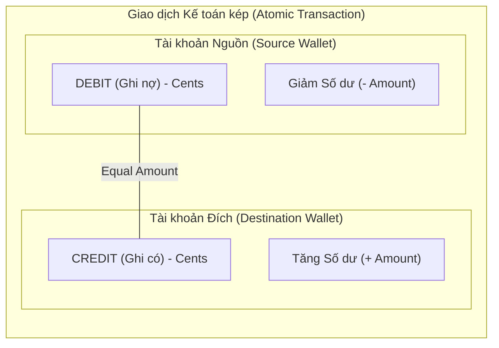
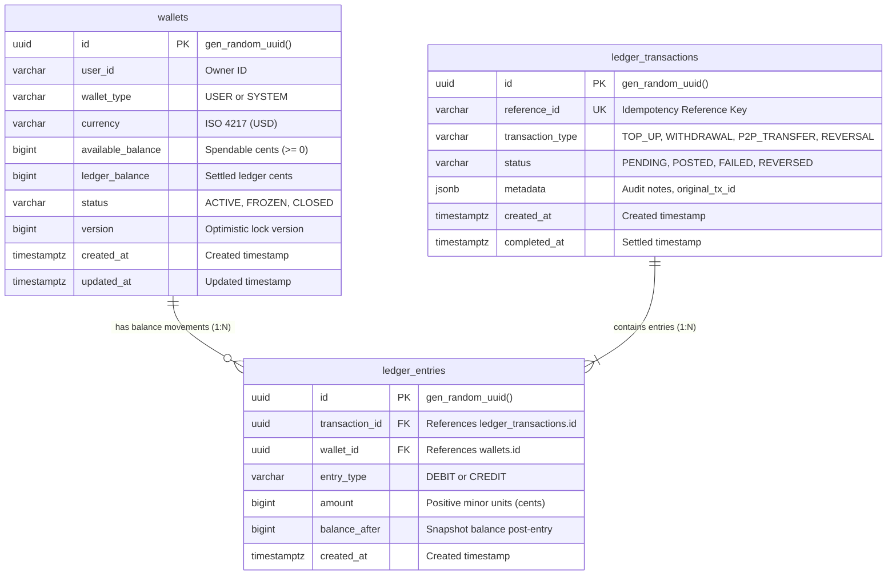
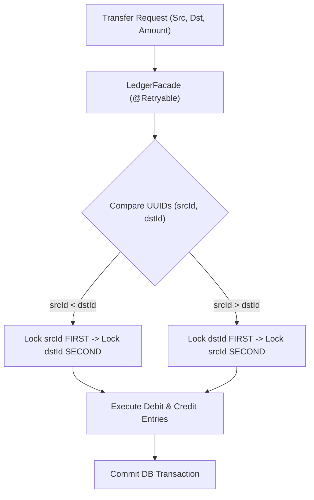
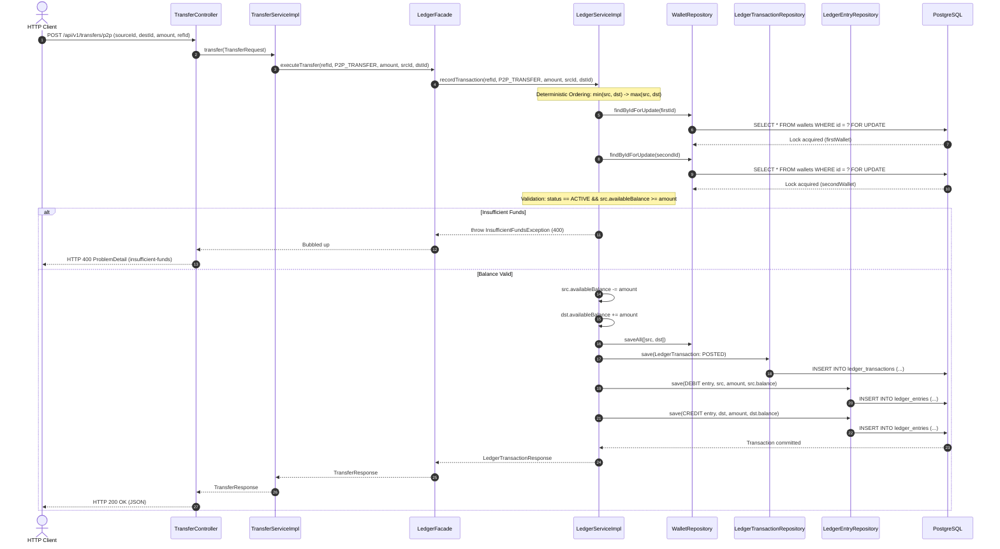
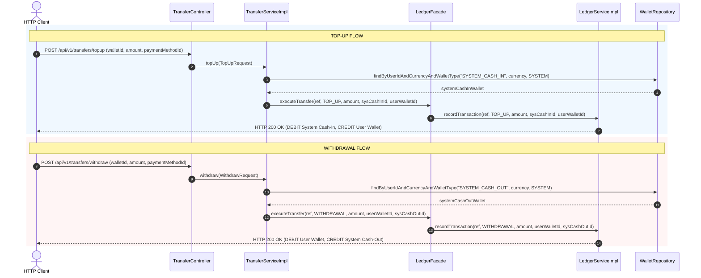
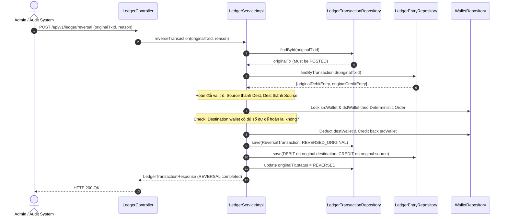
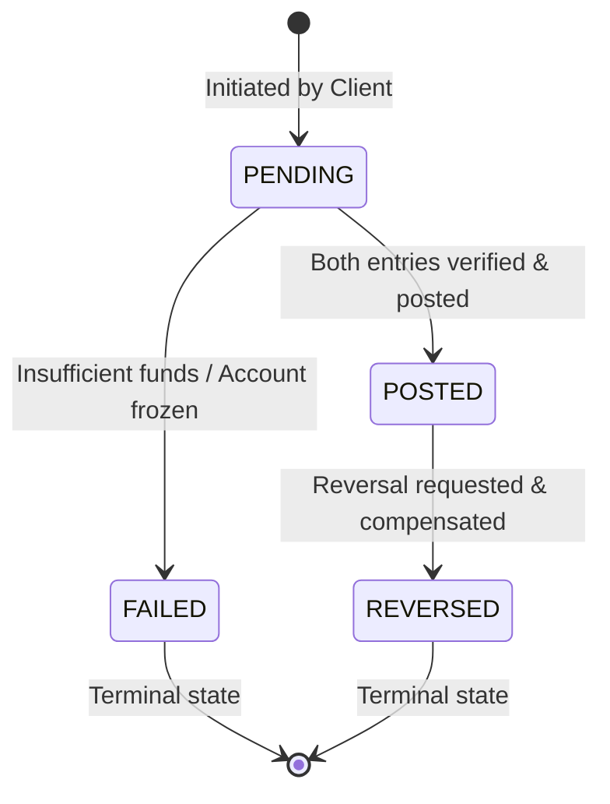

# Kiến Trúc & Luồng Tương Tác Core Double-Entry Ledger (Phase 2)

Tài liệu thiết kế chi tiết hệ thống sổ cái kế toán kép (Double-Entry Bookkeeping), cơ chế khóa chống deadlock và luồng giao dịch tiền tệ an toàn trong ngân hàng số.

---

## 1. Nguyên Lý Kế Toán Kép & Bất Biến Số Dư (Invariants)

Mọi giao dịch biến động số dư tài chính bắt buộc tuân thủ nguyên lý kế toán kép:
- **Không bao giờ tạo hoặc phá hủy tiền từ hư vô**: Tiền chỉ chuyển dịch giữa các tài khoản/ví.
- **Bất biến cân bằng (Balance Invariant)**: Tổng số tiền Ghi nợ (DEBIT) luôn bằng tổng số tiền Ghi có (CREDIT) trên từng mã giao dịch.
  $$\sum \text{Amount}_{\text{DEBIT}} = \sum \text{Amount}_{\text{CREDIT}}$$
- **Bất biến không âm (Non-negative Invariant)**: Ví người dùng (`USER`) không bao giờ được âm số dư khả dụng (`available_balance >= 0`). Ví hệ thống (`SYSTEM`) được phép âm tạm thời để phản ánh nguồn cấp vốn (Clearing/Settlement).

---

## 2. Mô Hình Dữ Liệu Sổ Cái (Ledger ERD)

---

## 3. Kiến Trúc Concurrency & Cơ Chế Khóa Chống Deadlock

Khi hai người dùng chuyển tiền chéo nhau đồng thời:
- Luồng 1: Ví A chuyển sang Ví B.
- Luồng 2: Ví B chuyển sang Ví A.

Nếu khóa theo thứ tự request (`A -> B` và `B -> A`), cơ sở dữ liệu sẽ gặp Deadlock (`ORA-00060 / PG Deadlock detected`).

### Giải pháp kỹ thuật:
1. **Deterministic Lock Ordering**: Luôn sắp xếp thứ tự khóa bi-directional theo thứ tự tự nhiên của khóa chính UUID (`UUID.compareTo`):
   $$\text{First Lock} = \min(\text{srcId}, \text{dstId}), \quad \text{Second Lock} = \max(\text{srcId}, \text{dstId})$$
2. **Pessimistic Lock (`PESSIMISTIC_WRITE`)**: Sử dụng lệnh SQL `SELECT ... FOR UPDATE` đảm bảo độc quyền ghi.
3. **Resilience Retry Layer (`@Retryable`)**: `LedgerFacade` tự động bắt `CannotAcquireLockException` hoặc `OptimisticLockingFailureException` để retry tối đa 3 lần với exponential backoff.

---

## 4. Luồng Chuyển Tiền P2P Transfer (P2P Sequence)

---

## 5. Luồng Nạp Tiền (Top-Up) & Rút Tiền (Withdrawal)

Giao dịch Nạp và Rút tiền tương tác trực tiếp với các Ví Hệ Thống (System Wallets) để bảo toàn nguyên lý kế toán kép:
- **Top-Up**: `DEBIT` Ví hệ thống `SYS_CASH_IN` $\rightarrow$ `CREDIT` Ví người dùng.
- **Withdrawal**: `DEBIT` Ví người dùng $\rightarrow$ `CREDIT` Ví hệ thống `SYS_CASH_OUT`.

---

## 6. Luồng Đảo Ngược Giao Dịch (Reversal Sequence)

Giao dịch trong sổ cái ngân hàng **không bao giờ bị DELETE hoặc UPDATE trực tiếp**. Để sửa sai hoặc hủy thanh toán, hệ thống ghi thêm giao dịch đảo ngược (`REVERSAL`) nhằm triệt tiêu hiệu ứng tài chính:

---

## 7. Máy Trạng Thái Giao Dịch Sổ Cái (Ledger Transaction Lifecycle)

- **PENDING**: Giao dịch đã tiếp nhận, đang tiến hành lấy lock trên 2 ví.
- **POSTED**: Cả hai bút toán DEBIT và CREDIT đã ghi thành công, số dư khả dụng và số dư sổ cái được cập nhật nguyên tử (Atomic).
- **FAILED**: Giao dịch bị hủy do thiếu số dư hoặc vi phạm nghiệp vụ; không bản ghi bút toán nào được lưu.
- **REVERSED**: Giao dịch gốc đã được triệt tiêu hoàn toàn bởi một cặp bút toán đảo ngược tương ứng.
