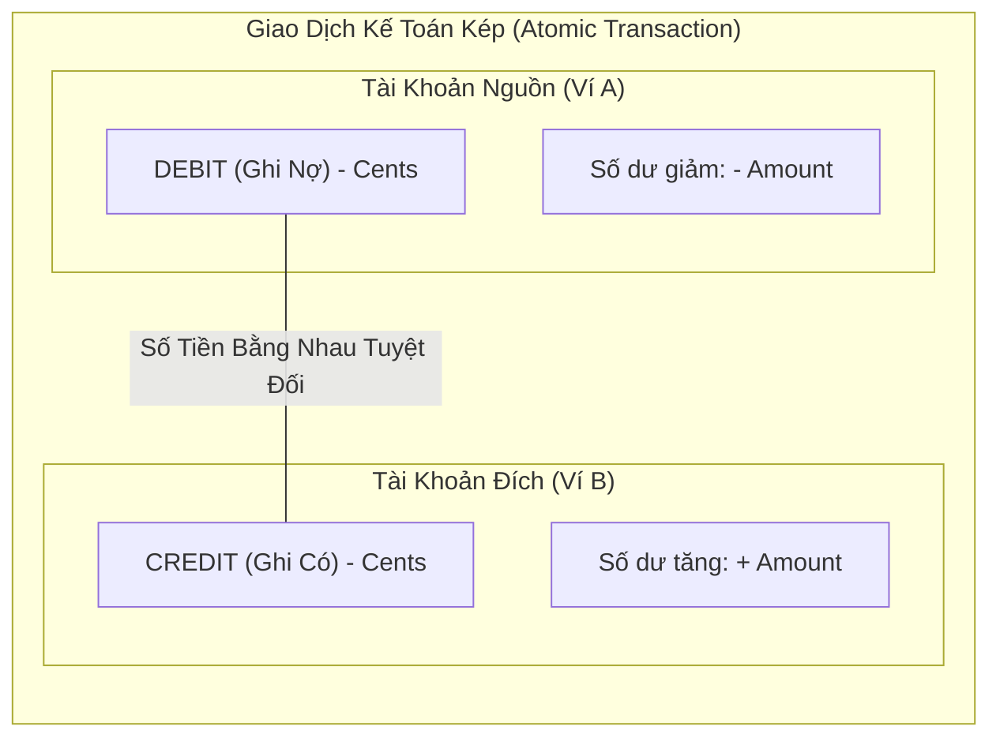
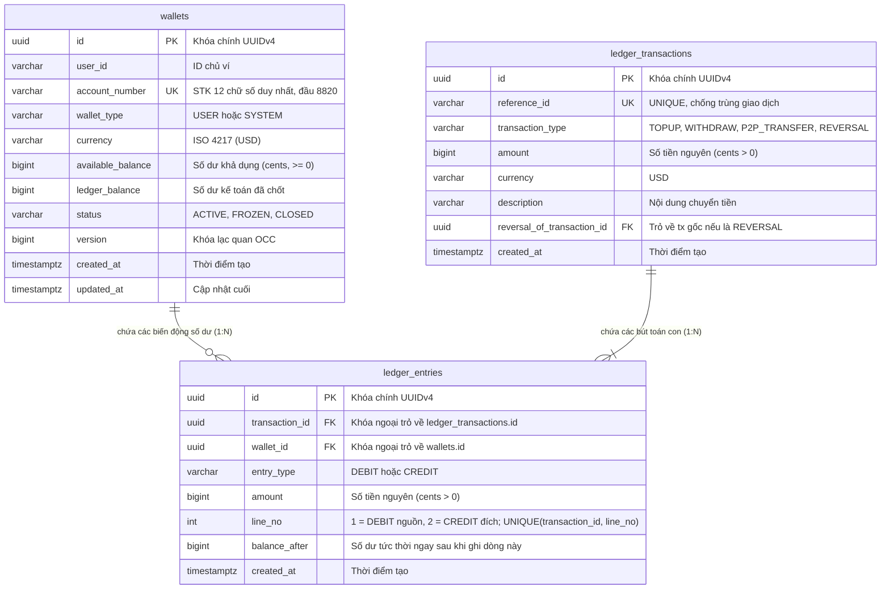
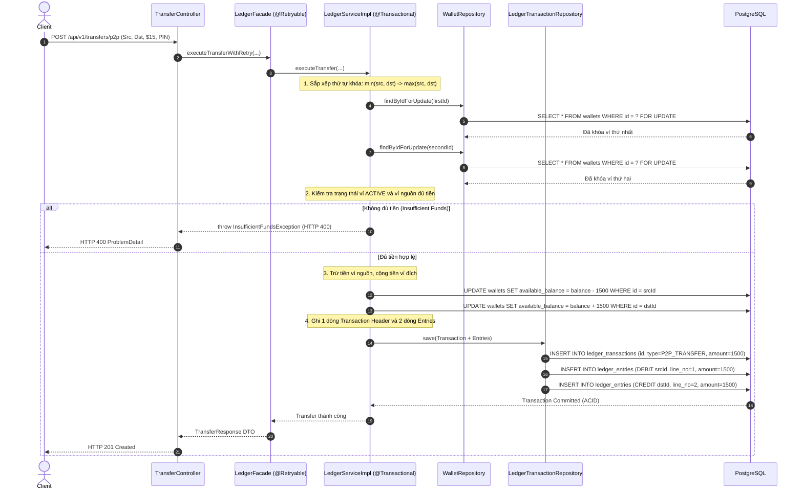
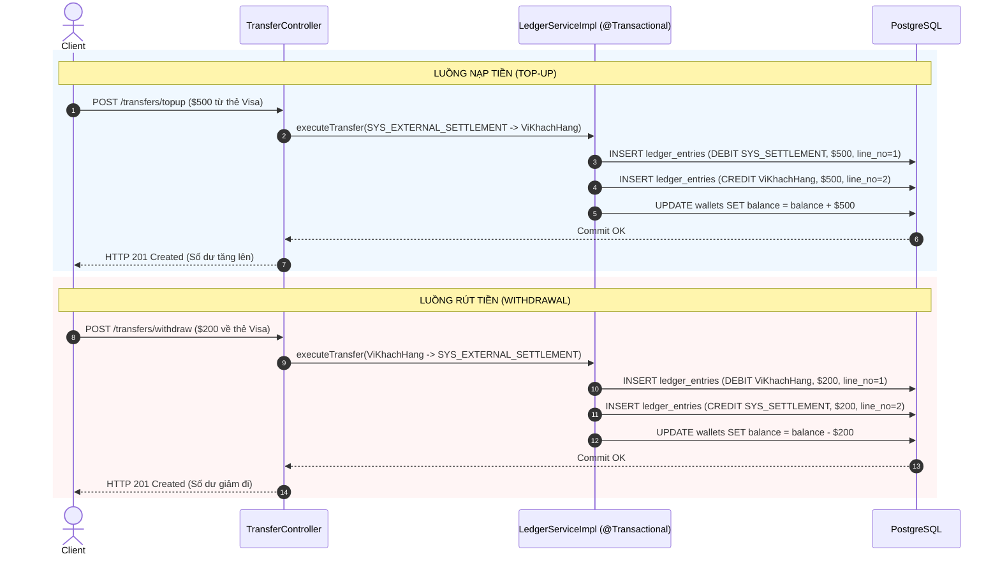
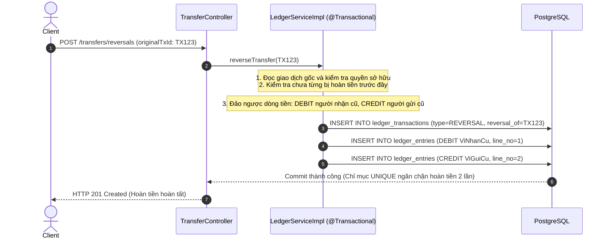

# Kiến Trúc & Luồng Giao Dịch Core Double-Entry Ledger

Tài liệu thiết kế chi tiết về hệ thống Sổ Cái Kế Toán Kép (Double-Entry Bookkeeping), cơ chế khóa bi quan chống Deadlock và cách bảo vệ tính toàn vẹn dòng tiền trong **Mini Digital Wallet**.

---

## 1. Nguyên Lý Kế Toán Kép (Double-Entry Bookkeeping)

Giả sử bạn chuyển 15 USD cho bạn của bạn:
- Ở thế giới thực, tờ tiền 15 USD rời khỏi tay bạn và chuyển sang tay người bạn. Tổng số tiền trên thế giới không hề thay đổi.
- Trong hệ thống ngân hàng, để mô phỏng sự thật đó, mọi giao dịch biến động số dư đều phải tuân thủ **Nguyên Lý Kế Toán Kép**:
  1. **Tiền không bao giờ tự sinh ra hay tự biến mất**: Nó luôn luôn đi từ một nơi (ví A) đến một nơi khác (ví B).
  2. **Bất biến cân bằng (Balance Invariant)**: Tổng số tiền Ghi nợ (`DEBIT`) luôn luôn bằng tổng số tiền Ghi có (`CREDIT`) trên từng giao dịch:
     $$\sum \text{Amount}_{\text{DEBIT}} = \sum \text{Amount}_{\text{CREDIT}}$$
  3. **Bất biến không âm (Non-negative Invariant)**: Ví của khách hàng (`USER`) không bao giờ được phép mang số dư âm (`available_balance >= 0`). Ví hệ thống (`SYSTEM`) được phép mang số dư âm vì nó đóng vai trò đại diện cho nguồn vốn đối ứng bên ngoài.



---

## 2. Mô Hình Dữ Liệu Sổ Cái (Ledger ERD)



---

## 3. Cơ Chế Khóa Bi Quan & Triệt Tiêu Deadlock

### Vấn đề Deadlock là gì?
Khi hai người bạn A và B cùng lúc chuyển tiền cho nhau trên 2 điện thoại khác nhau:
- Luồng 1 (từ ví A sang ví B): Cần khóa ví A trước, rồi khóa ví B sau.
- Luồng 2 (từ ví B sang ví A): Cần khóa ví B trước, rồi khóa ví A sau.

Nếu cả 2 luồng chạy cùng một phần nghìn giây: Luồng 1 giữ A và đợi B; Luồng 2 giữ B và đợi A. Cả hai bên chờ nhau mãi mãi gây **Deadlock** treo cứng cơ sở dữ liệu!

### Giải pháp trong hệ thống:
1. **Sắp xếp thứ tự khóa nhất quán (Deterministic Lock Ordering)**:
   - Không bao giờ khóa theo thứ tự người gửi/người nhận.
   - So sánh chuỗi UUID của 2 ví theo bảng chữ cái:
     `Khóa Thứ Nhất = min(UUID_A, UUID_B), Khóa Thứ Hai = max(UUID_A, UUID_B)`
   - Dù là A chuyển cho B hay B chuyển cho A, cả hai luồng đều bắt buộc phải xin khóa ví có UUID nhỏ hơn trước. Điều kiện chờ đợi vòng tròn bị phá vỡ hoàn toàn!
2. **Khóa độc quyền ghi (Pessimistic Lock)**:
   - Sử dụng câu lệnh SQL: `SELECT ... FOR UPDATE` thông qua `@Lock(LockModeType.PESSIMISTIC_WRITE)` của JPA.
3. **Lớp phục hồi tự động (`@Retryable`)**:
   - `LedgerFacade` tự động thử lại tối đa 3 lần nếu có tranh chấp lock tạm thời giữa các luồng, mỗi lần thử lại chạy trên một transaction sạch sẽ.

```mermaid
flowchart TD
    REQ["Yêu cầu chuyển tiền: Ví A <-> Ví B"] --> FACADE["LedgerFacade (@Retryable)"]
    FACADE --> ORDER{"So sánh UUID(A) và UUID(B)"}
    ORDER -->|UUID(A) &lt; UUID(B)| LOCK_AB["Khóa Ví A trước -> Khóa Ví B sau"]
    ORDER -->|UUID(B) &lt; UUID(A)| LOCK_BA["Khóa Ví B trước -> Khóa Ví A sau"]
    LOCK_AB --> EXEC["Ghi bút toán Debit & Credit"]
    LOCK_BA --> EXEC
    EXEC --> COMMIT["Commit Transaction & Nhả Khóa"]
```

---

## 4. Sequence Diagram: Luồng Chuyển Tiền P2P



---

## 5. Sequence Diagram: Luồng Nạp Tiền (Top-Up) & Rút Tiền (Withdrawal)

Giao dịch Nạp và Rút tiền đều sử dụng ví hệ thống `SYS_EXTERNAL_SETTLEMENT` (`00000000-0000-0000-0000-000000000001`) làm tài khoản đối ứng:



---

## 6. Sequence Diagram: Luồng Hoàn Tiền (Reversal)

Giao dịch cũ hoàn toàn giữ nguyên tính bất biến. Hệ thống tạo một giao dịch mới trỏ về giao dịch cũ và đảo ngược bút toán:



---

## 7. Vì Sao `@Retryable` Phải Tách Riêng Khỏi `@Transactional`?

Câu hỏi kinh điển dành cho fresher: *"Tại sao không viết cả `@Retryable` và `@Transactional` lên cùng một hàm trong `LedgerServiceImpl`?"*.

- **Bản chất Spring Proxy**: Khi một transaction trong Spring gặp lỗi Deadlock ở tầng DB, Spring sẽ đánh dấu transaction đó là **Rollback-Only** (đã hỏng, không thể commit nữa).
- Nếu `@Retryable` nằm chung trên cùng một bean: Lần thử lại (retry) sẽ chạy tiếp trên **chính transaction đã bị đánh dấu hỏng đó** $\rightarrow$ Nhận ngay ngoại lệ `TransactionRollbackException` và retry hoàn toàn vô ích.
- Khi tách ra 2 Bean riêng:
  - `LedgerFacade` nằm ngoài, mang `@Retryable`.
  - `LedgerServiceImpl` nằm trong, mang `@Transactional`.
  - Khi `LedgerServiceImpl` báo lỗi deadlock, transaction cũ bị rollback và hủy bỏ. `LedgerFacade` bắt được lỗi và gọi lại hàm, Spring sẽ mở một transaction hoàn toàn mới sạch sẽ.
