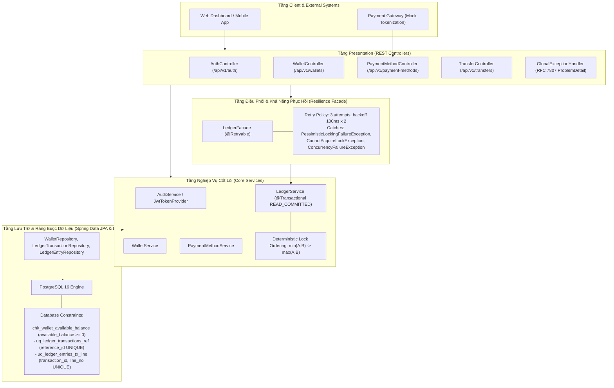
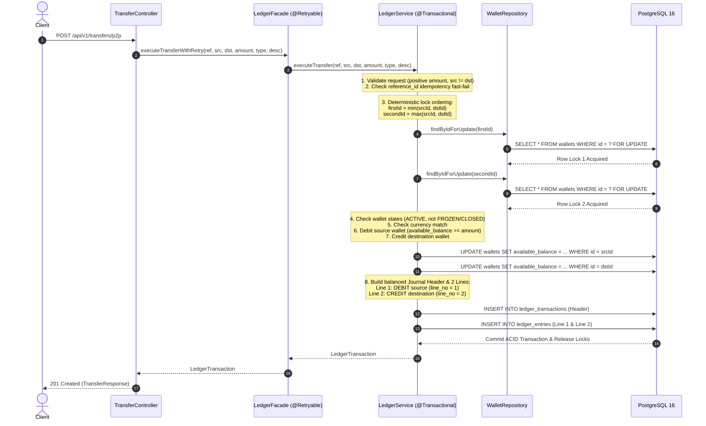

# Kiến Trúc Tổng Quan Hệ Thống Mini Digital Wallet (Phase 2)

Tài liệu mô tả kiến trúc tổng thể, mô hình phân tầng Layered Architecture và luồng điều phối giao dịch tài chính cốt lõi của **mini-digital-wallet** tại mốc Phase 2.

---

## 1. Mô Hình Kiến Trúc Phân Tầng (Layered Architecture)

Hệ thống được tổ chức theo kiến trúc phân tầng (Package-by-Layer) nghiêm ngặt nhằm tách biệt ranh giới trách nhiệm, ranh giới AOP Retry và ranh giới ACID Transaction:

---

## 2. Luồng Xử Lý Giao Dịch Chuyển Tiền Cốt Lõi (Phase 2 Transaction Flow)

Biểu đồ tuần tự chi tiết luồng xử lý giao dịch chuyển tiền hai ví (P2P Transfer) với cơ chế bọc ngoài `@Retryable`, khóa thứ tự chống Deadlock và ghi nhận bút toán kép:

---

## 3. Các Thành Phần Trách Nhiệm & Bất Biến Kỹ Thuật

### 3.1 Phân định ranh giới Facade vs Transaction

- **`LedgerFacade`**: Mang annotation `@Retryable`. Chịu trách nhiệm thực hiện thử lại (tối đa 3 lần) khi cơ sở dữ liệu xảy ra xung đột khóa hoặc tranh chấp tài nguyên tạm thời. Mỗi lần thử lại kích hoạt một giao dịch ACID mới hoàn toàn.
- **`LedgerService`**: Mang annotation `@Transactional(isolation = Isolation.READ_COMMITTED)`. Tuyệt đối không chứa logic retry bên trong để tránh retry trên Session Hibernate đã bị bẩn (dirty) hoặc bị đánh dấu rollback.

### 3.2 Giải pháp phá vỡ Deadlock (Deterministic Lock Ordering)

Khi hai luồng thực thi giao dịch chuyển tiền ngược chiều cùng thời điểm ($A \rightarrow B$ và $B \rightarrow A$):
- Nếu lấy khóa theo thứ tự tham số truyền vào: Luồng 1 giữ lock $A$ chờ $B$; Luồng 2 giữ lock $B$ chờ $A$ $\rightarrow$ Sinh chu trình chờ (Circular Wait) gây Deadlock.
- **Giải pháp**: Luôn so sánh UUID theo thứ tự từ điển:
  $$\text{First Lock} = \min(A, B), \quad \text{Second Lock} = \max(A, B)$$
  Cả hai luồng bắt buộc phải xin khóa ví nhỏ hơn trước, loại bỏ hoàn toàn chu trình chờ trong đồ thị cấp phát tài nguyên.

### 3.3 Tính toàn vẹn sổ kép (Double-Entry Bookkeeping)

- Tiền tệ được định lượng bằng đơn vị nguyên nhỏ nhất (`Long` cents).
- Mỗi giao dịch biến động số dư phải thỏa mãn phương trình kế toán:
  $$\sum \text{Amount}_{\text{DEBIT}} = \sum \text{Amount}_{\text{CREDIT}}$$
- Bảng `ledger_entries` đánh số dòng `line_no` (1 cho DEBIT, 2 cho CREDIT) kèm ràng buộc `UNIQUE(transaction_id, line_no)` để bảo đảm thứ tự và tính toàn vẹn của bút toán.
- Hoàn tiền (`reversal`) tuân thủ tính chất bất biến (Append-Only): Không cập nhật hoặc xóa bút toán cũ; tạo giao dịch mới kiểu `REVERSAL` đảo ngược dòng tiền và liên kết qua `reversal_of_transaction_id`.

---

## 4. Bảng Tổng Hợp Lý Thuyết & Hành Động Kỹ Thuật (Theory Summary)

> **[Action]**: Tách ranh giới `@Retryable` trên `LedgerFacade` và `@Transactional` trên `LedgerService`.  
> **[Theory Recall]**: Spring AOP Proxy Chain & Transaction Boundary Lifecycle. Retry phải bọc ngoài Transaction để mở session mới khi gặp lỗi rollback.  
> **[Design Pattern]**: Facade Pattern + Retry Pattern.  
> **[Catastrophe Prevented]**: Tránh ngoại lệ `TransactionSystemException` do thực thi trên session Hibernate đã rollback.  
> **[Interview TL;DR]**: "Tách Facade mang `@Retryable` ra ngoài Service mang `@Transactional` bảo đảm mỗi lần thử lại chạy trong một transaction độc lập."

> **[Action]**: Sắp xếp thứ tự khóa tài khoản `min(A, B) -> max(A, B)` trước khi thực hiện `SELECT ... FOR UPDATE`.  
> **[Theory Recall]**: Phá vỡ điều kiện Circular Wait trong 4 điều kiện sinh Deadlock của Coffman (Mutual Exclusion, Hold & Wait, No Preemption, Circular Wait).  
> **[Design Pattern]**: Deterministic Resource Allocation / Ordered Lock Acquisition.  
> **[Catastrophe Prevented]**: Triệt tiêu hoàn toàn database deadlock khi 2 tài khoản chuyển tiền đối xứng song song.  
> **[Interview TL;DR]**: "Sắp xếp khóa theo thứ tự đơn điệu chuyển đồ thị chờ tài nguyên thành đồ thị có hướng không chu trình (DAG)."
