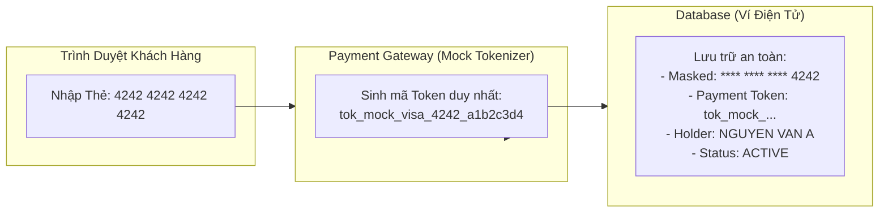
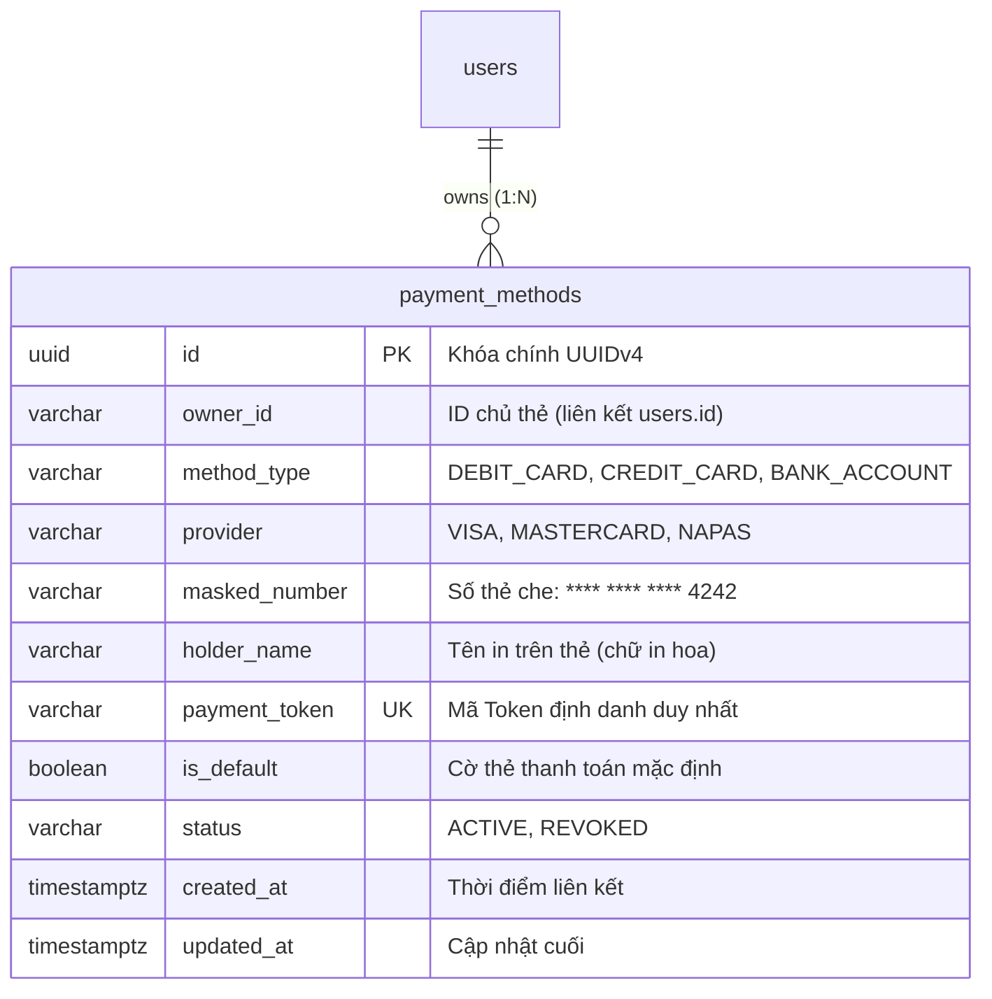
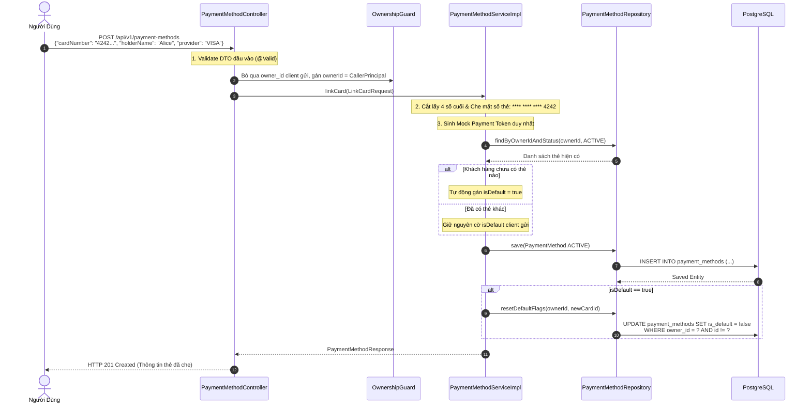
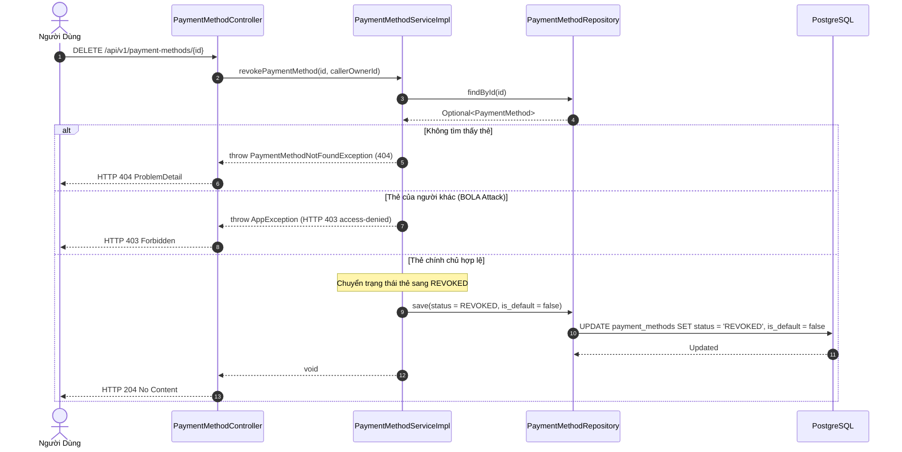

# Kiến Trúc & Luồng Tương Tác Payment Method (Quản Lý Thẻ & Nguồn Tiền)

Tài liệu thiết kế chi tiết kiến trúc tầng, mô hình dữ liệu và các sequence diagram cho tính năng liên kết thẻ thanh toán quốc tế (Visa, Mastercard) chuẩn bảo mật **PCI-DSS Tokenization** trong **Mini Digital Wallet**.

---

## 1. Nguyên Tắc Bảo Mật Thẻ PCI-DSS & Tokenization

Trong các hệ thống fintech, việc lưu trữ số thẻ ngân hàng thật (Primary Account Number - PAN 16 chữ số) và mã bảo mật (CVV/CVC) đòi hỏi chứng chỉ bảo mật cực kỳ khắt khe của hội đồng PCI Security Standards Council. Nếu cơ sở dữ liệu bị lộ, toàn bộ thẻ của khách hàng sẽ bị kẻ gian đánh cắp tiền.

### Giải pháp kỹ thuật trong hệ thống:
1. **Tuyệt đối không lưu số thẻ thật vào Database**:
   - Khi khách hàng nhập số thẻ `4242424242424242`, hệ thống giả lập việc gửi thông tin sang Cổng thanh toán (Payment Gateway Mock).
   - Cổng thanh toán xác thực thẻ và trả về một mã token ngẫu nhiên an toàn: `tok_mock_visa_4242_a1b2c3d4`.
2. **Che mặt số thẻ (Masked Number)**:
   - Hệ thống chỉ lưu chuỗi hiển thị đã che: `**** **** **** 4242` để khách hàng nhận diện thẻ của mình trên giao diện.
3. **Cơ chế Thẻ mặc định (Default Card Management)**:
   - Nếu khách hàng liên kết thẻ đầu tiên, thẻ đó tự động trở thành thẻ mặc định (`is_default = true`).
   - Khi khách hàng đặt một thẻ khác làm mặc định, hệ thống tự động reset cờ mặc định của tất cả các thẻ còn lại của người dùng đó.

---

## 2. Mô Hình Dữ Liệu Phương Thức Thanh Toán (ERD)

---

## 3. Sequence Diagram: Luồng Liên Kết Thẻ Mới (`POST /api/v1/payment-methods`)

---

## 4. Sequence Diagram: Luồng Hủy Thẻ Liên Kết (`DELETE /api/v1/payment-methods/{id}`)

Nguyên tắc bảo vệ dữ liệu: Khi khách hàng hủy thẻ, hệ thống **không xóa dòng dữ liệu khỏi database** mà chuyển trạng thái sang `REVOKED` (Soft Delete). Điều này giúp giữ toàn vẹn lịch sử đối soát của các giao dịch Nạp/Rút tiền đã từng sử dụng chiếc thẻ này trong quá khứ.

---

## 5. Bảng Tổng Hợp Hành Động & Lý Thuyết (Action & Theory Summary)

> **[Hành Động]**: Chỉ lưu `masked_number` và `payment_token`, không lưu số thẻ PAN 16 chữ số hay mã CVV vào cơ sở dữ liệu.  
> **[Lý Thuyết]**: Tiêu chuẩn an ninh dữ liệu thẻ thanh toán PCI-DSS (Payment Card Industry Data Security Standard) & Tokenization.  
> **[Mẫu Thiết Kế]**: Tokenization Pattern.  
> **[Thảm Họa Tránh Được]**: Lộ toàn bộ thông tin thẻ tín dụng của khách hàng nếu cơ sở dữ liệu bị tấn công.  
> **[Phỏng Vấn TL;DR]**: "Tokenization thay thế dữ liệu thẻ nhạy cảm bằng một chuỗi định danh ngẫu nhiên không thể giải mã ngược, triệt tiêu hoàn toàn rủi ro rò rỉ thẻ ngân hàng của khách hàng."

---

> **[Hành Động]**: Bỏ qua `owner_id` trong request body và luôn trích xuất `caller_id` từ token JWT đã xác thực.  
> **[Lý Thuyết]**: Phòng thủ lỗ hổng bảo mật BOLA / IDOR (Broken Object Level Authorization - OWASP API Security Top 1).  
> **[Mẫu Thiết Kế]**: Secure Context Resolution / Ownership Guard.  
> **[Thảm Họa Tránh Được]**: Kẻ xấu lợi dụng API để liên kết hoặc hủy trái phép thẻ của người dùng khác.  
> **[Phỏng Vấn TL;DR]**: "Không bao giờ tin tưởng định danh người dùng do client tự khai báo trong payload; luôn phân giải danh tính từ Authentication Context của phiên đăng nhập."
