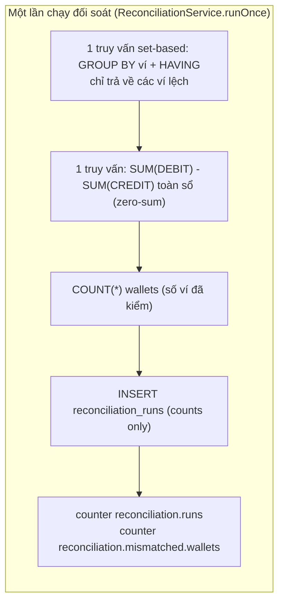
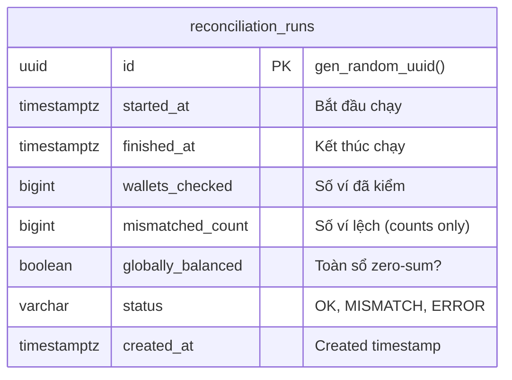
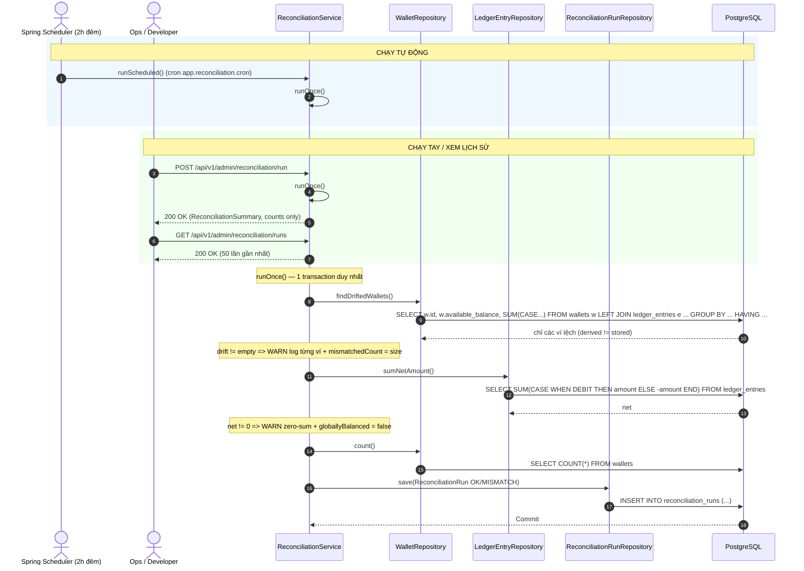
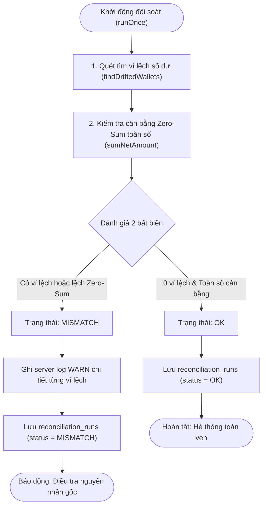

# Kiến Trúc & Luồng Đối Soát Sổ Cái (Phase 4 Reconciliation)

Tài liệu thiết kế job đối soát định kỳ: chứng minh mọi snapshot số dư khớp với nhật ký bút toán, toàn sổ zero-sum, và vết audit cho kiểm toán.

---

## 1. Nguyên Lý Đối Soát (Reconciliation Invariants)

Mỗi lần chạy kiểm tra 2 bất biến trên dữ liệu thật (PostgreSQL), không tin snapshot:

1. **Khớp từng ví**: `wallets.available_balance == sum(CREDIT) - sum(DEBIT)` (cộng từ `ledger_entries` theo `wallet_id`).
2. **Zero-sum toàn sổ**: `sum(DEBIT) == sum(CREDIT)` trên mọi entries.

---

## 2. Mô Hình Dữ Liệu Audit (ERD)

> Bảng chỉ lưu **số lượng**, tuyệt đối không lưu số dư từng ví. Chi tiết ví lệch ghi server log (`WARN`), API chỉ trả counts — tránh lộ số dư người khác. Hai endpoint admin yêu cầu `ROLE_ADMIN`.

---

## 3. Luồng Chạy Định Kỳ & Chạy Tay (Sequence)

---

## 4. Vòng Đời & Luồng Phân Nhánh Đối Soát (Run Lifecycle)

- **OK**: Hệ thống hoàn toàn toàn vẹn, không có ví nào bị lệch số dư, toàn sổ cân bằng Zero-Sum.
- **MISMATCH**: Kiểm toán phát hiện lệch tiền. Đọc server log `Reconciliation mismatch: wallet=... derived=... stored=... diff=...` để điều tra nguyên nhân gốc (tuyệt đối không sửa số dư bằng tay để khớp số).

---

## 5. Bảng Tổng Hợp Hành Động & Lý Thuyết (Action & Theory Summary)

> **[Action]**: Đối soát `available_balance == sum(CREDIT) - sum(DEBIT)` từ journal thay vì tin snapshot, chạy đêm + lưu `reconciliation_runs`.
> **[Theory Recall]**: Audit Trail & Eventual Consistency Verification — snapshot là projection có thể drift, journal append-only mới là sự thật.  
> **[Design Pattern]**: Scheduled Audit Job (không can thiệp luồng ghi, chỉ đọc).  
> **[Catastrophe Prevented]**: Phát hiện sớm bug làm lệch tiền (ghi snapshot sai, update tay) trước khi thành thất thoát.  
> **[Interview TL;DR]**: "Không bao giờ tin số dư cache; đêm nào cũng cộng lại toàn bộ sổ từ dòng bút toán bất biến, lệch là báo động."
