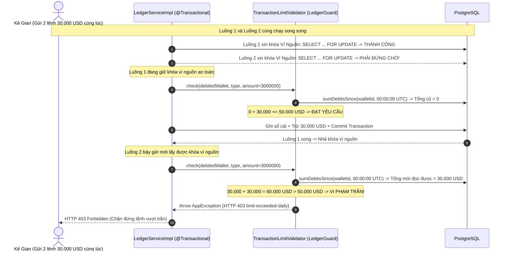
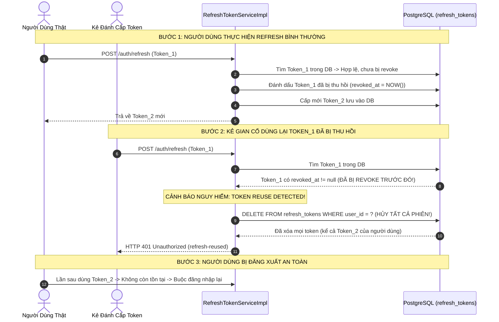

# Kiến Trúc Bảo Vệ & Phòng Thủ Đa Tầng (Security Guards & Tokens)

Tài liệu thiết kế chi tiết các cơ chế phòng thủ chuyên sâu trong **Mini Digital Wallet**: Kiểm soát hạn mức giao dịch dưới khóa hàng, xác thực mã PIN 6 số chống tấn công vét cạn (Brute-Force), và xoay vòng Refresh Token phát hiện đánh cắp phiên.

---

## 1. Kiểm Soát Hạn Mức Giao Dịch Dưới Khóa Hàng (`TransactionLimitValidator`)

### Lỗ hổng TOCTOU Race Condition là gì?
- **TOCTOU** (Time-Of-Check to Time-Of-Use) là một lỗi bảo mật nghiêm trọng trong lập trình đa luồng.
- Giả sử hạn mức chi tiêu trong ngày của một ví là **50.000 USD**. Hiện tại khách hàng chưa tiêu đồng nào (Tổng ngày = 0 USD).
- Kẻ gian mở 2 tab trình duyệt hoặc gửi đồng thời 2 request chuyển tiền, mỗi lệnh trị giá **30.000 USD** trong cùng một phần nghìn giây.
- **Nếu kiểm tra hạn mức ngoài tầng Controller/Service trước khi khóa database**:
  - Cả Luồng 1 và Luồng 2 đều đọc ra: Tổng ngày = 0 USD.
  - Cả hai đều kiểm tra: `0 + 30.000 <= 50.000 USD` -> Hợp lệ!
  - Cả hai luồng cùng được thực thi. Tổng tiền chi ra là **60.000 USD**, vượt trần hạn mức 50.000 USD!

### Giải pháp kỹ thuật: Kiểm tra hạn mức ngay dưới khóa hàng bi quan (`LedgerGuard`)
Hệ thống giải quyết triệt để lỗ hổng này bằng cách thực thi `TransactionLimitValidator` như một `LedgerGuard` **bên trong transaction sổ cái ngay sau khi đã khóa hàng ví nguồn (`SELECT ... FOR UPDATE`)**:



---

## 2. Xác Thực Mã PIN Giao Dịch & Chống Vét Cạn (`TransactionPinValidator`)

### Cơ chế hoạt động:
1. **Băm an toàn BCrypt**: Mã PIN gồm 6 chữ số (`000000` - `999999`), được băm với chi phí tính toán cao (`cost = 10`) và lưu tại cột `users.pin_hash`.
2. **Khóa 15 phút sau 5 lần nhập sai (`PinRateLimiter`)**:
   - Theo dõi số lần nhập sai liên tiếp theo `userId`.
   - Sau lần sai thứ 5, hàm `pinRateLimiter.isBlocked(userId)` trả về `true`. Hệ thống từ chối ngay lập tức với mã lỗi `HTTP 429 Too Many Requests` trong vòng 15 phút mà không thèm kiểm tra DB/BCrypt (giảm tải CPU máy chủ).
   - Khi nhập đúng, bộ đếm lỗi được xóa sạch về 0 (`reset`).

```mermaid
flowchart TD
    Req["Request Giao Dịch (Header: X-Transaction-Pin)"] --> CheckLock{"PinRateLimiter.isBlocked(userId)?"}
    CheckLock -->|Đang bị khóa (>= 5 lần sai)| Block["Từ chối ngay: HTTP 429 Too Many Requests (Khóa 15 phút)"]
    CheckLock -->|Chưa bị khóa| CheckInput{"Có truyền mã PIN không?"}
    CheckInput -->|Không truyền PIN| RequirePin["Từ chối: HTTP 401 pin-required"]
    CheckInput -->|Có truyền PIN| VerifyBCrypt{"BCrypt.matches(pin, user.pinHash)?"}
    VerifyBCrypt -->|Sai mã PIN| RecordFail["Ghi nhận 1 lần sai (recordFailure)"]
    RecordFail --> Error401["Từ chối: HTTP 401 pin-invalid"]
    VerifyBCrypt -->|Đúng mã PIN| Reset["Xóa sạch bộ đếm sai (reset = 0)"]
    Reset --> Proceed["Cho phép tiếp tục thực thi giao dịch"]
```

---

## 3. Quản Lý Phiên: Rotating Refresh Token & Phát Hiện Đánh Cắp Token

Hệ thống kết hợp cặp Token:
- **Access Token**: JWT có chữ ký điện tử HMAC-SHA256, thời hạn ngắn (15 phút), chứa thông tin người dùng và quyền hạn (claims).
- **Refresh Token**: Chuỗi ngẫu nhiên bảo mật cao (Opaque Token), thời hạn 7 ngày, lưu mã băm SHA-256 trong bảng `refresh_tokens`.

### Thuật toán Xoay Vòng (Token Rotation) & Tự Động Thu Hồi Khi Bị Đánh Cắp (Theft Detection):
Khi một Refresh Token được sử dụng để lấy Access Token mới:
1. Token cũ ngay lập tức bị vô hiệu hóa (`revoked_at = NOW()`).
2. Một Refresh Token mới toanh được sinh ra và cấp lại cho client.
3. **Phát hiện bị đánh cắp**: Nếu kẻ gian và người dùng cùng sở hữu một token cũ đã bị thu hồi:
   - Khi kẻ gian cố tình gửi token cũ lên (`current.isRevoked() == true`), hệ thống phát hiện đây là hành vi **Dùng lại token đã xoay (Token Reuse)**.
   - Hệ thống lập tức kích hoạt biện pháp trừng phạt cao nhất: **Xóa sạch toàn bộ Refresh Token của tài khoản đó (`deleteByUserId`)**.
   - Mọi thiết bị (kể cả máy của kẻ gian lẫn máy người dùng) đều bị đăng xuất ngay lập tức, vô hiệu hóa hoàn toàn cuộc tấn công.



---

## 4. Bảng Tổng Hợp Hành Động & Lý Thuyết (Action & Theory Summary)

> **[Hành Động]**: Kiểm tra hạn mức lũy kế ngày trong cùng một transaction sau khi đã giữ khóa dòng ví nguồn.  
> **[Lý Thuyết]**: Phòng chống lỗ hổng TOCTOU (Time-of-Check to Time-of-Use) Race Condition.  
> **[Mẫu Thiết Kế]**: Pessimistic Guard Pattern.  
> **[Thảm Họa Tránh Được]**: Khách hàng gửi đồng thời nhiều lệnh rút tiền để vượt trần hạn mức ngân hàng quy định.  
> **[Phỏng Vấn TL;DR]**: "Mọi kiểm tra phụ thuộc vào trạng thái lũy kế thay đổi liên tục bắt buộc phải được đặt sau khóa bi quan của dòng dữ liệu để loại bỏ race condition."

---

> **[Hành Động]**: Triển khai cơ chế xoay vòng Refresh Token và thu hồi toàn bộ phiên khi phát hiện token cũ được sử dụng lại.  
> **[Lý Thuyết]**: OAuth 2.0 Threat Model (RFC 6819 Section 5.2.2.3 - Refresh Token Rotation).  
> **[Mẫu Thiết Kế]**: Token Rotation & Cascading Revocation.  
> **[Thảm Họa Tránh Được]**: Kẻ gian đánh cắp được token trong mạng công cộng và duy trì quyền truy cập vĩnh viễn vào tài khoản nạn nhân.  
> **[Phỏng Vấn TL;DR]**: "Xoay vòng token giới hạn tuổi thọ của mỗi token trong một lần dùng duy nhất; phát hiện dùng lại token là chỉ dấu rõ ràng của việc token bị rò rỉ, kích hoạt cơ chế tự hủy toàn bộ phiên."
