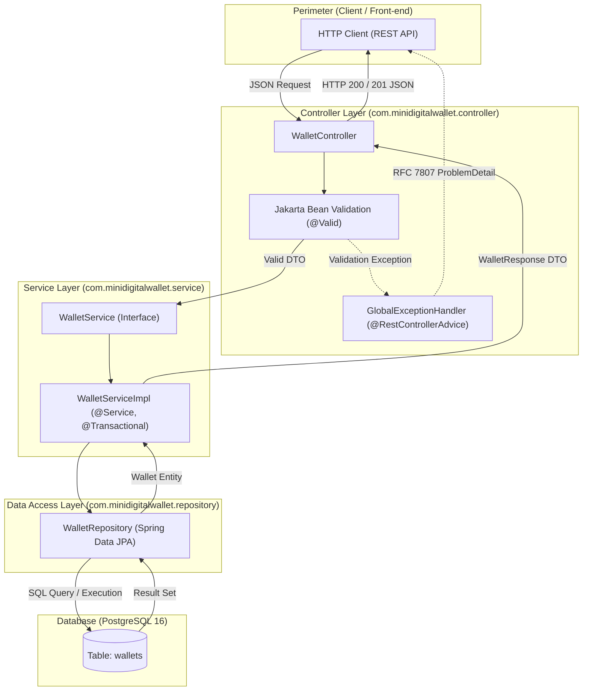
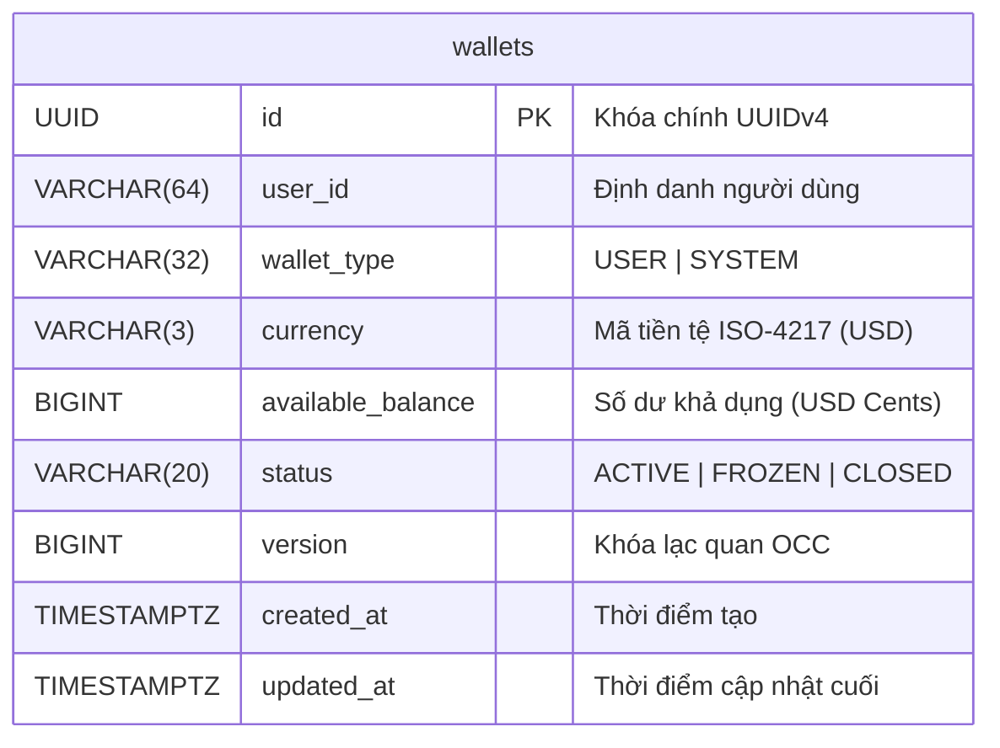
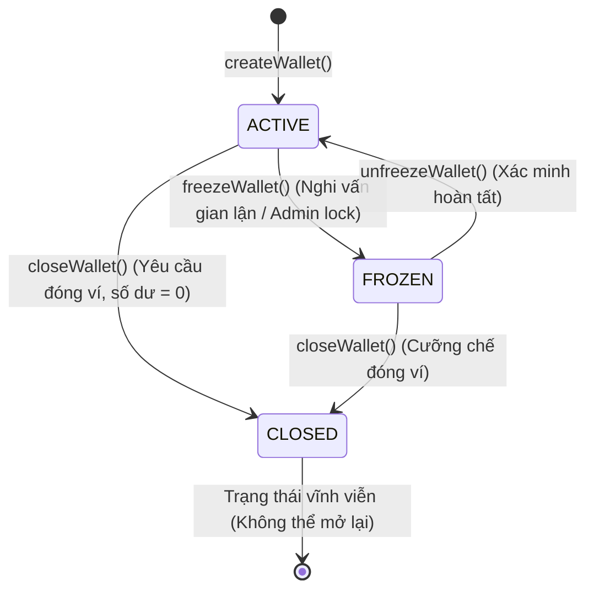
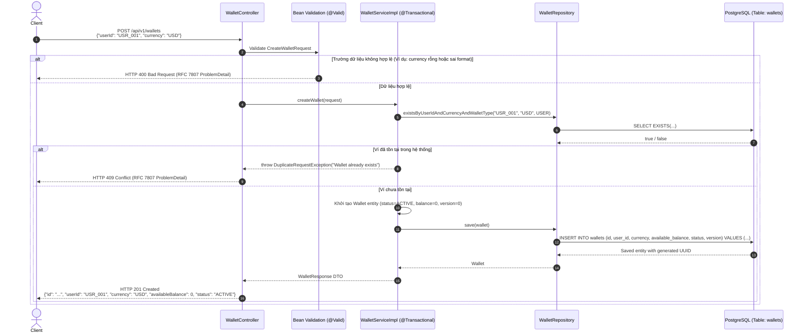

# Kiến Trúc & Luồng Tương Tác Module Wallet (Phase 1)

Tài liệu thiết kế chi tiết kiến trúc tầng, mô hình thực thể và luồng tương tác tuần tự (sequence diagrams) của module **Wallet** trong Phase 1.

---

## 1. Kiến Trúc Tầng Package-by-Layer (MVC Pattern)

Hệ thống tuân thủ nghiêm ngặt mô hình phân tầng chuẩn MVC trong Spring Boot:



- **Controller**: Tiếp nhận HTTP request, áp dụng `@Valid` để fail-fast các input sai quy cách, chuyển đổi DTO sang tham số gọi Service. Không chứa business logic.
- **Service**: Điều phối nghiệp vụ (`createWallet`, `getWalletByUserId`, `getBalance`), kiểm tra trùng lặp, gọi repository trong transaction.
- **Repository**: Cung cấp các thao tác truy xuất dữ liệu an toàn với `Optional<Wallet>`.
- **Entity**: Đóng gói trạng thái và ràng buộc của ví.

---

## 2. Mô Hình Dữ Liệu & Ràng Buộc Bất Biến (ERD & Invariants)



### Các Bất Biến Cấp Cơ Sở Dữ Liệu (Database Invariants)
1. **Không âm số dư ví người dùng**:
   ```sql
   CONSTRAINT chk_wallet_available_balance CHECK (wallet_type = 'SYSTEM' OR available_balance >= 0)
   ```
   Ví người dùng (`USER`) không bao giờ được phép âm. Ví hệ thống (`SYSTEM`) được phép mang số dư âm khi đóng vai trò tài khoản nguồn đối ứng (External Settlement).
2. **Duy nhất một ví cho mỗi cặp `(user_id, currency, wallet_type)`**:
   ```sql
   CONSTRAINT uq_wallets_user_currency_type UNIQUE (user_id, currency, wallet_type)
   ```
3. **Danh mục trạng thái và loại ví chuẩn hóa**:
   ```sql
   CONSTRAINT chk_wallet_type CHECK (wallet_type IN ('USER', 'SYSTEM'))
   CONSTRAINT chk_wallet_status CHECK (status IN ('ACTIVE', 'FROZEN', 'CLOSED'))
   ```

### Ví Hệ Thống Khởi Tạo Sẵn (Seeded System Accounts)
Hệ thống seed sẵn 3 ví hệ thống cố định để phục vụ các luồng nạp/rút/phí ở các phase sau:
- `SYS_EXTERNAL_SETTLEMENT` (`00000000-0000-0000-0000-000000000001`): Tài khoản đối ứng cổng thanh toán / ngân hàng ngoài.
- `SYS_CASH_IN_TRANSIT` (`00000000-0000-0000-0000-000000000002`): Tài khoản trung gian ký quỹ (escrow).
- `SYS_FEE_REVENUE` (`00000000-0000-0000-0000-000000000003`): Tài khoản thu phí dịch vụ.

---

## 3. Máy Trạng Thái Vòng Đời Ví (Wallet Lifecycle State Machine)



- **ACTIVE**: Cho phép thực hiện mọi thao tác ghi nợ, ghi có, truy vấn số dư.
- **FROZEN**: Đóng băng ví. Chặn toàn bộ thao tác trừ tiền / chuyển tiền đi.
- **CLOSED**: Ví đã đóng vĩnh viễn. Không chấp nhận bất kỳ giao dịch nào.

---

## 4. Sequence Diagram: Luồng Tạo Ví (`POST /api/v1/wallets`)



---

## 5. Sequence Diagram: Luồng Truy Vấn Ví (`GET /api/v1/wallets?owner_id=`)

```mermaid
sequenceDiagram
    autonumber
    actor Client
    participant Controller as WalletController
    participant Service as WalletServiceImpl (@Transactional readOnly = true)
    participant Repo as WalletRepository
    participant DB as PostgreSQL (Table: wallets)

    Client->>Controller: GET /api/v1/wallets?owner_id=USR_001
    Controller->>Service: getWalletsByUserId("USR_001")
    Service->>Repo: findByUserId("USR_001")
    Repo->>DB: SELECT * FROM wallets WHERE user_id = ?
    DB-->>Repo: Records (hoặc Empty)

    alt Không tìm thấy ví nào
        Repo-->>Service: List rỗng
        Service-->>Controller: []
        Controller-->>Client: HTTP 200 OK []
    else Tìm thấy ví
        Repo-->>Service: List&lt;Wallet&gt;
        Service-->>Controller: List&lt;WalletResponse&gt;
        Controller-->>Client: HTTP 200 OK<br/>[{"id": "...", "ownerId": "USR_001", "availableBalance": 5000, "status": "ACTIVE"}]
    end
```

---

## 6. Bảng Tổng Hợp Hành Động & Lý Thuyết (Action & Theory Summary)

> **[Action]**: Sử dụng ràng buộc cơ sở dữ liệu `CHECK (wallet_type = 'SYSTEM' OR available_balance >= 0)` làm chốt chặn cuối cùng cho ví người dùng.  
> **[Theory Recall]**: Database-Level Invariants & Defense-in-Depth.  
> **[Design Pattern]**: Safety Invariant Enforcement.  
> **[Catastrophe Prevented]**: Ngăn chặn số dư âm do race condition hoặc lỗi logic ứng dụng lọt qua tầng code.  
> **[Interview TL;DR]**: "Kiểm tra ở tầng code dễ bị lọt lỗi do race condition khi xử lý đồng thời; ràng buộc CHECK ở database bảo đảm tính bất biến tuyệt đối ngay tại tầng lưu trữ dữ liệu."

---

> **[Action]**: Trả về HTTP 409 Conflict khi `existsByUserIdAndCurrency` phát hiện ví đã tồn tại, kết hợp `UNIQUE` constraint trên bảng.  
> **[Theory Recall]**: Idempotent Resource Creation & REST Semantics (RFC 9110).  
> **[Design Pattern]**: Fail-Fast Guard.  
> **[Catastrophe Prevented]**: Tạo bản ghi rác trùng lặp và phân mảnh trạng thái tài khoản người dùng.  
> **[Interview TL;DR]**: "Kiểm tra tồn tại sớm trong service để trả mã lỗi ngữ nghĩa 409 Conflict, kết hợp chỉ mục UNIQUE ở DB làm chốt chặn bảo đảm tính duy nhất nguyên tử."
