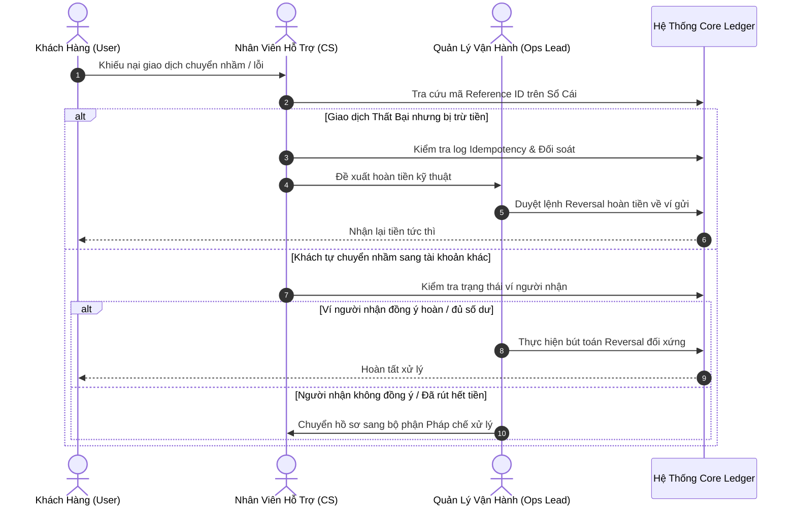

# Operational Playbook (Ops & Dispute SOP)

Quy trình chuẩn hóa vận hành (SOP) dành cho bộ phận Hỗ trợ khách hàng (CS), Vận hành (Ops) và Quản trị rủi ro (Risk/Compliance).

---

## 1. Quy trình xử lý tra soát & Khiếu nại chuyển nhầm (Dispute SOP)

Khi khách hàng báo chuyển nhầm tiền hoặc giao dịch bị lỗi mạng:

---

## 2. Nguyên tắc phê duyệt 4 mắt (Maker-Checker Policy)

Để ngăn ngừa gian lận nội bộ từ nhân viên:
- **Lệnh hoàn tiền $\le \$100$**: Nhân viên CS (Maker) tạo đề xuất $\rightarrow$ Tự động duyệt sau khi kiểm tra log lỗi hệ thống.
- **Lệnh hoàn tiền $> \$100$**: Nhân viên CS (Maker) tạo phiếu $\rightarrow$ Trưởng nhóm Vận hành hoặc Compliance (Checker) phê duyệt mới được ghi bút toán đảo vào sổ cái.
- Mọi thao tác Reversal đều lưu vết: `created_by`, `approved_by`, `reason`, `original_transaction_id`.

---

## 3. Khung phân cấp sự cố & Cam kết SLA (Incident Response Matrix)

| Cấp độ | Định nghĩa sự cố | Thời gian phản hồi (Response) | Thời gian khắc phục (MTTR) | Người chịu trách nhiệm chính |
| :---: | :--- | :---: | :---: | :--- |
| **P1 — Blocker** | Lệch số dư sổ cái, chết cổng P2P toàn hệ thống, lỗi trừ tiền 2 lần. | $\le 15$ phút | $\le 2$ giờ | Lead PO, Tech Lead, On-call Engineer |
| **P2 — Major** | Lỗi job đối soát ban đêm, chậm phản hồi giao dịch $> 3\text{s}$, tỷ lệ lỗi $> 1\%$. | $\le 30$ phút | $\le 4$ giờ | Backend Engineer, Ops Lead |
| **P3 — Minor** | Lỗi hiển thị avatar người nhận, xuất CSV sao kê bị chậm, lỗi typo UI. | $\le 4$ giờ | $\le 24$ giờ | Frontend Dev, PO |

---

## 4. Quy trình đối soát cuối ngày (Nightly Reconciliation SOP)

- **Thời điểm kích hoạt**: $02:00:00\text{ UTC}$ hằng ngày.
- **Tiến trình**:
  1. Job chạy batch so sánh tổng số tiền `TOPUP` và `WITHDRAW` nội bộ với số liệu quyết toán thực tế từ cổng đối tác.
  2. Kiểm tra tính bất biến: $\sum \text{Debit} - \sum \text{Credit} = 0$.
  3. Nếu chênh lệch $= \$0.00$: Đánh dấu ngày đối soát thành công, gửi báo cáo tóm tắt về Slack/Email của Finance.
  4. Nếu có sai lệch $> \$0.00$: Lập tức kích hoạt cảnh báo P2, đóng băng tạm thời tính năng rút tiền tự động của các tài khoản có nghi vấn để tra soát thủ công.
