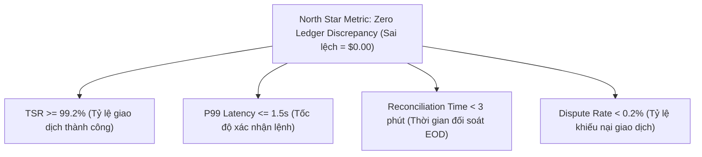

# Product Requirement Document (PRD) — Core Ledger Service

## 1. Bối cảnh & Vấn đề (Problem Statement)

Hệ thống thanh toán ví điện tử thường gặp 3 rủi ro lớn khi vận hành ở quy mô lớn:
1. **Thất thoát tài chính do Race Condition**: Rút tiền hoặc chuyển tiền đồng thời từ nhiều thiết bị dẫn đến số dư âm (Double-spending).
2. **Mất dấu vết dòng tiền (Audit Gap)**: Cập nhật trực tiếp số dư (`UPDATE balance`) khiến kế toán và kiểm toán không thể truy ngược nguyên nhân biến động số dư khi có khiếu nại.
3. **Đối soát thủ công tốn thời gian**: Lệch số liệu giữa ngân hàng đối tác và ví nội bộ, đội vận hành mất từ 3–5 tiếng mỗi đêm để đối chiếu file sao kê.

**Mục tiêu sản phẩm**: Xây dựng Lõi Sổ Cái Kép (Core Ledger) đảm bảo **bất biến dữ liệu tài chính (Zero Discrepancy)**, hỗ trợ giao dịch tức thì ($O(1)$) và tự động hóa quy trình đối soát cuối ngày.

---

## 2. Đối tượng người dùng (User Personas)

| Persona | Vai trò | Nhu cầu chính | Nỗi đau (Pain points) |
| :--- | :--- | :--- | :--- |
| **An (End-User)** | Khách hàng cá nhân | Chuyển/nhận tiền P2P ngay lập tức, an toàn, minh bạch lịch sử. | Sợ chuyển nhầm tài khoản, mạng lag bị trừ tiền 2 lần. |
| **Bình (Merchant)** | Chủ điểm bán | Nhận thanh toán nhanh qua mã QR/ví, rút tiền doanh thu về ngân hàng. | Tiền về chậm, khó tra cứu đơn hàng tranh chấp. |
| **Cường (Ops/CS)** | Chuyên viên hỗ trợ vận hành | Tra cứu trạng thái giao dịch để giải quyết khiếu nại, xử lý hoàn tiền nhầm. | Thiếu bằng chứng log chi tiết, không có công cụ hoàn tiền an toàn. |
| **Dung (Compliance/Kế toán)** | Kiểm soát tuân thủ & đối soát | Chốt sổ cuối ngày, kiểm tra cân đối nợ/có, phát hiện gian lận. | Sai lệch số liệu khó truy vết, file đối soát ngân hàng không khớp. |

---

## 3. Phạm vi sản phẩm (Product Scope)

### Trong phạm vi (In-Scope - MVP & V1)
- **Quản lý tài khoản ví**: Mở ví, cấp số tài khoản chuẩn 12 số, quản lý trạng thái (`ACTIVE`, `FROZEN`, `CLOSED`).
- **Lõi giao dịch sổ kép**: Nạp tiền (Top-up), Rút tiền (Withdraw), Chuyển tiền P2P.
- **Bảo vệ tài chính**: Khóa bi quan chống double-spending, Idempotency key chống bấm trùng lệnh.
- **Bảo mật giao dịch**: Mã PIN 6 số, tự động khóa tạm thời 15 phút nếu sai 5 lần liên tiếp.
- **Kiểm soát hạn mức (Velocity Limits)**: Tối đa $10.000/giao dịch và $50.000/ngày.
- **Tiện ích trải nghiệm**: Danh bạ thụ hưởng (Saved Contacts), xuất sao kê giao dịch stream CSV.
- **Vận hành & Đối soát**: Tự động đối soát hằng đêm (Nightly Reconciliation), cơ chế hoàn tiền (Reversal) không sửa dữ liệu cũ.

### Ngoài phạm vi (Out-of-Scope - Dành cho Phase 2)
- Thanh toán hóa đơn (Điện/Nước/Viễn thông).
- Thấu chi / Tín dụng tiêu dùng (Buy Now Pay Later).
- Hỗ trợ đa tiền tệ ngoài USD.

---

## 4. Ràng buộc & Bất biến sản phẩm (Product Invariants)

1. **Nguyên tắc cân bằng sổ cái**: Với mỗi giao dịch, $\sum \text{Debit} = \sum \text{Credit}$. Tổng tài sản toàn hệ thống luôn bảo toàn.
2. **Append-Only**: Bảng `ledger_entries` tuyệt đối không bao giờ được sửa (`UPDATE`) hoặc xóa (`DELETE`). Mọi sửa sai đều phải qua giao dịch đảo (Reversal).
3. **Idempotency Guarantee**: Gửi lại cùng một request (trùng `Idempotency-Key` hoặc `reference_id`) không bao giờ phát sinh 2 lần trừ tiền.
4. **Zero Overdraft**: Tài khoản người dùng cá nhân không bao giờ được phép có số dư khả dụng âm.

---

## 5. Chỉ số thành công (Success Metrics & KPIs)

